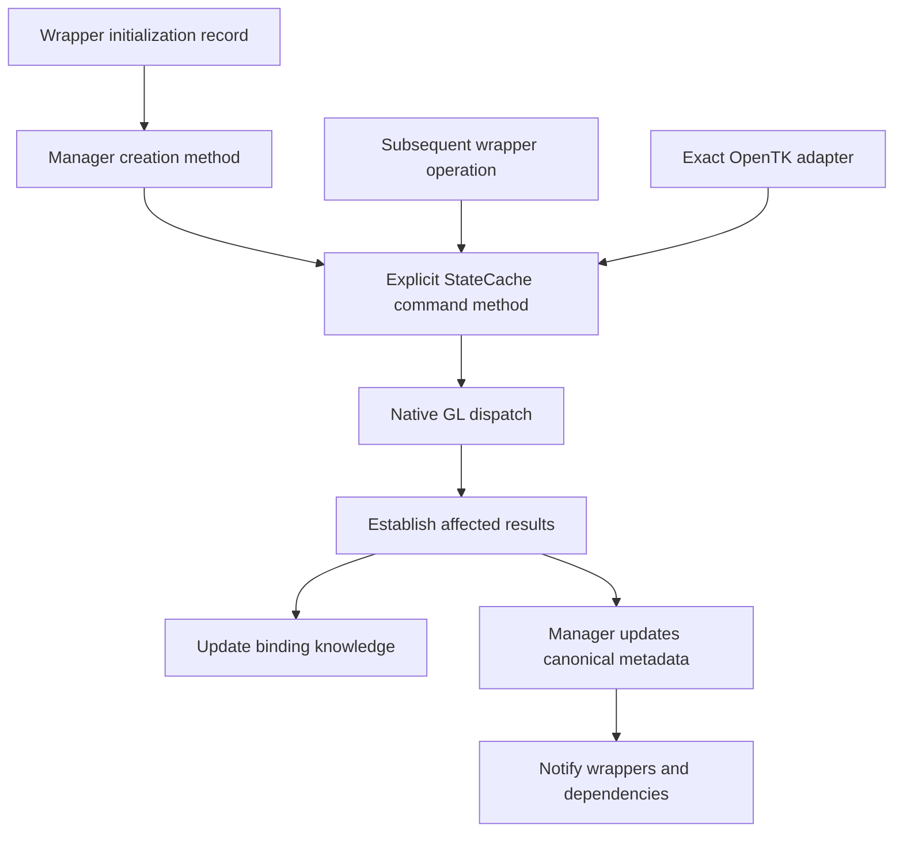

# Command execution and metadata publication

Status: architectural direction and narrower command-result policy approved by the user.
Implementation is governed by [Rendering.CommandPublication.todo](Rendering.CommandPublication.todo).

This refines the [resource metadata design](Rendering.GpuResourceHandles.Proposal.md) using the
[binding and acquisition findings](Rendering.GpuResourceHandles.Analysis.md). Existing ownership,
context, interception coverage and error-handling contracts remain controlling.

## Purpose

Keep facts established by commands instead of discarding them and querying OpenGL to reconstruct
them. Make native execution and its bookkeeping one responsibility, while keeping binding knowledge
separate from canonical resource metadata.

## Responsibilities

| Component | Proposed responsibility |
| --- | --- |
| Resource wrappers and helpers | Supply initialization records and retain higher-level policy and selected subresources. Do not construct canonical metadata. |
| StateCache | Provide explicit command methods that own native execution, binding suppression/restoration and reporting established command results. |
| GpuResourceManager | Orchestrate creation from initialization records; own canonical metadata, original resource associations, revisions, dependencies and typed notifications. |
| Native readers | Acquire missing facts, recover unavailable state and read results that commands cannot establish directly. |
| GpuResource<TMetadata> | Receive and expose the manager's snapshot; no tracking or acquisition logic. |

The adapter route preserves the original native overload and its error behavior. Shared bookkeeping
does not mean suppressing intercepted calls or substituting a different API. Managed operations can
continue selecting capability-appropriate DSA or binding-preserving fallback paths.

## Initialization records and creation results

Each manager creation method accepts a resource-specific initialization record, not its metadata
struct. The record exposes only valid creation inputs. Property setters automatically update a private
bitmask, so an omitted property differs from an explicitly assigned zero or `false`. Callers cannot
edit the mask independently. Canonical metadata remains an output snapshot without assignment flags.

Creation proceeds as follows:

1. Validate the supplied inputs and resolve omitted inputs using applicable guaranteed GL defaults
   or explicit creation policy. Missing required allocation inputs are errors, not discoverable facts.
2. Issue the required creation and value-setting commands through StateCache.
3. Build metadata from established command results, guaranteed defaults and derived values. For example,
   derive allocated mip dimensions from established texture allocation instead of querying every image.
4. Acquire unknown external facts and required outputs that inputs cannot supply. Controlled creation
   does not read back its submitted descriptor by default; apply the exceptions below individually.
5. Commit the completed metadata and dependencies, associate the wrapper and deliver its snapshot through
   `HandleMetadataChanged`. Return nullable metadata: a value means successful initialization; `null`
   means initialization failed and no usable result was published.

The proposed signature shape is `GpuTextureMetadata? CreateTexture(GpuTextureInitialization initialization,
out GpuResourceHandle handle)`. Other resource kinds return their corresponding nullable metadata struct.
The handle is valid only on success and is cleared on failure. Wrapper association/publication remains
manager-owned; returning metadata does not authorize wrappers to bypass notification. Wrapper creation
uses the recipient-bearing form and handoff described below.

### Creation handoff contract

Use a typed recipient parameter on wrapper creation paths, for example
`CreateTexture(GpuTextureInitialization initialization, GpuResource<GpuTextureMetadata> recipient,
out GpuResourceHandle handle)`. The nullable return remains the corresponding metadata struct.
The recipient is an existing, unpublished wrapper declaration; it supplies no metadata, subscription
token or callback. Creation and association execute synchronously in its originating context.

The manager holds the new native name privately while constructing the candidate. Before exposing
success, it installs native identity through a narrow identity-only operation on the resource base,
records the original association, delivers the snapshot through `HandleMetadataChanged`, and makes
the recipient usable. That identity operation does not mention metadata or add tracking to either
base class. The recipient must have completed its declaration initialization before handoff; its
existing native-ID setter must only assign identity. Creation invokes no other virtual wrapper
behavior or dependent callbacks on a partially constructed wrapper. Existing dependents are notified
only at a completed publication boundary.

The out handle starts invalid and becomes valid only after the handoff completes. The returned
metadata is the same committed snapshot; the wrapper tests success rather than assigning it again.
If allocation, association or delivery fails, rollback removes provisional delivery membership and
wrapper association, clears any newly installed wrapper identity, and retires only the new owned native
object through StateCache in the original context. Immediate cleanup removes the provisional entry.
Deferred cleanup retains only its unavailable retiring identity in the existing registry until the
original-context deletion queue drains or that context retires; it cannot deliver metadata or adopt
a replacement name. Required exceptions still propagate after cleanup.
Borrowed backing objects are never part of that cleanup. Replacement must use the existing explicit
retirement/replacement path; creation cannot overwrite a live or retired original association.

CPU-only declarations remain native-free. Reserved names without complete metadata stay on the
existing declaration/realization path; do not manufacture a successful complete creation result for
them. Kinds with intentionally empty canonical schemas can return non-null empty metadata after
successful native creation. Context-local tools use the same static manager orchestration and direct
typed delivery, with no persistent alias registry added when no manager is installed.

### Initialization record conventions

Each input property has a private backing value and an automatically maintained assignment bit.
Construction starts with no assigned bits; copying a record copies both intent and values. Callers
cannot set or clear bits independently. Record values are consumed as a stable request during the
synchronous call; referenced collections must be copied or otherwise frozen before native dispatch.
Canonical output structs and wrapper snapshots never contain these request bits.

Resolve omissions before dispatch, in this order: required input validation, explicit creation-policy
defaults, then applicable guaranteed native defaults. A default applies only to its supported kind,
target and capability path. Missing dimensions, formats or required backing selections cannot be
filled by querying a newly allocated object. Explicit zero, false and empty collections remain inputs
and receive their own validation; they do not activate omission defaults.

Initialization describes one native resource operation, not streaming/growth policy, compilation,
linking or arbitrary command lists. Initial content payloads remain separate command inputs where
existing creation APIs need them; they do not become metadata fields. Per-family input/default tables
are specified below under the approved narrower policy.

| Record | Legal inputs and omission policy | Output boundary |
| --- | --- | --- |
| `GpuBufferInitialization` | Explicit storage mode; capacity required for allocation, usage required for mutable storage, storage flags required for immutable storage. Empty realization has no allocation request. Buffer binding role stays wrapper policy. | Capacity/usage; no EBO interpretation, mapping pointer or content extent. |
| `GpuTextureInitialization` | Target, allocation mode, internal format, target-applicable dimensions and allocated level count required for storage. Multisample requests additionally specify samples and fixed-sample-location policy. Optional base/max level overrides; absent overrides retain applicable native defaults, not a computed last allocated mip. | Derive image dimensions per level/face from controlled allocation. Select explicit formats/supported sample counts before dispatch where possible. Sampling policy stays with the wrapper. |
| `GpuBufferTextureInitialization` | Backing buffer, sized format and explicit whole/range mode required. Range mode requires native-width offset and size; whole mode has no range request. | Whole mode retains the existing size-zero sentinel. Resolve original backing association through the manager. |
| `GpuTextureViewInitialization` | Source, view target, sized format, base/count levels and base/count layers required. No implicit selection of the entire source. | View-relative geometry derives from accepted selection and original source storage. |
| `GpuRenderbufferInitialization` | Storage format, width and height required for allocated creation; omitted samples means zero (non-multisample). | Dimensions/format from controlled inputs; resolve sample support before allocation, with the narrow exception below when necessary. |
| `GpuFramebufferInitialization` | Empty creation is valid. Optional explicit attachment selections and supported attachmentless defaults; omit to retain empty/native-default state. Attachment ownership remains in existing helpers, not the record. | Attachment descriptors and defaults; window-system framebuffer zero remains separate. |
| `GpuShaderInitialization` | Shader stage required. No source, binary, compile result or interface properties. | Fixed stage after successful creation. |
| `GpuProgramInitialization` | Empty creation record. Link-input configuration remains subsequent explicit commands. | Empty unlinked program; no reflection or invented linked interface. |
| `GpuVertexArrayInitialization` | Empty record. Attribute/EBO/buffer configuration remains explicit commands. | Existing empty revision schema; no layout mirror. |
| `GpuProgramPipelineInitialization` | Empty record. Stage assignments remain explicit commands. | Existing empty schema. |
| `GpuSamplerInitialization` | Empty record. Existing setters retain filtering/wrap/compare policy. | Existing empty schema; do not acquire sampler parameters. |
| `GpuQueryInitialization` | Empty record for existing generated-name creation. Query target/result remains established by existing use APIs. | Empty schema does not certify that a generated name has been realized. |
| `GpuSyncInitialization` | Empty record; insertion retains the existing fixed fence condition and no-flags policy. | Nonzero native-width sync handle, empty metadata; no status polling during creation. |
| `GpuTransformFeedbackInitialization` | Empty record. Buffer assignments and capture operations remain subsequent commands. | Existing empty schema. |
| `GpuSemaphoreInitialization` | Empty record. Import, wait and signal remain separate operations. | Existing empty schema; no invented import metadata. |
| `GpuMemoryObjectInitialization` | Empty record. Parameters/import remain separate operations, retaining external-handle ownership rules. | Existing empty schema; storage allocation is a later buffer/image operation. |

Optional debug labels stay outside canonical metadata and do not establish creation success.
No new input is inferred from an output field. Capability-specific creation variants must preserve
their existing legal parameter sets rather than silently substituting another resource operation.

### Defaults and invalid combinations

These are creation defaults, not permission to query a missing required input. Existing higher-level
constructors keep their signatures and pass their own selected values explicitly.

- Buffer mode is required: realization-only, mutable or immutable. Realization-only has capacity zero
  and usage `StaticDraw`, with no allocation inputs. Mutable capacity may be zero and requires usage;
  immutable capacity must be positive and requires explicit flags (including explicit zero). Reject
  usage on immutable requests, storage flags on mutable requests, negative sizes and flags outside
  the native supported set. Persistent flags require read or write; coherent requires persistent.
  Immutable storage sets canonical usage to `DynamicDraw` per
  [ARB_buffer_storage](https://registry.khronos.org/OpenGL/extensions/ARB/ARB_buffer_storage.txt).
- Texture allocation requires positive target-applicable extents and a positive level count. Cube
  faces are square; array layer counts do not shrink with mip level, while 3D depth does. Multisample
  and rectangle targets have one level. Missing unused axes normalize to one; contradictory supplied
  axes are rejected. Base level defaults to zero and max level to 1000 where those parameters exist;
  rectangle base level must remain zero despite its max-level parameter. Reject mip overrides on buffer/multisample targets. Explicit
  overrides must be legal for the target; do not silently replace max level with allocated-level count.
  See [texture parameters](https://registry.khronos.org/OpenGL-Refpages/gl4/html/glTexParameter.xhtml).
  Mutable storage has no immutable levels; immutable storage uses the requested allocation level count.
  Non-multisample images use zero samples. Capability validation uses GpuLimits/GpuSupport, not raw
  per-allocation limit getters. View creation uses its required explicit range rather than these
  storage-allocation defaults.
- Renderbuffers require positive extents and an explicit supported format. Samples default to zero;
  negative samples and extents beyond cached limits are rejected. Multisample requests use the
  supported-count normalization policy below. Texture multisample fixed-location input is required
  rather than silently chosen; renderbuffers do not expose that texture-only input.
- Buffer views require live backing and a supported sized format. Range offset is nonnegative,
  size positive, aligned and within known capacity with overflow-safe arithmetic. Whole mode rejects
  range properties. Texture views require immutable source storage, compatible format/target and
  positive, in-bounds level/layer counts; preserve existing source-certificate checks.
- Framebuffer input properties are `Attachments`, `DefaultWidth`, `DefaultHeight`, `DefaultLayers`,
  `DefaultSamples`, `DefaultFixedSampleLocations`. Omitted attachments form an empty immutable set.
  The four numeric defaults are zero and fixed sample locations false, when attachmentless defaults
  are supported. Without that capability, reject explicit default-property assignments and retain
  the existing unavailable/not-applicable convention rather than issuing unsupported setters.
  Reject negative/out-of-limit defaults, duplicate slots and invalid image selections. Empty creation
  need not be render-complete; preserve the existing completeness check at rendering use.
  Defaults follow [ARB_framebuffer_no_attachments](https://registry.khronos.org/OpenGL/extensions/ARB/ARB_framebuffer_no_attachments.txt).
- Shader stage is mandatory and capability-checked. Empty program creation means unlinked with empty
  interface collections; link/compile inputs remain separate. Every other empty record has no optional
  descriptor fields or getters. Fence insertion uses `SyncGpuCommandsComplete` and `WaitSyncFlags.None`.

For managed sample requests, normalize a positive request to the smallest cached supported count
at least as large as requested; fail if none exists. Preserve zero as non-multisample where supported.
Use target/format-specific capabilities, not a global maximum as a list of supported counts. This
normalization is a creation policy, not a second metadata snapshot. If the capability route is absent,
retain the existing allocation path and the narrowly justified sample read described below. External
calls always retain their original arguments. Native defaults for fields absent from canonical structs
need no new representation or acquisition.

Failed creation cleans up any newly created native object and provisional registration without deleting
borrowed dependencies. Preserve existing exception propagation where required; nullable results represent
reported initialization failure, not a blanket exception-swallowing policy. A non-null empty metadata
struct is a valid success for kinds with no represented fields. Nullable output does not itself detect
GL failure: the command-success policy below still applies.

Default values belong to explicit per-kind initialization logic, with their applicable target/capability
conditions. Do not rely on C# `default` to supply GL defaults. Initialization flags express caller intent;
they are neither native-success flags nor persistent metadata-availability tracking.

### Resource and metadata coverage

The initialization record names below are proposed new types. Existing wrappers share records by native
operation rather than receiving a separate record for every subclass.

| Native resource / operation | Wrappers involved | Initialization record | Canonical output struct |
| --- | --- | --- | --- |
| Texture storage | `GpuTexture`, `Texture2D`, `Texture3D`, `DynamicTexture2D`, `DynamicTexture3D`, `DynamicTextureCube`, `DepthTexture`, `StencilTexture`, `DepthStencilTexture`, `PmjJitterTexture`, `CloudBlueNoiseTexture` | `GpuTextureInitialization` | `GpuTextureMetadata` |
| Buffer texture | `GpuBufferView`, `GpuBufferTexture` | `GpuBufferTextureInitialization` | `GpuTextureMetadata` |
| Texture view | `GpuTextureView` | `GpuTextureViewInitialization` | `GpuTextureMetadata` |
| Buffer | `GpuBufferObject`, `GpuVbo`, `GpuEbo`, `GpuUniformBuffer`, `GpuShaderStorageBuffer`, `GpuAtomicCounterBuffer`, `GpuIndirectBuffer`, `GpuPixelPackBuffer`, `GpuPixelUnpackBuffer` | `GpuBufferInitialization` | `GpuBufferMetadata` |
| Renderbuffer | `GpuRenderbuffer` | `GpuRenderbufferInitialization` | `GpuRenderbufferMetadata` |
| Framebuffer | `GpuFramebuffer`, `DynamicGpuFramebuffer`, `StaticGpuFramebuffer` | `GpuFramebufferInitialization` | `GpuFramebufferMetadata` |
| Vertex array | `GpuVao` | `GpuVertexArrayInitialization` | `GpuVertexArrayMetadata` |
| Program | `GpuProgramObject`, `GpuComputePipeline` | `GpuProgramInitialization` | `GpuProgramMetadata` |
| Shader | `GpuShaderModule` | `GpuShaderInitialization` | `GpuShaderMetadata` |
| Program pipeline | `GpuProgramPipeline` | `GpuProgramPipelineInitialization` | `GpuProgramPipelineMetadata` |
| Sampler | `GpuSampler` | `GpuSamplerInitialization` | `GpuSamplerMetadata` |
| Query | `GpuQuery` | `GpuQueryInitialization` | `GpuQueryMetadata` |
| Sync | `GpuFence` | `GpuSyncInitialization` | `GpuSyncMetadata` |
| Transform feedback | `GpuTransformFeedback` | `GpuTransformFeedbackInitialization` | `GpuTransformFeedbackMetadata` |
| Semaphore | `GpuSemaphore` | `GpuSemaphoreInitialization` | `GpuSemaphoreMetadata` |
| Memory object | `GpuMemoryObject` | `GpuMemoryObjectInitialization` | `GpuMemoryObjectMetadata` |

Records for kinds with no optional creation inputs may be empty; do not invent configurable fields or
queries simply to fill a record. Generated names and realized objects retain their distinct contracts.
Program creation initially establishes the empty executable; linking and interface discovery remain
separate operations. Compilation, linking and content upload are not implied by returning creation metadata.

These nested output structs also participate: `GpuTextureLevelMetadata`, `GpuTextureBufferMetadata`,
`GpuTextureViewMetadata`, `GpuFramebufferImageMetadata`, `GpuProgramResourceMetadata` and
`GpuProgramTextureUnitMetadata`. The manager constructs them; reflected interfaces and actual image
descriptors are not writable inputs merely because they appear in canonical output.

`GpuFramebufferAttachment` receives `GpuImageMetadata`, projected from its texture/renderbuffer backing
and local image selection. Its owned backing uses the corresponding creation record; the attachment
does not create another native resource or canonical registry entry. `BorrowedTexture` and external
wrap/adopt paths for textures, renderbuffers, framebuffers, shaders and programs use lookup/acquisition,
not creation records that would mutate the borrowed object. Renderbuffer-backed texture associations
remain represented by `GpuTextureMetadata` and the backing `GpuRenderbufferMetadata`.

Composition helpers such as `GpuProgram`, `GpuComputeProgram`, `GpuTimerQuery`, `GpuTimestampQuery`
and `GpuVertexAttribBinding` continue through their underlying resource wrappers; they do not gain new
canonical metadata structs. Higher-level growth, streaming and content-generation policy remains with
the existing wrappers/helpers; creation command orchestration moves to the manager.

## Separate three operations

- **Lookup:** return available canonical facts without GL queries. A raw ID referring to an already
  tracked object does not, by itself, justify refreshing that object.
- **Acquire/recover:** query missing or unavailable facts. Use this for initially unknown external
  objects, driver-derived results and recovery after an uncertain mutation.
- **Publish a command result:** update affected canonical fields from established results, retaining
  unaffected fields. Notify aliases and dependencies through the existing manager.

These should be distinct internal contracts rather than a general acquisition method whose default
silently forces a refresh. External mutation outside supported observation still requires explicit
invalidation/recovery. Registry membership alone does not establish observation coverage.

## What command execution looks like

An explicit StateCache command method is an ordinary C# method for a particular operation, with
compiler-checked parameters, such as `BindVertexArray(int vao)`. It issues the native call, maintains
applicable binding knowledge and reports established metadata changes to the manager. This requires
no new command-object class or generic dispatch framework.

Each method owns dispatch and completion together. Callers do not manually pair public begin/end
calls. Original identity capture and failure cleanup remain internal where needed.

| Operation | Proposed flow |
| --- | --- |
| Bind a VAO | Skip a known-equal managed selection; otherwise dispatch and establish the selected object. Retain established selection without a metadata-driven invalidation. Unknown or uncertain results use selector recovery. |
| Allocate buffer storage | Capture the original entry, dispatch allocation, establish actual capacity/usage, then publish those fields. A reported allocation failure must not publish the requested capacity. |
| Attach a texture to a framebuffer | Capture the original framebuffer and backing association, dispatch, establish the affected slot, then update that descriptor and its dependencies. Avoid following targeted verification with a full framebuffer scan. |
| Change a texture's base mip | Establish the resulting base level and update that field; retain unrelated image dimensions, formats and allocation facts. |
| Link a program | Mark executable facts unavailable at submission. At the existing completion boundary, inspect link outcome and acquire the driver-produced interface. A later unit/block change updates only its affected facts. |

## Approved command-result policy

Controlled VGE operations publish supplied inputs, applicable defaults and derived facts through the
manager. Preserve existing input checks and failure handling; do not add a getter, Is-object check,
GetError drain, acceptance certificate or second requested/actual snapshot to every command. This
is a deliberate trust boundary, not a claim that a nonthrowing GL call proves native success.
Reported failures and managed exceptions do not publish requested success. Silent native failures
remain subject to existing diagnostics and explicit invalidation/recovery, rather than a new universal
verification protocol. Nullable creation reports failures detected by that existing boundary.

Use canonical state for existing eligible equal-command suppression. Same-sized allocations, content
uploads, links and synchronization are not redundant merely because descriptor fields match. No broad
new suppression framework is introduced. Normalize capability-dependent inputs deterministically before
comparison/dispatch so a stable request does not repeatedly resubmit a resolved value.

Unknown external resources require acquisition. Arbitrary intercepted calls preserve exact native
execution and errors; when their validity/effects are unknown, withdraw affected knowledge and recover
only what a consumer needs. Existing targeted external checks may remain where they establish otherwise
unqueryable semantics. External calls do not inherit trust merely because their target is VGE-owned.
Partial multi-object calls preserve independently established outcomes; uncertain objects recover
separately. Untracked calls do not eagerly register resources.

The read exceptions are deliberately limited:

- Link/compile status and executable reflection are outputs, not creation descriptors. Keep their
  existing completion checks; do not reflect again for a known unit/block assignment.
- Use cached target/format sample capabilities before managed allocation. For renderbuffer and multisample-texture paths
  where supported counts cannot be obtained, read only the sample count once at allocation because
  RenderPassTargets compares attachment sample counts. Do not reread dimensions/format or compare
  that resolved sample value against a raw request to decide whether to allocate again. Existing
  allocation policy decides whether allocation is requested; no duplicate metadata cache is needed.
- Prefer an explicit sized internal format for managed images. A retained unsized-format path may
  read only the resolved format when typed format validation needs it and inputs cannot determine it.
- Unknown selectors, external image/storage/attachment facts and recovery after explicit invalidation
  use their existing reader boundaries. Available covered aliases and image projection remain query-free.
- Deletion retains existing kind-specific outcome handling, including retained shader/program names.
  This is lifecycle handling, not a reason to verify every metadata mutation.

Capability discovery is cached by context/target/format, not repeated per resource. Do not invoke
error-consuming capability discovery from an intercepted command; preserve its pending native errors.
These exceptions do not authorize full post-allocation scans. Any additional read needs a concrete
consumer, field and reason it cannot be derived; it is not implied by a field being called metadata.

### Family and observer dispositions

All supported GL/Core, Ext and Arb variants inherit their semantic row below. Controlled means the
VGE command path with its existing validation and diagnostics; intercepted means arbitrary external
arguments. Existing original-entry/context, dependency and retirement rules apply to both.

| Family / analyzed observer | Controlled publication | External/unknown handling and reads |
| --- | --- | --- |
| Selectors: BeginNativeBufferBinding, BeginNativeVertexSelection, BeginNativeProgramSelection | Keep selected ID after managed dispatch; preserve equal suppression. EBO selection also updates its VAO binding fact. | Unknown result clears only affected selector; recover at use. Complete against captured cache; do not retain reentrant intermediate observations. Program uniform destination, full-stage selection and pipeline selection stay distinct. |
| Routing: BeginNativeFramebufferRouting | Keep known managed draw routing; read routing retains its existing uncached path. | Resolve unknown draw FBO only when needed; withdraw affected route, recover lazily. Preserve independent read/draw bindings. |
| B1: BeginNativeBufferStorage | Capacity/usage from allocation inputs; immutable allocation's usage follows native default. Storage effects advance storage revision even at equal size. | Acquire actual capacity/usage on demand after uncertain mutation; no unconditional post-dispatch full reader. Do not trust equal descriptors as proof that storage identity survived. |
| T1: BeginNativeTextureMetadata (definitions) | Target, allocated faces/levels, dimensions, immutable facts and explicit format from allocation. Derive mips; use sample/format exceptions only when applicable. | Unknown images need targeted image discovery; full initial acquisition remains valid. Proxy targets never publish to a real texture. |
| T2: BeginNativeTextureMetadata (generation), RefreshGeneratedTextureMetadata | Derive mutable generated range from known base/max and base image; revise storage only for changed layout. Immutable content-only generation publishes no storage change. | Unknown/incomplete base or uncertain generation recovers affected range. Never certify a partial cube from requested dimensions. |
| T3: BeginNativeBufferTexture, ObserveBufferView, TryObserveBufferAssociation, ConfigureTextureView | Publish selected backing/format/native-width range, whole-buffer mode or view range from controlled inputs and original source; derive view geometry. | Retain narrow association/range verification where command provenance is necessary. Unavailable backing acquired once; never infer original source of an arbitrary view or whole-buffer mode from matching range alone. |
| T3 renderbuffer-backed texture / I1 | Controlled association supplies backing identity; imported storage supplies represented size/format. Import ownership stays outside metadata. | Read unknown association/backing once; unknown import effects recover storage. Residency/access-only commands have no represented metadata effect. |
| T4: BeginNativeTextureMetadata (parameters) | Update represented base/max field only; keep all unaffected images. | Recover only changed represented parameter when unknown; unrepresented parameters do not trigger reads. |
| R1: BeginNativeRenderbufferStorage | Width/height/format from controlled request, sample choice from capability resolution or narrow exception. | Unknown external storage acquires descriptor; unsupported coverage variants retain existing required sample semantics. |
| F1: BeginNativeFramebufferMetadata, BeginNativeFramebufferParameter, BeginNativeFramebufferAttachment, RequireNativeAttachment, ObserveFramebufferAttachment | Update selected slot/default and dependencies directly; retain known ordinary/multiview mode from command selection. No targeted check followed by full scan. | Read affected slot/default when needed. Existing checks preserve unqueryable attachment-mode provenance; ambiguous external mode stays unavailable for replay. Detach and partial slot updates retain independent outcomes. |
| V1: BeginNativeVertexMetadata | Publish existing empty schema/revision; keep supplied EBO/helper binding facts without rereading them. No full VAO mirror. | Invalidate stale helpers conservatively, including unknown per-index multi-bind outcomes; recover only required helper fields. Unrelated VAOs unaffected. |
| P1: BeginNativeProgramMetadata, SubmitProgramLink, CompleteProgramLink, SetProgramUniformUnit | Fresh program is empty; defer link reflection to completion. Unit/block updates change only affected facts, preserving equal suppression. Link inputs affect next link. | Unknown executable uses link/reflection boundary; unit assignments need only affected values. Numeric uniforms excluded; unsupported bindless representation remains unavailable. |
| L1: CompleteResourceDeletion, WasResourceDeleted | Preserve existing original-entry retirement and deletion outcomes; never infer physical reclamation from name retirement. | Keep per-kind retained-reference checks and per-object list outcomes, duplicate/zero names and reused-ID safety. |

### Acquisition and helper dispositions

The analysis's named entry points are assigned as follows; these are implementation contracts, not
claims that migration has occurred.

| Entry points | Required disposition |
| --- | --- |
| AcquireResource, AcquireWrapperMetadata, AcquireExternalImageTexture, AcquireProgramMetadata | Lookup available covered entries first. Acquire only unknown/unavailable facts. Remove default forced-refresh ambiguity; external coverage remains explicit. |
| AcquireBufferTextureBacking, AcquireRenderbufferTextureBacking | Reuse original available backing entries; acquire missing backing facts once without a new wrapper/owner. |
| AcquireImageMetadata, AssociateImageResource, AssignImageMetadata, GpuFramebufferAttachment.ValidateSlot | Project available supplied backing metadata, including local tools. Recover unknown/invalidated backing only; failed projection cannot leave an old usable image. |
| AcquireCreatedProgramMetadata, RegisterBufferWrapper | Publish known empty executable or realization facts. Do not double-check generated/realized names with Is-object reads; reserved names still lack allocated storage. |
| ObserveWrapperMetadata, PublishObservedMetadata, RefreshMetadata, PublishMetadata | Separate input-derived commit from explicit acquisition/recovery. Commit preserves original entries, complete immutable snapshots and dependency notifications. Missing external dependencies may require acquisition; do not hide full refresh in publication. |
| GpuBufferMetadataReader, GpuTextureMetadataReader, GpuRenderbufferMetadataReader, GpuRenderbufferTextureMetadataReader, GpuFramebufferMetadataReader, GpuShaderMetadataReader, GpuProgramMetadataReader | Retain for external discovery/recovery and the named output exceptions. No controlled post-command full reader by default. Shader stage comes from creation input. |
| TryGetBufferBindingQuery, BindFramebufferScope, BindScopeTracker, BindBufferScope, BindTextureScope, CaptureBoundaryBindings | Correct atomic-counter binding token; reuse known selections and query only unknown state. Restore separate read/draw FBO and original context state. |
| GpuVertexAttribBinding constructors, BindVertexBuffer, SetDivisor, RequireCurrentFacts | Retain supplied current helper fields and original owner/revision. Query unknown fields only; preserve stale fallback rejection. |
| BindFramebufferResource, PublishRenderPassMetadata, GpuFramebufferAttachmentDiscovery.Read, ReconcileAttachmentMetadata | Fresh FBO starts empty without scan. External discovery produces one reusable descriptor/backing set; do not scan again during publication/reconciliation. |
| BeginTextureStorageUpdate, BeginTextureMetadataUpdate, BeginFramebufferAttachmentUpdate, MetadataUpdate.Dispose | Replace ambient scopes with operation-owned execution and explicit internal participation as described below. Collect command facts; do not recover on disposal. |
| GpuPreparedBindings constructor, ReadBlocks | Validate supplied complete metadata only; acquisition belongs to the caller. |

## Operation-owned publication

Each meaningful operation owns execution and construction of its complete metadata result. Wrappers
request operations; StateCache owns native dispatch and command-derived facts; GpuResourceManager owns
canonical publication and recipient/dependency notifications. Wrappers never author canonical snapshots.

For example, CreateTexture validates an initialization record, allocates and configures the object,
constructs metadata from supplied inputs and guaranteed defaults, then hands the complete result to the
manager. The unpublished object needs no general alias group. AllocateTextureStorage on an existing
object captures its original identity, withdraws affected availability, executes all face/mip commands,
constructs a complete candidate, and commits once. Framebuffer configuration follows the same pattern.

Internal steps explicitly receive the enclosing operation state and contribute facts/effects to its
candidate. They do not independently publish. Standalone intercepted OpenTK calls remain independently
handled operations. PublishMetadata always commits a supplied complete snapshot; recovery always means
explicit acquisition. Neither silently stages or defers work because an ambient group exists.

### Shared commit and interruption contract

Keep the shared mechanism limited to original entry/context capture, affected availability, accumulated
storage/configuration effects, and exactly-once commit or failure withdrawal. A busy marker may guard
an entry, but it must not become an ambient collector that changes publication semantics. Registered
and context-local paths use the same operation contract through existing manager services, without a
thread-local group lookup or a second persistent resource registry.

Explicitly participating internal steps share operation state. Unrelated reentrant mutations of the
same resource are rejected before native dispatch, including calls through aliases; they do not
implicitly join. An interrupted participating step prevents commit even if its exception is caught.
Aliases receive the final canonical snapshot through the existing registry. Different resources
retain independent outcomes. This contract does not require arbitrary alias calls to join an update.

GPU commands execute immediately. Completion never retries a native mutation after publication failure
and never rolls back already executed GPU commands. Preserve the original dispatch exception during
cleanup. Disposal is cleanup, not success evidence. Failure leaves affected metadata unavailable;
recovery is a separate explicit operation, not an automatic branch of generic completion.

While an operation is open, consumers cannot acquire its partially updated affected snapshot.
Unrelated binding knowledge remains usable. Preserve unaffected fields in the candidate; where the
schema exposes only whole-snapshot availability, keep that snapshot unavailable until coherent commit
or recovery. Apply combined revisions once and deliver snapshots before availability/dependent
notifications. Deletion or context retirement cancels completion against the original identity;
lookup by reused numeric ID must never redirect it.

Texture-generation policy and any justified output queries belong to the texture operation. Framebuffer
reconciliation and dependency notifications belong to their existing manager services. The shared
commit mechanism contains no texture-specific recovery, framebuffer policy, or native reader selection.
Existing unmigrated readers may run explicitly in their owning operation until command-derived facts
replace them; this must not introduce additional reads or a generic recovery-on-disposal fallback.

Deferred program linking retains its separate submission/completion boundary. Submission withdraws
executable availability; completion consumes the pending original association once, obtains the link
outcome and required interface facts, then publishes or leaves the executable unavailable. Starting
another link resolves or supersedes pending work explicitly. It does not use a synchronous group.
Context-local operation state lives only for the operation or existing deferred owner. Failure uses
manager-owned snapshot discard, including selected-image projections, so no stale usable snapshot
survives solely because a persistent registration is absent.

## Why this structure

| Alternative | Assessment |
| --- | --- |
| Only remove individual redundant queries | Small initial diff, but leaves duplicated execution/completion policies and inconsistent grouping. Useful fixes alone do not address the foundation. |
| Begin/complete tokens at every caller | Preserve identity, but callers remain responsible for correct pairing and exactly-once completion. Keep tokens internal only where necessary. |
| Disposable scope for every command | Helps exception cleanup, but disposal does not prove native success and does not naturally represent deferred completion. Keep any cleanup scope internal to the owning operation. |
| Post-command notifications everywhere | Simple, but cannot reliably recover pre-command identity or account for interrupted operations. Suitable only when those concerns do not apply. |
| Explicit StateCache command methods with internal publication | Recommended: one owner for dispatch and bookkeeping, testable per operation, with explicit internal composition and separate deferred completion. |

Compiler-checked entry points reduce opportunities to omit completion; they cannot prove GL acceptance.
Avoid per-call closures or heap objects as a prerequisite for using this design. Measure queries,
allocations and dispatch counts rather than assuming abstraction has no cost.

The later GpuCommand/GpuCommandList abstraction can use these execution paths as backend operations.
This proposal does not introduce recording, queues or the StateCache rename, or preselect that RHI design.

## Decisions and acceptance

Approval covers the responsibility split, separate lookup/acquisition/publication contracts
and explicit StateCache command methods, including manager creation from assignment-tracked initialization
records with nullable canonical metadata results. The user also approved the narrower policy above:
controlled inputs are authoritative, external unknown state is acquired, and driver-output reads need
a specific justification. No further blanket acceptance-policy approval is required.

Then refine the existing checklist: repair binding behavior first, acquisition/publication second,
and supplied-metadata preparation afterward. Foundational restructuring belongs in those repairs,
before further consumer integration.

Verification must cover rejected/interrupted commands, aliases, explicitly composed and deferred work, deletion/name
reuse, context-local tools, DSA/fallback equivalence and binding restoration. Compare query/bind counts
with the analysis baseline. Preserve available-entry reuse and image projection; demonstrate that narrow
mutations no longer trigger unrelated full reads. Verify omitted versus explicit inputs, conditional defaults,
derived metadata, nullable failure cleanup and exactly-once initial publication for every creation family.
Call-count reductions alone are not frame-time claims.
