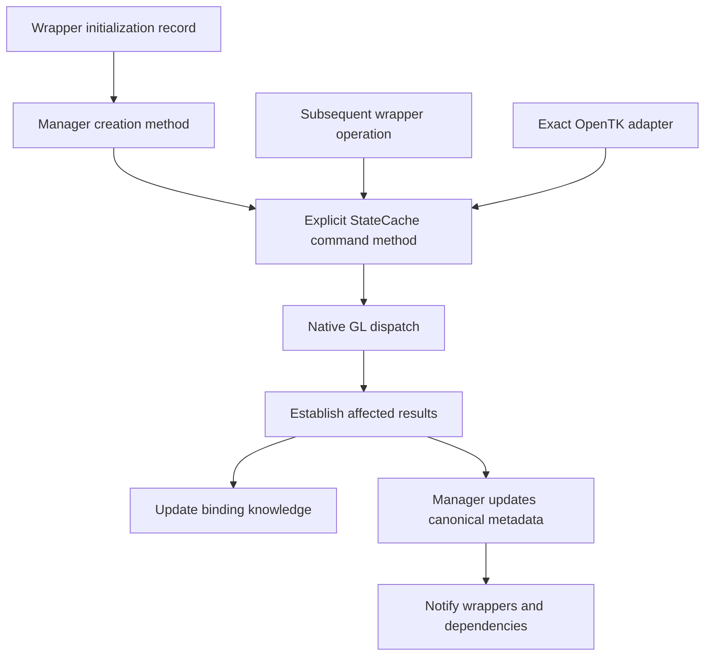

# Command execution and metadata publication

Status: approved architectural direction. Implementation is governed by
[Rendering.CommandPublication.todo](Rendering.CommandPublication.todo); its remaining contract decisions
must be resolved before runtime changes.

This refines the [resource metadata design](Rendering.GpuResourceHandles.Proposal.md) using the
[binding and acquisition findings](Rendering.GpuResourceHandles.Analysis.md). Existing ownership,
context, interception coverage and error-handling contracts remain controlling.

## Purpose

Keep facts established by commands instead of discarding them and querying OpenGL to reconstruct
them. Make native execution and its bookkeeping one responsibility, while keeping binding knowledge
separate from canonical resource metadata.

## Responsibilities

| Component | Proposed responsibility |
| --- | --- |
| Resource wrappers and helpers | Supply initialization records and retain higher-level policy and selected subresources. Do not construct canonical metadata. |
| StateCache | Provide explicit command methods that own native execution, binding suppression/restoration and reporting established command results. |
| GpuResourceManager | Orchestrate creation from initialization records; own canonical metadata, original resource associations, revisions, dependencies and typed notifications. |
| Native readers | Acquire missing facts, recover unavailable state and read results that commands cannot establish directly. |
| GpuResource<TMetadata> | Receive and expose the manager's snapshot; no tracking or acquisition logic. |

The adapter route preserves the original native overload and its error behavior. Shared bookkeeping
does not mean suppressing intercepted calls or substituting a different API. Managed operations can
continue selecting capability-appropriate DSA or binding-preserving fallback paths.

## Initialization records and creation results

Each manager creation method accepts a resource-specific initialization record, not its metadata
struct. The record exposes only valid creation inputs. Property setters automatically update a private
bitmask, so an omitted property differs from an explicitly assigned zero or `false`. Callers cannot
edit the mask independently. Canonical metadata remains an output snapshot without assignment flags.

Creation proceeds as follows:

1. Validate the supplied inputs and resolve omitted inputs using applicable guaranteed GL defaults
   or explicit creation policy. Missing required allocation inputs are errors, not discoverable facts.
2. Issue the required creation and value-setting commands through StateCache.
3. Build metadata from established command results, guaranteed defaults and derived values. For example,
   derive allocated mip dimensions from established texture allocation instead of querying every image.
4. Query only remaining required facts, including driver-derived results. A supplied request does not
   eliminate a query when the actual result can differ, such as a driver-selected sample count.
5. Commit the completed metadata and dependencies, associate the wrapper and deliver its snapshot through
   `HandleMetadataChanged`. Return nullable metadata: a value means successful initialization; `null`
   means initialization failed and no usable result was published.

The proposed signature shape is `GpuTextureMetadata? CreateTexture(GpuTextureInitialization initialization,
out GpuResourceHandle handle)`. Other resource kinds return their corresponding nullable metadata struct.
The handle is valid only on success and is cleared on failure. Wrapper association/publication remains
manager-owned; returning metadata does not authorize wrappers to bypass notification. The exact wrapper
association parameter or handoff is an implementation detail to settle before coding.

Failed creation cleans up any newly created native object and provisional registration without deleting
borrowed dependencies. Preserve existing exception propagation where required; nullable results represent
reported initialization failure, not a blanket exception-swallowing policy. A non-null empty metadata
struct is a valid success for kinds with no represented fields. Nullable output does not itself detect
GL failure: the command-success policy below still applies.

Default values belong to explicit per-kind initialization logic, with their applicable target/capability
conditions. Do not rely on C# `default` to supply GL defaults. Initialization flags express caller intent;
they are neither native-success flags nor persistent metadata-availability tracking.

### Resource and metadata coverage

The initialization record names below are proposed new types. Existing wrappers share records by native
operation rather than receiving a separate record for every subclass.

| Native resource / operation | Wrappers involved | Initialization record | Canonical output struct |
| --- | --- | --- | --- |
| Texture storage | `GpuTexture`, `Texture2D`, `Texture3D`, `DynamicTexture2D`, `DynamicTexture3D`, `DynamicTextureCube`, `DepthTexture`, `StencilTexture`, `DepthStencilTexture`, `PmjJitterTexture`, `CloudBlueNoiseTexture` | `GpuTextureInitialization` | `GpuTextureMetadata` |
| Buffer texture | `GpuBufferView`, `GpuBufferTexture` | `GpuBufferTextureInitialization` | `GpuTextureMetadata` |
| Texture view | `GpuTextureView` | `GpuTextureViewInitialization` | `GpuTextureMetadata` |
| Buffer | `GpuBufferObject`, `GpuVbo`, `GpuEbo`, `GpuUniformBuffer`, `GpuShaderStorageBuffer`, `GpuAtomicCounterBuffer`, `GpuIndirectBuffer`, `GpuPixelPackBuffer`, `GpuPixelUnpackBuffer` | `GpuBufferInitialization` | `GpuBufferMetadata` |
| Renderbuffer | `GpuRenderbuffer` | `GpuRenderbufferInitialization` | `GpuRenderbufferMetadata` |
| Framebuffer | `GpuFramebuffer`, `DynamicGpuFramebuffer`, `StaticGpuFramebuffer` | `GpuFramebufferInitialization` | `GpuFramebufferMetadata` |
| Vertex array | `GpuVao` | `GpuVertexArrayInitialization` | `GpuVertexArrayMetadata` |
| Program | `GpuProgramObject`, `GpuComputePipeline` | `GpuProgramInitialization` | `GpuProgramMetadata` |
| Shader | `GpuShaderModule` | `GpuShaderInitialization` | `GpuShaderMetadata` |
| Program pipeline | `GpuProgramPipeline` | `GpuProgramPipelineInitialization` | `GpuProgramPipelineMetadata` |
| Sampler | `GpuSampler` | `GpuSamplerInitialization` | `GpuSamplerMetadata` |
| Query | `GpuQuery` | `GpuQueryInitialization` | `GpuQueryMetadata` |
| Sync | `GpuFence` | `GpuSyncInitialization` | `GpuSyncMetadata` |
| Transform feedback | `GpuTransformFeedback` | `GpuTransformFeedbackInitialization` | `GpuTransformFeedbackMetadata` |
| Semaphore | `GpuSemaphore` | `GpuSemaphoreInitialization` | `GpuSemaphoreMetadata` |
| Memory object | `GpuMemoryObject` | `GpuMemoryObjectInitialization` | `GpuMemoryObjectMetadata` |

Records for kinds with no optional creation inputs may be empty; do not invent configurable fields or
queries simply to fill a record. Generated names and realized objects retain their distinct contracts.
Program creation initially establishes the empty executable; linking and interface discovery remain
separate operations. Compilation, linking and content upload are not implied by returning creation metadata.

These nested output structs also participate: `GpuTextureLevelMetadata`, `GpuTextureBufferMetadata`,
`GpuTextureViewMetadata`, `GpuFramebufferImageMetadata`, `GpuProgramResourceMetadata` and
`GpuProgramTextureUnitMetadata`. The manager constructs them; reflected interfaces and actual image
descriptors are not writable inputs merely because they appear in canonical output.

`GpuFramebufferAttachment` receives `GpuImageMetadata`, projected from its texture/renderbuffer backing
and local image selection. Its owned backing uses the corresponding creation record; the attachment
does not create another native resource or canonical registry entry. `BorrowedTexture` and external
wrap/adopt paths for textures, renderbuffers, framebuffers, shaders and programs use lookup/acquisition,
not creation records that would mutate the borrowed object. Renderbuffer-backed texture associations
remain represented by `GpuTextureMetadata` and the backing `GpuRenderbufferMetadata`.

Composition helpers such as `GpuProgram`, `GpuComputeProgram`, `GpuTimerQuery`, `GpuTimestampQuery`
and `GpuVertexAttribBinding` continue through their underlying resource wrappers; they do not gain new
canonical metadata structs. Higher-level growth, streaming and content-generation policy remains with
the existing wrappers/helpers; creation command orchestration moves to the manager.

## Separate three operations

- **Lookup:** return available canonical facts without GL queries. A raw ID referring to an already
  tracked object does not, by itself, justify refreshing that object.
- **Acquire/recover:** query missing or unavailable facts. Use this for initially unknown external
  objects, driver-derived results and recovery after an uncertain mutation.
- **Publish a command result:** update affected canonical fields from established results, retaining
  unaffected fields. Notify aliases and dependencies through the existing manager.

These should be distinct internal contracts rather than a general acquisition method whose default
silently forces a refresh. External mutation outside supported observation still requires explicit
invalidation/recovery. Registry membership alone does not establish observation coverage.

## What command execution looks like

An explicit StateCache command method is an ordinary C# method for a particular operation, with
compiler-checked parameters, such as `BindVertexArray(int vao)`. It issues the native call, maintains
applicable binding knowledge and reports established metadata changes to the manager. This requires
no new command-object class or generic dispatch framework.

Each method owns dispatch and completion together. Callers do not manually pair public begin/end
calls. Original identity capture and failure cleanup remain internal where needed.

| Operation | Proposed flow |
| --- | --- |
| Bind a VAO | Skip a known-equal managed selection; otherwise dispatch and establish the selected object. Retain established selection without a metadata-driven invalidation. Unknown or uncertain results use selector recovery. |
| Allocate buffer storage | Capture the original entry, dispatch allocation, establish actual capacity/usage, then publish those fields. An allocation failure must never publish the requested capacity. |
| Attach a texture to a framebuffer | Capture the original framebuffer and backing association, dispatch, establish the affected slot, then update that descriptor and its dependencies. Avoid following targeted verification with a full framebuffer scan. |
| Change a texture's base mip | Establish the resulting base level and update that field; retain unrelated image dimensions, formats and allocation facts. |
| Link a program | Mark executable facts unavailable at submission. At the existing completion boundary, inspect link outcome and acquire the driver-produced interface. A later unit/block change updates only its affected facts. |

**Establishing a result is a separate policy from executing a command.** A nonthrowing GL call and
VGE ownership do not prove acceptance. Use command arguments only when the operation's contract and
available evidence establish the result; otherwise use targeted verification. Do not add blanket
`GetError` consumption or replace full refreshes with unconditional validity queries.

Confirmed rejection preserves actual state. An uncertain outcome makes affected knowledge unavailable
until recovery; a managed exception must not be mistaken for success. Unrelated known state remains
usable. Partial multi-object commands require per-object outcomes.

## Where transactions are still useful

Allocation loops and attachment groups should coordinate through the original manager entry, so
aliases participate in the same update. Accumulate affected facts and publish a coherent snapshot at
successful completion; interruption leaves affected metadata unavailable. Internal grouping must avoid
both repeated readback and duplicate notifications.

Deferred linking needs explicit pending state because execution and completion are separated in time.
Pending work retains its original association and context; it cannot attach to a reused numeric ID.
Simple selector operations need neither a heap-allocated transaction nor a resource metadata refresh.

Context-local tools use the same execution/publication rules through the manager's existing static
path. Established command results can supply snapshots directly; missing facts still require acquisition.
Persistent alias tracking requires the existing manager, not a second registry or tracking in wrappers.

## Why this structure

| Alternative | Assessment |
| --- | --- |
| Only remove individual redundant queries | Small initial diff, but leaves duplicated execution/completion policies and inconsistent grouping. Useful fixes alone do not address the foundation. |
| Begin/complete tokens at every caller | Preserve identity, but callers remain responsible for correct pairing and exactly-once completion. Keep tokens internal only where necessary. |
| Disposable scope for every command | Helps exception cleanup, but disposal does not prove native success and does not naturally represent deferred completion. Reserve scopes for actual groups. |
| Post-command notifications everywhere | Simple, but cannot reliably recover pre-command identity or account for interrupted operations. Suitable only when those concerns do not apply. |
| Explicit StateCache command methods with internal publication | Recommended: one owner for dispatch and bookkeeping, testable per operation, with explicit exceptions for grouping and deferred work. |

Compiler-checked entry points reduce opportunities to omit completion; they cannot prove GL acceptance.
Avoid per-call closures or heap objects as a prerequisite for using this design. Measure queries,
allocations and dispatch counts rather than assuming abstraction has no cost.

The later GpuCommand/GpuCommandList abstraction can use these execution paths as backend operations.
This proposal does not introduce recording, queues or the StateCache rename, or preselect that RHI design.

## Decisions and acceptance

Approval covers the responsibility split, separate lookup/acquisition/publication contracts
and explicit StateCache command methods, including manager creation from assignment-tracked initialization
records with nullable canonical metadata results. Before implementation, agree the per-operation acceptance policy:
which managed commands have sufficient evidence to retain argument-derived results, which require
targeted verification, and how arbitrary intercepted commands recover uncertain outcomes.

Then refine the existing checklist: repair binding behavior first, acquisition/publication second,
and supplied-metadata preparation afterward. Foundational restructuring belongs in those repairs,
before further consumer integration.

Verification must cover rejected/interrupted commands, aliases, grouped and deferred work, deletion/name
reuse, context-local tools, DSA/fallback equivalence and binding restoration. Compare query/bind counts
with the analysis baseline. Preserve available-entry reuse and image projection; demonstrate that narrow
mutations no longer trigger unrelated full reads. Verify omitted versus explicit inputs, conditional defaults,
derived metadata, nullable failure cleanup and exactly-once initial publication for every creation family.
Call-count reductions alone are not frame-time claims.
