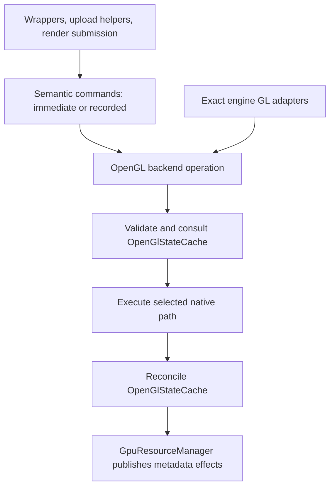

# RHI commands and command lists

Status: proposed for approval. Design deliverable for Phase 8 of
[Rendering.GpuResourceHandles.todo](Rendering.GpuResourceHandles.todo). This document proposes
an execution boundary; it does not implement commands or rename `StateCache`.

Use uppercase `RHI` in all interface-layer type, namespace and directory names. Existing GPU resource names remain unchanged; `OpenGlStateCache` names the backend-specific cache.

## The proposed boundary

Rendering code should express **what operation to perform on which resources**. The OpenGL backend
should decide which native calls implement it. `OpenGlStateCache` should retain executed binding knowledge
and reconcile command effects, while `GpuResourceManager` remains the sole metadata authority.

For example, an upload helper requests `UploadBuffer(destination, offset, bytes)`. It does not select
`NamedBufferSubData` versus `BufferSubData`, bind a temporary target or restore that binding afterward.
One operation may require several native calls; it is not an OpenTK overload renamed as a command.

Unreal's RHI provides the useful separation: commands express platform-independent work, and an API
command context translates it with backend state handling. We adopt that separation, not Unreal's
thread scheduling or engine infrastructure. See Epic's [parallel rendering overview](https://dev.epicgames.com/documentation/en-us/unreal-engine/parallel-rendering-overview-for-unreal-engine).
Its [command-list API](https://dev.epicgames.com/documentation/en-us/unreal-engine/API/Runtime/RHI/FRHICommandListBase)
also distinguishes immediate behavior and list-owned argument storage; its
[dynamic RHI](https://dev.epicgames.com/documentation/en-us/unreal-engine/API/Runtime/RHI/FDynamicRHI)
illustrates the backend boundary. These are architectural references, not dependencies.



| Component | Owns |
| --- | --- |
| `RHICommand` | Immutable operation code and typed argument location in a recorded list. No native dispatch, metadata or lifetime authority. |
| `RHICommandList` | Ordered recording, argument retention, closing, submission state and reset. Provides named operations rather than public arbitrary callbacks. |
| `RHICommandContext` | Immediate execution facade and synchronous submission of a closed list to its originating backend/context. |
| `IRHIBackend` / OpenGL implementation | Semantic operation execution, capability dispatch, native calls, temporary bindings, outcome handling and explicit operation composition. |
| `OpenGlStateCache` (renamed `StateCache`) | Existing executed binding/routing knowledge, suppression decisions, boundary restoration facts and forwarding established resource effects to the manager. No public native execution surface in the final design. |
| `GpuResourceManager` | Creation handoff, original associations, canonical metadata, operation candidates, availability, revisions, dependency validation and retirement queues. |
| Existing wrappers/renderers | Ownership, allocation/growth/streaming policy, content readiness, pass orchestration and ordering. |

Backend operations and cache are collaborators, not two dispatchers. Cache restoration plans are
executed by the backend and recorded back into the same cache. Native metadata readers remain
manager-owned services; their binding-preserving execution uses the same backend/cache boundary.
No second binding cache, resource registry or metadata hierarchy is introduced.

## Public operations and resource inputs

The command API uses project-owned descriptors/enums for formats, dimensions, access, pipeline state,
vertex layout and synchronization intent. No public operation accepts an OpenTK enum, binding target,
DSA flag, GL method name or native overload selector. Existing GL-shaped wrapper APIs can translate
at their compatibility boundary while they migrate.

Use the implemented `GpuTextureRef` unchanged for texture consumption. Its native accessors and
OpenTK-valued metadata are an existing compatibility surface, not fields exposed in command descriptors.
Commands pass the reference opaquely; the backend/manager resolves it. This permits another backend
implementation later without claiming the existing native wrappers already support one.

Introduce analogous consumer-only values as needed: `GpuBufferRef`, `GpuSamplerRef`,
`GpuRenderbufferRef`, `GpuFramebufferRef`, `GpuVertexArrayRef`, `GpuProgramRef`, `GpuShaderRef`,
`GpuProgramPipelineRef`, `GpuQueryRef`, `GpuSyncRef`, `GpuTransformFeedbackRef`,
`GpuSemaphoreRef` and `GpuMemoryObjectRef`. Each retains its existing typed resource base, exposes
no ownership API and uses manager validation; none captures another lifetime token or metadata copy.
Pipeline bindings reference immutable graphics/compute descriptions and the existing executable owner.
Framebuffer references remain useful for the OpenGL integration; portable passes describe attachments,
not read/draw framebuffer binding targets. The default surface is an explicit surface input, not ID zero.

Consumption does not grant resize, deletion or ownership transfer. Mutating wrapper methods use an
internal owner-bearing execution route; destroy requests originate only from existing ownership and
retirement services. Buffer uploads/copies are explicit write operations admitted through existing
usage guards, not methods on the reference itself. Imported resources keep their current ownership rules.

| Operation family | API intent and execution disposition |
| --- | --- |
| Creation/destruction | Manager creation retains legal-input initialization records and nullable metadata handoff. Backend creation executes immediately; no unresolved resource placeholders in lists. Owner disposal schedules existing retirement; deletion is internal and never a consumer `Destroy(ref)` API. Covers every existing resource kind, including views and external-memory/semaphore objects. |
| Storage/configuration | Allocate buffer/image/renderbuffer storage; configure attachments, vertex input, samplers and executable interfaces. Owner operations execute immediately and commit one coherent result. Immutable storage restrictions remain enforced. |
| Shader work | Compile, link/binary installation and pipeline-stage configuration remain explicit immediate operations. Existing deferred link completion owns reflection/results; it is not command-list GPU completion. |
| Upload/copy/clear/mips | Typed buffer ranges, texture regions, row/slice pitches and view-relative subresources. Upload, copy and clear can be recorded. Mip generation is immediate initially because mutable generation can change storage facts. Contents never become canonical metadata. |
| Binding/passes | Set pipeline, bind resource table, set dynamic state, begin/end render pass. Include explicit image level/layer/access/format and attachment load/store/clear intent. Preserve full-input validation and alias feedback checks. Recordable. |
| Draw/dispatch | Direct, indexed, instanced and indirect draw/dispatch with explicit offsets/counts. Vertex/index semantics stay above GL addressing. Recordable; no reordering. |
| Synchronization | Resource access barriers, fence insertion, GPU waits and external semaphore operations. Backend maps supported access intent; no inferred render graph. CPU waits are explicit immediate calls. Imported-handle ownership is never inferred from a command. |
| Queries/readback | Begin/end timestamp or statistics operations and enqueue readback into owned staging storage are recordable. Typed result requests expose `Pending`, `Ready`, `Failed` or `Cancelled`; polling/waiting/mapping is explicit and immediate. Raw client pointers and mapped spans are never recorded. |

`GpuCapabilities` exposes semantic availability and limits. Context-owned backend dispatch tables
contain native variant choices; capability discovery is cached, not repeated per command. Unsupported
operations reject before dispatch with a specific feature reason. External interop remains an optional
feature contract with platform-specific import descriptors; another backend need not emulate it.

## Immediate execution and recorded lists

Recommend immediate execution as the default, using the same backend operations as list submission.
This preserves synchronous creation, current exception boundaries and existing rendering order. A list
is an optional CPU recording container, not an OpenGL display list or a new GPU queue.

Illustrative call shape (names are proposed, not existing APIs):

```text
context.UploadBuffer(bufferRef, offset, bytes)      // executes now
list.UploadBuffer(bufferRef, offset, bytes)         // copies bytes; no GL or publication
list.BeginRenderPass(passDescription)
list.SetPipeline(pipeline)
list.BindResources(bindings)
list.DrawIndexed(drawDescription)
list.EndRenderPass()
list.Close()
submission = context.Submit(list)                   // executes in order on this thread
```

Lists transition `Recording -> Closed -> Executing -> Executed` or `Failed`. Cancellation is allowed
before execution and releases owned arguments/references. During synchronous submission there is no
concurrent cancellation. Reset is permitted after execution, failure or cancellation, never while
executing. Reset returns to empty recording; lists are single-use recordings, not replayable snapshots.

The first implementation records and submits on the originating context thread. There is no worker
thread, asynchronous submission, shared-context execution, nested-list execution or cross-list scheduler.
CPU-only multithreaded recording could be added later behind the boundary; it is not required now.

Record commands in reusable typed payload pages with an ordered `RHICommand` header stream. Store
managed references in list-owned tables, not an unmanaged union. Copy spans/arrays and mutable binding
descriptions at recording; freeze immutable executable/descriptive objects by retaining them. Do not
record closures or require one heap object per command. Pooling is a candidate implementation to measure,
not a performance claim. Immediate calls need no recording allocation.

References retain wrappers but do not prevent explicit disposal or replacement. Resolve current resource
identity and metadata at execution, consistent with `GpuTextureRef`: an intentional owner replacement
before submission is visible, while retired borrowers/views remain invalid. Copying descriptors freezes
arguments, not resource contents or native identity. Callers needing old storage must retain a distinct
owner; the command list does not invent snapshot semantics. Revalidate bounds, executable compatibility,
manager usability and pass feedback before use, even when reference equality is unchanged.

Recording performs argument-shape and balanced-pass checks without native queries, cache updates,
guards or metadata publication. Submission rechecks context and capabilities and validates each complete
binding set before publishing it. Pass guards start on execution and end on execution/unwind. Lists must
contain complete passes; they cannot leave an active pass for another list or straddle an engine callback.
They are not implicitly state-isolated: commands leave their specified state, while temporary operation
bindings and explicit pass/engine boundary scopes restore their contracted surrounding state.

Successful `Submit` means CPU native dispatch completed, not GPU completion. It neither calls Finish nor
inserts a fence automatically. Explicit fence/readback tickets own staging or persistently mapped memory
until the GPU is finished; list reset releases only CPU recording storage. Ordinary upload bytes may be
released after their native upload call consumes them. Resources follow existing GL deferred destruction
and deletion queues; CPU completion is not permission to recycle GPU-used staging regions.

A recorded fence marker returns a pending completion ticket, not a usable `GpuSyncRef`. Execution
creates its native fence through the existing manager creation path; cancellation before execution
creates nothing. This result-bearing synchronization operation is distinct from deferred general resource
creation. Query resources are created before recording their begin/end commands. Mapping a readback
requires a ready ticket; waiting is explicit and may block, polling never promises immediate availability.

On failure stop at the offending command, preserve its original exception and report the command index.
Already executed work is not rolled back or retried. Unexecuted result requests become failed/cancelled;
already enqueued readbacks/fences keep their own completion ownership. Unwind pass/binding scopes and
withdraw uncertain knowledge. Context retirement cancels outstanding CPU work and marks result requests
unavailable without issuing GL into a replacement context.

## Backend dispatch and publication

Every operation has one execution owner:

1. Check context, resource usability, legal inputs and existing usage/reentry guards. Resolve native
   implementation from the cached per-operation capability table.
2. Ask `OpenGlStateCache` whether an eligible known-equal state change can be suppressed. Allocation,
   content upload, draw, link and synchronization are not suppressible just because metadata matches.
3. Capture original associations and required restoration facts. For metadata mutations use the existing
   manager operation to withdraw affected availability and assemble a complete candidate.
4. Execute native calls in the backend. Explicit internal steps share the owning operation; they do not
   independently publish. Intercepted calls remain individual operations.
5. Reconcile established binding and lifecycle effects through `OpenGlStateCache`; deliver metadata effects
   to the manager for exactly-once canonical commit and typed notification. Restore temporary selections
   through backend calls and the same cache, including exceptional paths.

This replaces caller-facing Begin/End pairs with complete semantic operations. Internal operation state
remains necessary for original identity, grouped work and interruption; disposal is cleanup, not evidence
of success. There is no ambient collector or arbitrary callback that can join another operation.

Preserve the approved query policy: controlled inputs/defaults/derivations are authoritative under existing
failure handling. No universal GetError drain, Is-object query, full metadata readback or duplicate
requested/actual cache. Retain narrowly justified sample-count/resolved-format reads, shader results and
interfaces, external discovery/recovery and kind-specific deletion outcomes. Reported rejection does not
publish success; uncertain effects withdraw only affected knowledge. This does not claim detection of
every silent GL rejection. Metadata publication failure never retries native work.

| Example | Named path | Bound path and required reconciliation |
| --- | --- | --- |
| Buffer allocation/upload | Supported named buffer storage/data/subdata variant | Resolve saved selector only if unknown; bind scratch-compatible target, execute, restore. Storage commits once; subdata does not publish capacity. |
| Cube/mip allocation | Supported named texture storage or compatible EXT operation | Bind correct target/unit; allocate faces/mips as one operation; restore active unit and target binding. Derive images and commit once. Immutable storage preferred when requested and supported, never substituted for mutable semantics. |
| Framebuffer attachment | Supported named attachment operation | Preserve distinct read/draw selections; bind required target, attach, restore. Routing and attachment metadata have distinct owners. |
| Vertex input | Supported named VAO format/binding/EBO operation | Bind target VAO and required buffer selectors; preserve the original VAO's EBO association when restoring. Publish configuration revision once, without a new full-layout metadata mirror. |

Select core/ARB/EXT paths per operation and semantic compatibility, not with one global DSA Boolean.
If a named path is unavailable, select the supported bound path **before dispatch**. A throw or partial
execution is failure, never a signal to attempt the other path. In particular, migrate the existing
`GpuBufferUploader` try-named/catch-and-fallback policy into capability selection rather than preserving
it as the new error model. Missing capabilities are discovered during backend initialization, with lazy
format-specific capability caching where needed; intercepted calls never drain errors to discover them.
Cache-restoration failure marks affected selectors unknown and preserves the original failure.

## Engine integration and migration boundaries

Keep compiler-checked `EngineStateCallMap` adapters and exact call replacement. An intercepted operation
uses an internal OpenGL compatibility entry point on the backend: preserve the original overload,
arguments, side effects and error behavior, execute it exactly once, then use the shared reconciliation
contract. It is not converted to a suppressible managed command and is never deferred into a list.
Allowed owners remain GL/Core, Ext and Arb; legacy exclusions and the built-in-assembly interception
boundary remain unchanged. Backend native calls are outside rewritten engine call sites, preventing
recursion. Raw unsupported external inputs retain conservative handling.

The final split moves native execution from `StateCache` into focused OpenGL backend modules, then
renames the remaining class `OpenGlStateCache`. During migration each operation has exactly one owner:
an old entry point may temporarily forward to the new backend, but cannot execute or notify again.
Manager creation calls the backend through the execution context; backend effects use existing manager
operation/publication services without recursively invoking creation. Retain existing wrapper constructors
and helper policy while replacing their native path selection. Readers keep manager acquisition ownership.

`ShaderPreparedSubmission` retains complete-set validation and compatibility history; its publication
target becomes command operations. `GpuPreparedBindings` continues preparing supplied program metadata
only. Generated submissions retain immutable desired arguments for recording; successful-upload history
must advance on execution, never merely when commands are recorded. On cancellation/failure, preserve
dirty CPU uniform state and invalidate only affected execution history. Prepared tables/executable owners
are revalidated at execution so a recorded layout cannot be used against a different linked interface.
Commit only the captured uniform version that actually executed; never clear a newer CPU edit. Reject
an incompatible executable/table change and require re-recording rather than replaying old slot indices
against a new interface. Submission-time equality checks cannot discard a needed upload based solely
on a successful recording that has not executed.

Render pass scopes retain clear/load/store behavior, feedback guards and boundary restoration. Draw and
dispatch enter the same backend; no direct native draw escape remains in migrated consumers. Retirement
queues retain original entries/context and run backend deletion only after their existing admission.
Recorded references never authorize a queued delete to reacquire an entry by reused ID.

Organize source by responsibility: `Rendering/RHI/Commands` for command contracts/recording,
`Rendering/RHI/Backends/OpenGL` for native operations/dispatch and cache modules, and existing manager,
metadata, initialization and wrapper domains for their current responsibilities. Separate argument
storage, list lifecycle, operation families and capability tables rather than making one large dispatcher.
Other backends implement the semantic interface; optional features can reject unsupported requests.
No second backend, shader-language translation, render graph or global resource-model rewrite is proposed.
PSO multi-bind fits inside the binding backend using independent cached capability selection and existing
slot knowledge; this design does not require it to wait for deferred recording.

## Representative outcomes and verification

| Path | Required outcome / focused verification |
| --- | --- |
| Cube with several mips | Existing constructor supplies its allocation request. Manager/backend creates privately, derives all face/mip facts, publishes once, then hands off identity. Partial allocation failure cleans only the provisional object; no usable partial wrapper. |
| Buffer named/bound upload | Same semantic request with capability on/off produces identical contents. Sentinel bindings restored; no per-call capability query, extra metadata refresh or retry after native failure. |
| Framebuffer reattachment failure | Capture original association, apply configuration as an explicit operation. A detected partial failure leaves affected metadata unavailable, restores surrounding selectors and prevents drawing from stale attachments. No rollback claim; explicit repair/recovery remains possible. |
| Draw/dispatch | Bind complete validated inputs and pipeline, execute work in order, preserve shader algorithms and content readiness. Stable bindings suppress native calls without bypassing current resource checks. |
| External deletion | Exact engine overload executes once, per-object outcomes retire original entries and repair affected binding knowledge. Duplicate/zero names and retained shader/program native references keep their existing semantics. |
| Queued retirement | Dispose withdraws managed usability under existing guards. Drain validates original entry/context before deletion; name reuse cannot redirect it. A list retaining a retired wrapper fails use, rather than keeping it artificially live. |

Test immediate and recorded paths against the same outputs and sentinel state, including native views,
view-relative selections, aliases, owner replacement, unavailable metadata, context-local tools and
context retirement. Cover list close/reset/cancel, copied array mutation, partial execution, staged
readback ownership, shader reload and deferred link completion. Test enabled/disabled DSA independently
for buffers, images, framebuffers and VAOs; test core/ARB/EXT dispatch decisions separately when hardware
cannot execute every variant. External exact-forwarding tests must count one native execution and one
publication, preserve errors and prove no recursion. Keep hardware coverage gaps explicit.

Measure immediate baseline versus command facade and recorded submission: CPU time per operation/list,
recording allocation bytes, retained capacity, native binds, metadata queries and publication counts.
Use unchanged/changed/sparse binding sets, small/large payloads and representative cloud/depth passes.
Reuse stable snapshots without added queries; measure dispatch overhead before selecting page sizes or
pooling policy. No promised frame-time gain. Debug instrumentation remains DEBUG-only; no instrumented
Release product variant. Future implementation qualification includes delegated regression tests,
canonical build/package identity and user-run visual checks, distinct from this document review.

## Approval and controlling contracts

Recommended decisions: semantic backend operations; immediate default with optional same-thread,
single-use recorded lists; execution-time resource resolution; immediate creation/storage/lifecycle
operations; backend-owned capability dispatch; existing manager publication and error policy.
These choices are proposed together for review. No unresolved external specification blocks the design;
API naming and measured storage tuning remain implementation details, not permission to change semantics.

Current authority: [GPU resources](Rendering.GpuResources.md),
[prepared resource submission](Rendering.ShaderBindingState.md#prepared-resource-submission),
[resource proposal](Rendering.GpuResourceHandles.Proposal.md),
[inventory](Rendering.GpuResourceHandles.Inventory.md) and
[API coverage](Rendering.GpuResourceHandles.ApiCoverage.md). The approved creation/publication contract
is retained at `3f307365:docs/Rendering.CommandPublication.Proposal.md`; the completed texture-reference
proposal is retained at `b9fca04c:docs/Rendering.GpuTextureRef.Proposal.md`. Consult those Git versions,
not their removed live paths. The current source remains authoritative for implemented APIs.

Approval of this proposal is required before deriving implementation phases or changing runtime code.
