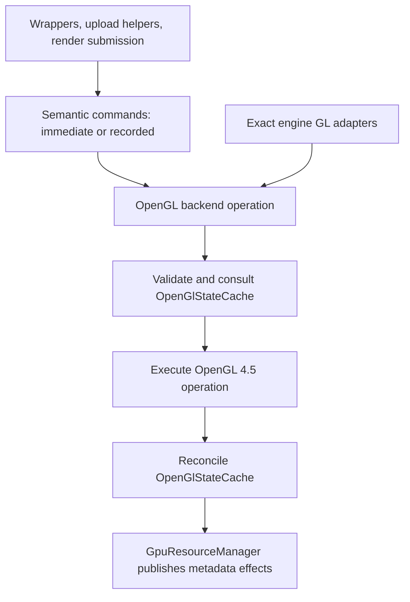

# RHI commands and command lists

Status: approved. Design deliverable for Phase 8 of
[Rendering.GpuResourceHandles.todo](Rendering.GpuResourceHandles.todo). This document proposes
an execution boundary; it does not implement commands or rename `StateCache`.

Use uppercase `RHI` in all interface-layer type, namespace and directory names. Existing GPU resource names remain unchanged; `OpenGlStateCache` names the backend-specific cache.

## The proposed boundary

Rendering code should express **what operation to perform on which resources**. The OpenGL backend
should decide which native calls implement it. `OpenGlStateCache` should retain executed binding knowledge
and reconcile command effects, while `GpuResourceManager` remains the sole metadata authority.

For example, an upload helper requests `UploadBuffer(destination, offset, bytes)`. It does not select
`NamedBufferSubData` versus `BufferSubData`, bind a temporary target or restore that binding afterward.
One operation may require several native calls; it is not an OpenTK overload renamed as a command.

Commands express backend-independent operations. The command context executes them immediately or
submits a recorded list to the backend, which owns native execution and state reconciliation.
Recorded lists own their retained arguments; recording and execution have separate lifetime contracts.



| Component | Owns |
| --- | --- |
| `RHICommand` | Immutable operation code and typed argument location in a recorded list. No native dispatch, metadata or lifetime authority. |
| `RHICommandList` | Ordered recording, argument retention, closing, submission state and reset. Provides named operations rather than public arbitrary callbacks. |
| `RHICommandContext` | Replaces `GraphicsCommandContext`: owns immediate graphics/compute submission and closed-list execution, coordinating passes, pipelines, dynamic state, binding validation/publication, draw/dispatch and engine-boundary restoration. |
| `IRHIBackend` / OpenGL implementation | Semantic operations implemented directly with core 4.5 calls; optional extension operations, outcome handling and explicit operation composition. |
| `OpenGlStateCache` (renamed `StateCache`) | Existing executed binding/routing knowledge, suppression decisions, boundary restoration facts and forwarding established resource effects to the manager. No public native execution surface in the final design. |
| `GpuResourceManager` | Creation handoff, original associations, canonical metadata, operation candidates, availability, revisions, dependency validation and retirement queues. |
| Existing wrappers/renderers | Ownership, allocation/growth/streaming policy, content readiness, pass orchestration and ordering. |

Backend operations and cache are collaborators, not two dispatchers.

Explicit engine framebuffer attachment/routing/blend changes, callback mesh upload/retirement and
particle output redirection belong to restricted native integration operations. Those operations own
the selectors and restoration they change. Cloud adapters request canonical external texture,
framebuffer and executable facts through the manager; covered facts are reused. Content certificates
come from observed allocation/upload/generation outcomes, never ambient error draining or object probes.
Backend pass helpers implement the context's selected pass and cannot serve as another submission API.

Ordinary named resource operations
leave selectors untouched and need no binding scope or restoration plan. Cache restoration remains for
render/engine boundaries and operations whose semantics actually change bindings. Native metadata readers
remain manager-owned services, using core named queries wherever available through the backend.
No second binding cache, resource registry or metadata hierarchy is introduced.
The internal `IRHIResourceExecution` contract covers private initialization, explicit acquisition and
retirement beneath `RHICommandContext`. The manager uses that context boundary rather than obtaining
a concrete backend. These internal methods preserve existing initialization records and metadata outputs;
they are not public native-object operations or a second factory layer. Backend creation invokes manager
handoff, whose initialization step dispatches allocation directly without reentering the public factory.

## Public operations and resource inputs

The OpenGL backend requires an OpenGL 4.5-or-newer context and uses `OpenTK.Graphics.OpenGL4`
bindings for managed RHI execution. This is the approved minimum, not an optional fast path.
Validate the version and required entry-point availability once at backend initialization; reject
unsupported contexts rather than providing an older-version backend. No platform/adoption survey is
required to adopt this policy. It does not require changing the host engine's context profile.
Core DSA and multi-bind are baseline facilities. Optional features beyond 4.5 retain explicit capability
checks. Exact engine adapters retain their original OpenTK signatures at the external boundary.

The `RHI` namespace and major abstraction names identify the rendering hardware boundary. Enums use
descriptive domain names such as `ComparisonFunction`, `BlendOperation`, `TextureFormat` and
`ResourceAccess`, without an `RHI` or `E` prefix.

The command API uses project-owned descriptors/enums for formats, dimensions, access, pipeline state,
vertex layout and synchronization intent. No public operation accepts an OpenTK enum, binding target,
DSA flag, GL method name or native overload selector. Migration proceeds through complete operation-family
replacements against this final contract, as defined below.

Use the implemented `GpuTextureRef` unchanged for texture consumption. Published metadata uses
project-owned dimensions, formats and selections and remains query-free. Commands retain the reference
opaquely; the backend/manager resolves its original association. Consumption grants no native execution,
metadata recovery or lifecycle authority. This boundary does not claim another backend is implemented.

Introduce analogous consumer-only values as needed: `GpuBufferRef`, `GpuSamplerRef`,
`GpuRenderbufferRef`, `GpuFramebufferRef`, `GpuVertexArrayRef`,
`GpuQueryRef`, `GpuSyncRef`, `GpuTransformFeedbackRef`,
`GpuSemaphoreRef` and `GpuMemoryObjectRef`. Each retains its existing typed resource base, exposes
no ownership API and uses manager validation; none captures another lifetime token or metadata copy.
Pipeline bindings use the immutable RHI pipeline realizations and executable generations defined below.
Public shader inputs use `RHIShaderRef`; native shader, program and program-pipeline references, if
needed, remain private to OpenGL realization/integration and are not public command inputs.
Framebuffer references remain useful for the OpenGL integration; portable passes describe attachments,
not read/draw framebuffer binding targets. The default surface is an explicit surface input, not ID zero.
The backend realizes attachment-based pass targets as described below; ordinary renderers do not create
framebuffers merely to begin a pass.

Consumption does not grant resize, deletion or ownership transfer. Mutating wrapper methods use an
internal owner-bearing execution route; destroy requests originate only from existing ownership and
retirement services. Buffer uploads/copies are explicit write operations admitted through existing
usage guards, not methods on the reference itself. Imported resources keep their current ownership rules.

| Operation family | API intent and execution disposition |
| --- | --- |
| Creation/destruction | Typed RHI factories return owned resources or failure results. Legal-input initialization records and nullable metadata handoff remain internal to manager orchestration. Creation executes immediately; no unresolved resource placeholders in lists. Owner disposal schedules existing retirement; deletion is internal and never a consumer `Destroy(ref)` API. Covers every existing resource kind, including views and external-memory/semaphore objects. |
| Storage/configuration | Allocate buffer/image/renderbuffer storage; configure attachments, vertex input and samplers. Executable configuration belongs to shader creation, with subsequent managed changes producing a new generation. Owner operations execute immediately and commit one coherent result. Immutable storage restrictions remain enforced. |
| Shader work | Create an executable from stage-code inputs through the shader contract below. Compilation, linking, binary installation and native stage configuration are backend details. Existing deferred link completion remains internal to pending creation; it is not command-list GPU completion. |
| Upload/copy/clear/mips | Typed buffer ranges, texture regions, row/slice pitches and view-relative subresources. Upload, copy and clear can be recorded. Mip generation is immediate initially because mutable generation can change storage facts. Contents never become canonical metadata. |
| Binding/passes | Set pipeline, bind resource table, set dynamic state, begin/end render pass. Include explicit image level/layer/access/format and attachment load/store/clear intent. Preserve full-input validation and alias feedback checks. Recordable. |
| Draw/dispatch | Direct, indexed, instanced and indirect draw/dispatch with explicit offsets/counts. Preserve noninstanced indexed batching through `DrawIndexedBatch` and stable supplied intervals. Vertex/index semantics stay above GL addressing. Recordable; no reordering. |
| Synchronization | Resource access barriers, fence insertion, GPU waits and external semaphore operations. Backend maps supported access intent; no inferred render graph. CPU waits are explicit immediate calls. Imported-handle ownership is never inferred from a command. |
| Queries/readback | Begin/end timestamp or statistics operations and enqueue readback into owned staging storage are recordable. Typed result requests expose `Pending`, `Ready`, `Failed` or `Cancelled`; polling/waiting/mapping is explicit and immediate. Raw client pointers and mapped spans are never recorded. |

Expose semantic limits and optional features through `RHICapabilities`, projected from the existing
context capability/limit data rather than creating a second discovery system. Baseline operations call
their core implementation directly: no per-operation variant table, DSA enable flag, backend fallback
strategy objects or runtime core/ARB/EXT resolver. `IRHIBackend` selects the graphics backend, not an
OpenGL version strategy. The command opcode dispatcher only interprets recorded operations.

Optional operations, such as external memory/semaphore imports, have explicit feature checks and
focused extension implementations. Reject unsupported requests before dispatch with a feature reason;
do not invent a general fallback registry for them. Format-dependent limits and sample counts remain
cached. Native entry-point loading is still required, but it is not semantic implementation selection.

## Resource creation and adoption

Expose one creation pattern across resource kinds:

```text
context.CreateTexture(description, optionalInitialData)
    -> RHICreationResult<owned texture resource>
```

`RHICreationResult<TResource>` exposes either the completed owned resource or a failure with diagnostics,
never a provisional resource, native handle or nullable metadata snapshot. Successful ownership passes
to the caller; failed creation exposes no resource to dispose. Preserve required exception propagation;
the result reports detected initialization failure, not a universal detector for silent native errors.
General resource creation is synchronous and context-affine. The separately defined pending shader
creation request produces the same success/failure contract when complete.

Factories cover buffers, textures, renderbuffers, framebuffers, samplers, vertex arrays, queries,
transform feedback and supported external memory/semaphore objects. Buffer textures and native texture
views are explicit creation operations with required backing references and ranges. Framebuffer creation
serves backend target realization and explicit OpenGL integration, not portable pass descriptions. Fence insertion
retains its synchronization result contract. Native shader/program/program-pipeline allocation stays
private to shader realization. Return existing appropriate owned resource abstractions; do not introduce
a parallel RHI resource hierarchy or replace the established consumer reference types.

Descriptions contain only legal inputs using project-owned types, including required dimensions,
formats, usage and storage mode. Preserve omitted-versus-explicit-zero/false semantics where relevant.
Higher-level wrappers/helpers retain growth, streaming and allocation policy and request creation using
those decisions. They do not pass themselves as public factory recipients or coordinate registration.

Internally the creation service declares an unpublished recipient, validates/freezes the request,
executes backend allocation and initialization, establishes canonical metadata, and completes manager
association and typed snapshot delivery before returning success. Existing recipient-bearing manager
methods and nullable metadata handoff can remain private machinery. This is not a temporary public
compatibility facade: their purpose is the manager's identity/publication transaction. Avoid recursion
between resource constructors and factories by keeping unpublished declaration construction internal.

Initial content is a separate optional payload, never metadata. Buffer payloads specify offset/extent;
texture payloads specify subresources, layout and row/slice pitches. Validate supplied ranges against the
description before native work. Immediate CPU payloads must remain stable until the call returns and
must not be retained afterward unless an explicit staging ownership contract transfers them. GPU-backed
payloads retain their source allocation through consumption under the existing synchronization rules.
Unspecified regions remain unspecified; creating storage does not establish application content readiness.

A successful result means the resource is usable for subsequent correctly ordered commands and its
canonical metadata is available. It does not mean initial upload work has completed on the GPU.
An unimported semaphore result owns a reservation only: disposal is legal, while wait/signal require
confirmed imported realization. The import boundary makes the approved single lifecycle outcome check;
it does not discover descriptors or infer payload success from the handle argument.
Ordinary client-memory upload consumption and GPU staging reuse have distinct lifetimes; staging owners
retain their memory until explicit completion permits reuse. Do not insert an unconditional GPU wait or
fence into every creation. No writable staging-initializer API is required without a demonstrated need.

Failure retires only newly owned candidate allocations, clears provisional identity/association and
preserves the original error. Borrowed backing dependencies are never deleted by failed creation.
Keep the existing original-context deletion queue and context-retirement rules, including local tools.

External adoption is separate from creation. Explicit borrow operations acquire available facts and
establish existing non-owning wrappers without taking native deletion authority. Any ownership-taking
adoption must explicitly accept transfer under existing ownership rules; neither a bare native ID nor
ordinary borrowing implies transfer. Keep native-ID adoption at the OpenGL integration boundary rather
than adding native IDs to portable creation descriptions. Covered aliases reuse manager metadata;
unknown external facts retain explicit acquisition and coverage limitations.

Replacement creates a new allocation and commits it through the existing owning wrapper's replacement
contract only when ready. `GpuTextureRef` follows intentional owner replacement as already specified;
old borrowers and native views retain their original associations and cannot silently follow it.
Failed replacement preserves the existing documented failure behavior rather than inventing rollback of
already retired storage. Shader/pipeline candidate installation has its stricter preservation contract below.

Managed buffer contracts carry project-owned usage/storage-access values; shader stage and executable
reflection facts use semantic kinds, types, stage masks and typed fields with explicit availability.
Authored resource types have no numeric equivalence with native tokens. Binding preparation and ordinary
layout reads consume supplied snapshots/limits; explicit external assignment resolves through RHI.
Managed image and framebuffer contracts carry project-owned dimensions, cube faces, formats, slots and
routing selections throughout wrappers, initialization, canonical metadata and capability-cache keys.
A native translation helper is not a replacement for migrating those callers. Encode values only at
backend dispatch and decode native query results or actual external arguments at their native boundary.
Resource consumers and manager acquisition services never invoke native codecs.

The manager continues to own registry entries, canonical metadata, dependencies, alias publication and
retirement. Creation factories hide those mechanics; they do not replace them with a second registry,
reference-counting system or metadata authority.

## Shader and pipeline objects

Define these contracts before implementing command payloads or migrating draw/dispatch. Shader and PSO
implementation is a separate complete migration unit; it must implement these contracts rather than
temporarily exposing current program objects through the command API. Resource-family operations and
command storage can be implemented first. Draw/dispatch integration depends on shader/PSO realization.

### Shader assets, executable creation and ownership

Keep asset loading, preprocessing, permutation selection and offline compilation above the RHI.
An immutable `RHIShaderDescription` contains the selected stage-code inputs, entry points, specialization
values and authored binding contract. Stage inputs explicitly identify their code format and immutable
bytes/text. Validate stage combinations and format support before native work. OpenGL 4.5 alone does
not imply SPIR-V ingestion: use the supplied supported GLSL path or require the relevant optional feature
for SPIR-V. The backend does not silently translate or substitute an unrelated asset.

`CreateShader(description)` creates one graphics or compute executable, returning an owned `RHIShader`
only when its executable and immutable binding interface are ready. This is an executable bundle, not
one native stage object. The OpenGL backend privately creates stage objects, compiles/specializes them,
links a program or installs a valid cached binary, and obtains required driver-produced interface facts.
Linking and program IDs are not caller-facing RHI operations. Existing asset and driver-binary caches
retain their responsibilities; their native execution moves behind this boundary.

Native shader/program objects remain existing `GpuResource<TMetadata>` resources created and published
through `GpuResourceManager`. `RHIShader` owns the resulting native executable resource; its prepared
interface derives from supplied canonical metadata through the existing preparation system. It does not
create another canonical metadata authority. Intermediate stages are cleaned up after successful linking
where no longer needed; failed candidates retire only their own allocations. Creation returns a typed
success/failure result with diagnostics, preserving exceptional error propagation where required.

Preserve existing deferred linking through `BeginCreateShader(description)` returning a pending creation
request. Its explicit completion returns Pending, Ready with an owned `RHIShader`, or Failed with diagnostics;
it never exposes a partially usable shader. The synchronous convenience completes the same operation and
may wait. Both run through the originating context; pending requests retain their frozen inputs and
original native associations. Cancellation/teardown cleans the candidate through existing retirement
services. This is deferred native creation completion, not worker compilation or asynchronous submission.

Each ready `RHIShader` represents a fixed executable generation. Published code/interface cannot be
relinked in place through the managed RHI. Record native association and executable revision so external
mutation or context retirement invalidates use through existing manager validation. A consumer-only
`RHIShaderRef` retains that managed object without exposing disposal, relinking or its native resource.
It never follows a higher-level shader asset's replacement generation.

### Graphics and compute PSO realization

Use `CreateGraphicsPipeline(RHIGraphicsPipelineDescription)` and
`CreateComputePipeline(RHIComputePipelineDescription)` on the context. Both return a typed creation
result containing a ready owned realization or failure diagnostics; creation is immediate and does not
require the caller to bind the result. No pending PSO handle is exposed in the initial design.

| Object | Required input and contract |
| --- | --- |
| `RHIGraphicsPipelineDescription` | A specific ready graphics `RHIShaderRef`, vertex layout, topology/assembly, blend, depth/stencil, rasterizer, sampling/output state, render-target format/sample signature and explicitly dynamic state fields. Reuse the existing immutable description/value contracts with project-owned enums. |
| `RHIComputePipelineDescription` | A specific ready compute `RHIShaderRef`; executable compatibility and dispatch limits derive from that executable and cached capabilities. No graphics state or invented framebuffer dependency. |
| `RHIGraphicsPipeline` / `RHIComputePipeline` | Immutable context-bound realizations retaining the exact shader generation, prepared binding interface and backend application data. Graphics realization also retains target compatibility and the state footprint needed for engine-boundary restoration. |
| `RHIGraphicsPipelineRef` / `RHIComputePipelineRef` | Consumer-only references used by command recording and submission. They expose no lifecycle methods and never resolve to a different pipeline after replacement. |

OpenGL PSO realization need not allocate a native monolithic pipeline object. Graphics realization can
hold validated fixed-state application data and the executable; compute realization holds its executable
and binding interface. Selecting a pipeline applies it through `OpenGlStateCache`, preserving suppression.
Dynamic state values remain command inputs. Binding tables, texture/buffer instances, framebuffer identity,
viewport dimensions and ordinary uniform values are not part of immutable PSO identity.

Descriptions compare all behavior-bearing fields and the exact shader generation, excluding diagnostic
labels. Creation does not introduce a global PSO cache or automatic sharing: the existing renderer owner
retains and reuses its realizations. Identical descriptions may produce distinct lightweight realizations.
This provides a deterministic future cache key without requiring cache eviction, reference-counted sharing,
precaching or asynchronous PSO compilation now. Pipeline realization does not independently relink or
reflect a ready shader; it consumes the executable's prepared facts.

### Replacement, recording and retirement

Shader ownership stays with the higher-level shader owner; pipeline ownership stays with the renderer.
Pipelines strongly retain their shader reference but do not acquire disposal authority or prevent explicit
shader retirement. Disposing a pipeline retires that realization and its exclusively owned backend data;
it does not dispose the shader. Native deletion continues through existing resource retirement queues.
Managed PSO records do not need native registry entries when they own no native object.

Reload builds a fresh shader candidate and the required replacement pipelines before installation. The
higher-level owner publishes the compatible shader/pipeline set together between submissions. On failure,
the installed set remains usable and candidate-only allocations are retired. Desired CPU binding values
survive; prepared layouts and successful-upload history belong to the installed executable generation.
The owner can retain an old set deliberately, but retiring it invalidates later use of its references.

`SetPipeline` records a pipeline reference, not a mutable shader owner or lookup key. Recorded resource
tables carry that pipeline's prepared-interface identity. Execution rejects retired pipelines, unavailable
or externally changed executables, mismatched tables and incompatible pass targets before issuing the
affected work. It never silently retargets recorded slot indices to a replacement generation. A still-live
old set can execute; a retired set requires re-recording. Texture references retain their separately agreed
owner-following behavior: executable identity has a stricter contract because it defines command layout.

There is no general replay recovery or list-wide native rollback. If a later command fails validation,
earlier executed commands retain their normal outcomes. Creation, cancellation and context retirement
must preserve original associations and prevent stale candidates from installing after a newer selection.

## Immediate execution and recorded lists

### Geometry inputs

Draws consume retained geometry inputs: vertex-buffer references with stream ranges, offsets and strides,
an optional index-buffer reference with its format/range, and explicit draw parameters. The pipeline
supplies the immutable vertex-layout contract. Before issuing a draw, validate layout compatibility,
resource usability, supplied offsets/alignment and declared ranges against known resource bounds.
Validate accesses derivable from explicit draw parameters; indirect inputs retain their buffer references
and argument ranges under the same execution-time rules.

Producers remain responsible for index values and GPU-generated draw arguments, including the validity
of accesses those contents determine. Ordinary RHI submission does not inspect or read back those
contents, or synchronize the GPU to prove their values. Descriptor/range validation does not claim to
prove every content-dependent vertex access.

Geometry adapters supply these inputs and retain ownership/adoption policy; they do not execute draws.
Replace `GraphicsGeometry.Submit` and concrete engine/native draw paths with backend-owned submission.
Engine mesh adapters preserve engine ownership and their permitted usage interval when exposing borrowed
streams. Retaining a recording does not extend that interval; reject expired inputs before dispatch.
Move upload/adoption, manager-backed validation, input binding, draw submission and retirement together
so no completed geometry migration retains an adapter-owned native execution path.

### Attachment-based pass targets

Portable pass descriptions supply attachment references and subresource selections, output routing,
render area and load/store/clear intentions. Renderers own the attachment resources and pass ordering;
the OpenGL backend owns the framebuffer objects needed to execute those descriptions. An explicit
surface input follows its surface integration contract rather than becoming an ordinary attachment cache entry.

A target service scoped to the owning context/backend resolves attachments at execution and reuses or
creates a framebuffer for their resolved configuration. Its key includes original resource associations,
selected mip/layer or layered ranges, and other configuration affecting framebuffer realization, including
routing where retained on the object. Do not key solely by wrapper equality or numeric native names.
Per-pass clear values and load/store actions are executed intentions, not reasons to create another
framebuffer. The service caches native realizations, not another copy of canonical resource metadata.

Create and configure cache misses through backend operations and existing manager publication. Validate
attachment usability, target compatibility and completeness before executing pass loads, clears or draws.
Publish a reusable realization only after successful configuration; failure retires its candidate and
unwinds admission without exposing a partial target. Recording retains descriptions/references and does
not realize framebuffers or acquire pass guards.

The manager retains canonical framebuffer metadata, attachment dependencies and retirement authority.
Replacement or invalidation of an attachment makes dependent cached realizations ineligible for reuse;
the next execution resolves the current owner identity and realizes the matching configuration. Borrowed
attachments preserve their original associations and cannot follow unrelated name reuse. Retire obsolete
owned framebuffers through existing guards and original-context queues, leaving attachment ownership
unchanged. Context teardown releases the target cache through those same lifetime rules. Explicitly
borrowed engine framebuffers remain external objects and never acquire backend deletion ownership.

Migrate attachment descriptions, target realization/reuse, routing, completeness validation, pass guards
and restoration together. Existing pass helpers remain responsible for their specialized behavior behind
the unified context; they consume the resolved target rather than requiring renderer-created framebuffers.

### Execution and recording lifecycle

Recommend immediate execution as the default, using the same backend operations as list submission.
This preserves synchronous creation, current exception boundaries and existing rendering order. A list
is an optional CPU recording container, not an OpenGL display list or a new GPU queue.

Illustrative call shape (names are proposed, not existing APIs):

```text
context.UploadBuffer(bufferRef, offset, bytes)      // executes now
list.UploadBuffer(bufferRef, offset, bytes)         // copies bytes; no GL or publication
list.BeginRenderPass(passDescription)
list.SetPipeline(pipeline)
list.BindResources(bindings)
list.DrawIndexed(drawDescription)
list.EndRenderPass()
list.Close()
submission = context.Submit(list)                   // executes in order on this thread
```

Lists transition `Recording -> Closed -> Executing -> Executed` or `Failed`. Cancellation is allowed
before execution and releases owned arguments/references. During synchronous submission there is no
concurrent cancellation. Reset is permitted after execution, failure or cancellation, never while
executing. Reset returns to empty recording; lists are single-use recordings, not replayable snapshots.

The first implementation uses immediate execution and single-threaded recording/submission on the
originating context thread. Recording must nevertheless be independent of a current native context by
contract, rather than relying on a future refactor to permit concurrency:

- Each recording list has one exclusive owner. Its command storage and mutable recording state are
  list-local; no shared mutable recorder, ambient current context or global scratch storage is allowed.
- Recording consumes supplied values, copied payloads and retained immutable descriptions/references.
  It does not inspect mutable wrapper metadata, resource validity, the manager registry or executed cache
  state. Resource-dependent checks remain at execution; recording checks only supplied argument shape.
- Closing freezes the recording. Ownership transfer must publish the complete recording before another
  thread consumes it, with exclusive ownership of submission, cancellation and reset. Retaining a managed
  reference does not make its resource thread-safe or prevent explicit retirement.
- Execution remains on the originating context thread. The orchestrator specifies submission order;
  future worker completion order must never implicitly determine rendering order. Recorded work retains
  its intended context identity without requiring that context to be current during recording.

These are required architectural boundaries now. Worker scheduling, concurrent recording integration,
asynchronous submission, shared-context execution, nested lists and a cross-list scheduler remain outside
the initial implementation. A dedicated RHI execution thread and parallel native translation are separate
design decisions, not implied by enabling CPU-only parallel recording.

Record commands in reusable typed payload pages with an ordered `RHICommand` header stream. Store
managed references in list-owned tables, not an unmanaged union. Copy spans/arrays and mutable binding
descriptions at recording; freeze immutable executable/descriptive objects by retaining them. Do not
record closures or require one heap object per command. Reuse storage where ownership permits; page sizes
and pooling are implementation choices, not benchmark gates. Immediate calls need no recording allocation.

References retain wrappers but do not prevent explicit disposal or replacement. Resolve current resource
identity and metadata at execution, consistent with `GpuTextureRef`: an intentional owner replacement
before submission is visible, while retired borrowers/views remain invalid. Copying descriptors freezes
arguments, not resource contents or native identity. Callers needing old storage must retain a distinct
owner; the command list does not invent snapshot semantics. Revalidate bounds, executable compatibility,
manager usability and pass feedback before use, even when reference equality is unchanged.

Recording performs argument-shape and balanced-pass checks without native queries, cache updates,
guards or metadata publication. Submission rechecks context, required optional features and resource limits,
and validates each complete
binding set before publishing it. Pass guards start on execution and end on execution/unwind. Lists must
contain complete passes; they cannot leave an active pass for another list or straddle an engine callback.
They are not implicitly state-isolated: commands leave their specified state, while temporary operation
bindings and explicit pass/engine boundary scopes restore their contracted surrounding state.

Successful `Submit` means CPU native dispatch completed, not GPU completion. It neither calls Finish nor
inserts a fence automatically. Explicit fence/readback tickets own staging or persistently mapped memory
until the GPU is finished; list reset releases only CPU recording storage. Ordinary upload bytes may be
released after their native upload call consumes them. Resources follow existing GL deferred destruction
and deletion queues; CPU completion is not permission to recycle GPU-used staging regions.

A recorded fence marker returns a pending completion ticket, not a usable `GpuSyncRef`. Execution
creates its native fence through the existing manager creation path; cancellation before execution
creates nothing. This result-bearing synchronization operation is distinct from deferred general resource
creation. Query resources are created before recording their begin/end commands. Mapping a readback
requires a ready ticket; waiting is explicit and may block, polling never promises immediate availability.

On failure stop at the offending command, preserve its original exception and report the command index.
Already executed work is not rolled back or retried. Unexecuted result requests become failed/cancelled;
already enqueued readbacks/fences keep their own completion ownership. Unwind pass/binding scopes and
withdraw uncertain knowledge. Context retirement cancels outstanding CPU work and marks result requests
unavailable without issuing GL into a replacement context.

## Backend dispatch and publication

Every operation has one execution owner:

1. Check context, resource usability, legal inputs and existing usage/reentry guards. Baseline operations
   use their fixed core implementation; only optional operations check their extension requirement.
2. Ask `OpenGlStateCache` whether an eligible known-equal state change can be suppressed. Allocation,
   content upload, draw, link and synchronization are not suppressible just because metadata matches.
3. Capture original associations and required restoration facts. For metadata mutations use the existing
   manager operation to withdraw affected availability and assemble a complete candidate.
4. Execute native calls in the backend. Explicit internal steps share the owning operation; they do not
   independently publish. Intercepted calls remain individual operations.
5. Reconcile established binding and lifecycle effects through `OpenGlStateCache`; deliver metadata effects
   to the manager for exactly-once canonical commit and typed notification. Named resource operations
   do not invalidate unrelated selectors. Where a binding scope is actually required, restore it through
   backend calls and the same cache, including exceptional paths.

This replaces caller-facing Begin/End pairs with complete semantic operations. Internal operation state
remains necessary for original identity, grouped work and interruption; disposal is cleanup, not evidence
of success. There is no ambient collector or arbitrary callback that can join another operation.

Preserve the approved query policy: controlled inputs/defaults/derivations are authoritative under existing
failure handling. No universal GetError drain, Is-object query, full metadata readback or duplicate
requested/actual cache. Retain narrowly justified sample-count/resolved-format reads, shader results and
interfaces, external discovery/recovery and kind-specific deletion outcomes. Reported rejection does not
publish success; uncertain effects withdraw only affected knowledge. This does not claim detection of
every silent GL rejection. Metadata publication failure never retries native work.

| Example | OpenGL 4.5 execution | Required reconciliation |
| --- | --- | --- |
| Buffer allocation/upload | Core named buffer storage/data/subdata | Preserve surrounding selectors without temporary binds. Storage commits once; subdata does not publish capacity. |
| Cube/mip allocation | Core named immutable texture storage when immutable storage is requested | Derive face/mip images and commit once. Retained mutable image definition uses the required bound API; preserve active unit and target binding. Never substitute immutable storage for mutable semantics. |
| Framebuffer attachment | Core named attachment operation | Preserve distinct read/draw selections without temporary binds. Routing and attachment metadata have distinct owners. |
| Vertex input | Core named VAO format/binding/EBO operations | Preserve surrounding VAO/buffer state. Publish configuration revision once, without a new full-layout metadata mirror. |

Use core 4.5 DSA wherever it expresses the operation. Remove older-context named/bound fallback branches
and redundant core/ARB/EXT alternatives for baseline operations. Binding is still required for drawing,
exact external calls and operations without an equivalent core named API; these are semantic requirements,
not older-version fallbacks. Keep their binding/restoration mechanics inside the backend.
A throw or partial execution is failure, never a signal to try another path. Remove `GpuBufferUploader`'s
try-named/catch-and-fallback policy when replacing that family. Optional extension operations select a
supported implementation before dispatch or reject as unsupported. Format-specific limits remain cached;
intercepted calls never drain errors to discover capabilities.
Cache-restoration failure marks affected selectors unknown and preserves the original failure.

Managed creation uses core `Create*` entry points where available so named operations receive realized
objects. Do not introduce a generate-name/temporary-bind realization fallback. Kinds without `Create*`
retain their specific core creation contract. Exact intercepted `Gen*` calls still preserve reserved-name
semantics; acquiring external resources must not pretend those names are already realized.

Managed metadata acquisition likewise uses named core queries where equivalent. Remove older-context
reader switches and their bound-query implementations in the same family replacement. Keep discovery
for unknown external state and binding-based queries only where the required fact has no equivalent
named query. OpenGL 4.5 availability does not turn mutable storage into immutable storage, make content
immutable, or make unknown external facts query-free.

## Engine integration and migration boundaries

Use the approved [OpenTK binding-interception design](Rendering.OpenTKBindingInterception.Proposal.md)
for external GL observation. Replace selected native dispatch entries in both installed OpenTK binding
tables, independent of caller assembly. Coverage includes supported GL/Core, Ext and Arb operations;
retain legacy/auxiliary-owner exclusions and exclude independently cached driver pointers or other
binding libraries. Current built-in caller rewriting is the incomplete route being replaced, not a
permanent integration requirement. Routine purges cannot substitute for missing interception.

An external operation reaches its original driver function exactly once with unchanged arguments,
return values, output buffers and native error behavior. It is never suppressed as known-equal,
deferred into a command list, vetoed by managed guards or retried. Observer failures cannot skip native
dispatch, escape the callback or become exceptions deferred to the external caller. Withdraw only
uncertain affected knowledge; reflect conflicting mutations through existing operation interruption,
availability and certificate invalidation. This observational policy does not replace managed RHI API
validation. Shared cache/manager reconciliation and publication remain singular.

Keep native callbacks, original-pointer dispatch and loader/context lifecycle inside the backend.
Backend-owned RHI calls bypass interception while retaining their existing admission, suppression and
effect ownership. Qualify binding reloads, callback lifetime and reentry so neither path recursively
observes or publishes the same operation twice. Complete covered state effects, including program/
pipeline selection and transform-feedback activity, with the native-route replacement.

Define the final RHI interfaces and dependency rules before migrating callers. Migration proceeds through
complete operation-family replacements: update every affected caller, move native execution and capability
selection into the OpenGL backend, and remove superseded entry points in the same replacement.
Temporary compatibility facades and forwarding shims are prohibited. Unmigrated families may retain their
existing implementation only while explicitly tracked as incomplete; a completed family cannot depend on
a temporary compatibility layer. If a dependency prevents complete replacement, include it in the same
migration unit. Final acceptance requires removing every internal execution bypass of the RHI boundary.

Each replacement must verify behavior, exactly-once publication, binding suppression and restoration,
and inspect callers/dependencies for residual old entry points or native dispatch outside the backend.
Remove that family's baseline capability branches, variant tables, retry-based fallback state, temporary
DSA-emulation binding scopes and obsolete fallback-only tests together. Cover wrappers, upload helpers,
manager creation, native readers and fixtures, not only the public command facade. Replace forced
DSA-disabled tests with direct core-operation/state-preservation tests; retain tests for necessary bound
semantics and exact external calls. Do not preserve an old backend implementation just to satisfy fixtures.
Remove the superseded caller-rewriting maps, exact adapter dispatch and generic-discovery machinery
with their native interception replacement. Broader engine hooks retain only their separate semantic
integration purpose. Existing resource/reference accessors are retained contracts, not permission for
internal callers to issue native operations or select backend paths.

The final split moves native execution from `StateCache` into focused OpenGL backend modules, then
renames the remaining class `OpenGlStateCache`. Each operation has exactly one execution owner.
Manager creation calls the backend through the execution context; backend effects use existing manager
operation/publication services without recursively invoking creation. Preserve wrapper allocation policy,
ownership and helper responsibilities; update GL-shaped signatures and their callers where the final
contract requires it rather than retaining obsolete overloads. Readers keep manager acquisition ownership.

`ShaderPreparedSubmission` retains complete-set validation and compatibility history; its publication
target becomes command operations using the pipeline's exact executable/interface generation.
`GpuPreparedBindings` continues preparing supplied program metadata
only. Generated submissions retain immutable desired arguments for recording; successful-upload history
must advance on execution, never merely when commands are recorded. On cancellation/failure, preserve
dirty CPU uniform state and invalidate only affected execution history. Prepared tables/executable owners
are revalidated at execution so a recorded layout cannot be used against a different linked interface.
Commit only the captured uniform version that actually executed; never clear a newer CPU edit. Reject
an incompatible executable/table change and require re-recording rather than replaying old slot indices
against a new interface. Submission-time equality checks cannot discard a needed upload based solely
on a successful recording that has not executed.

Recorded uniform inputs retain logical bytes, captured content revision and lifetime policy, not a
physical ring offset acquired during recording. Execution selects reusable storage or allocates and
uploads a complete captured version through the existing uniform publication services in the current
open publication epoch. Binding success commits that captured revision; it never clears newer CPU edits.
Cancellation before execution allocates no uniform storage. Failure aborts only the new candidate under
the existing publication rules, and allocator completion/epoch rules govern physical storage reuse.
Migrate generated submissions, CPU snapshots, allocator publication and execution history together.

`RHICommandContext` entirely supersedes `GraphicsCommandContext`. Move its pass lifecycle/sequencing,
pipeline selection, dynamic state, binding validation/publication and draw submission responsibilities
into the unified context alongside compute dispatch. Migrate all callers and delete the old class in
the same replacement unit; no forwarding facade, parallel graphics context API or duplicated submission
state remains. Renderers retain orchestration: choosing work and its order, not another execution context.

Specialized pass, validation, usage-guard and engine-boundary restoration helpers remain behind the
unified context with their existing responsibilities. Reuse them rather than duplicating their state
inside the context. Immediate calls and recorded execution use the same execution machinery; recording
itself still acquires no pass guards and changes no executed state.

Before executing work inside an engine boundary, admit its complete permitted pipeline set and state
footprint. Immediate callers declare those pipelines and the state categories required by their other
operations before entering the boundary. The context validates the declaration and captures only the
required surrounding state before the first mutation. An undeclared pipeline or operation outside the
admitted footprint is rejected before execution; it cannot expand restoration coverage after mutation.

A closed command list supplies its pipeline set and required state footprint from retained immutable
pipeline descriptions and recorded operation kinds. Building that declaration reads no mutable resource
metadata or executed state. Submission validates it before native work and uses the same boundary
admission machinery as immediate execution. When submitting within an existing boundary, the list must
fit its already admitted declaration; submission neither widens that boundary nor implicitly opens an
isolating scope. Keep explicit boundary scopes and selective restoration, without blanket state capture
or a second restoration cache.

Render pass scopes retain clear/load/store behavior, feedback guards and boundary restoration. Draw and
dispatch enter the same backend; no direct native draw escape remains in migrated consumers. Retirement
queues retain original entries/context and run backend deletion only after their existing admission.
Recorded references never authorize a queued delete to reacquire an entry by reused ID.

Organize source by responsibility: `Rendering/RHI/Commands` for command contracts/recording,
`Rendering/RHI/Backends/OpenGL` for native operations/dispatch and cache modules, and existing manager,
metadata, initialization and wrapper domains for their current responsibilities. Separate argument
storage, list lifecycle, core operation families and optional extension modules rather than making one large dispatcher.
Other backends implement the semantic interface; optional features can reject unsupported requests.
No second backend, shader-language translation, render graph or global resource-model rewrite is proposed.
PSO multi-bind fits inside the binding backend using baseline support and existing slot knowledge;
individual calls remain useful for ineligible semantics or batching policy, not older contexts.
This design does not require multi-bind to wait for deferred recording. The separately scheduled PSO
work may precede this backend migration; its existing-runtime capability path is removed when that family
is replaced under the 4.5 contract.

## Representative outcomes and verification

| Path | Required outcome / focused verification |
| --- | --- |
| Cube with several mips | Existing constructor supplies its allocation request. Manager/backend creates privately, derives all face/mip facts, publishes once, then hands off identity. Partial allocation failure cleans only the provisional object; no usable partial wrapper. |
| Buffer upload | Core named operations produce expected contents while sentinel bindings remain unchanged; no temporary bind, per-call capability query, extra metadata refresh or retry after native failure. |
| Framebuffer reattachment failure | Capture original association, apply configuration as an explicit operation. A detected partial failure leaves affected metadata unavailable, restores surrounding selectors and prevents drawing from stale attachments. No rollback claim; explicit repair/recovery remains possible. |
| Draw/dispatch | Bind complete validated inputs and pipeline, execute work in order, preserve shader algorithms and content readiness. Stable bindings suppress native calls without bypassing current resource checks. |
| External deletion | Exact engine overload executes once, per-object outcomes retire original entries and repair affected binding knowledge. Duplicate/zero names and retained shader/program native references keep their existing semantics. |
| Queued retirement | Dispose withdraws managed usability under existing guards. Drain validates original entry/context before deletion; name reuse cannot redirect it. A list retaining a retired wrapper fails use, rather than keeping it artificially live. |

Test immediate and recorded paths against the same outputs and sentinel state, including native views,
view-relative selections, aliases, owner replacement, unavailable metadata, context-local tools and
context retirement. Cover list close/reset/cancel, copied array mutation, partial execution, staged
readback ownership, shader reload and deferred link completion. Test baseline admission/rejection and
core DSA for buffers, images, framebuffers and VAOs. Test binding preservation for operations that still
require bound semantics. Test optional features enabled/disabled separately, retaining unexecuted native
cases as explicit gaps. External exact-forwarding tests must count one native execution and one
publication, preserve errors and prove no recursion. Keep hardware coverage gaps explicit.

Verify boundary admission for immediate declarations and closed-list footprints: required state is
captured before mutation, undeclared pipelines/operations are rejected before dispatch, and submission
within an existing boundary cannot widen its declaration. Verify selective restoration on success and
failure without blanket capture or recording-time resource inspection.

Verify geometry inputs for owned and borrowed streams, indexed/instanced/indirect ranges, replacement
and expiration of engine borrowing intervals; adapters must issue no native draws. Verify that descriptor
and known-bound checks reject invalid supplied ranges without reading index/indirect contents back or
adding GPU synchronization to validate their values. Verify recorded
uniform submission across allocator epoch changes, cancellation before execution, failed binding and
newer CPU edits, with physical allocation deferred until execution and no expired ring-offset reuse.

Verify attachment-based passes reuse matching framebuffer realizations, distinguish subresources and
configuration, and execute new clear/load/store intentions without needless framebuffer creation. Cover
attachment replacement/deletion and native-name reuse, incomplete-target cleanup before pass effects,
context teardown, and borrowed engine targets without deletion or ownership transfer. Recording must
perform no target realization, and cache reuse must still honor manager dependency validity.

For shader/PSO replacement, verify synchronous and pending creation, compile/link/interface failure,
candidate cleanup, context retirement, exact shader-generation identity, graphics target compatibility,
compute stage validation and renderer-owned reuse. Verify pipeline disposal preserves its shader owner,
shader retirement rejects dependent pipeline use, failed reload preserves the installed set, and successful
reload never retargets recorded bindings. Assert PSO realization performs no duplicate link/reflection.
Exercise graphics and compute through the same lifetime/result contracts, including cached-binary creation.

For general creation, verify each resource family returns only completed owned resources, preserves
input omission semantics and publishes once without descriptor readback. Cover initial-data bounds and
lifetimes, partial allocation/initialization failure, context-local creation and original-context cleanup.
Verify borrowing versus explicit ownership transfer, available-alias reuse, replacement and native-view
dependencies. Assert public callers cannot obtain provisional identity or perform metadata handoff,
and distinguish usable creation from GPU completion and producer content readiness.

Design for efficient execution: reuse stable snapshots without added queries, preserve binding suppression,
avoid unnecessary allocations and keep immediate execution free of recording storage. Use focused source
checks and behavioral tests to guard these properties. Performance baselines, benchmarks, timing studies
and measured performance acceptance are not requirements of this implementation. Debug instrumentation
remains DEBUG-only; no instrumented Release product variant. Qualification includes delegated regression tests,
canonical build/package identity and user-run visual checks, distinct from this document review.

Verify recording with no current native context and supplied inputs only; verify closing prevents further
mutation and that reset/cancellation release retained CPU data without native work. These checks establish
the recording boundary, not full concurrent execution qualification. Worker recording and concurrency
integration remain separate design decisions requiring additional approval and their own race/lifetime
tests; this implementation does not require a performance study to assess that future work.

## Execution exclusions and resource lifetimes

Canonical metadata transactions remain manager-owned. Their private RHI exclusion contract exposes
original identity, interruption and deletion state only; it neither holds candidates nor commits them.
The existing backend cache supplies that exclusion through the thin context composition root without
native admission. This preserves registry-only tools, cancellation and originating-cache cleanup while
removing concrete cache guards from manager signatures. Context-local operations also preserve physical
namespace identity through the existing context registry. Ordinary wrappers retain ownership, usage
retention and queued retirement policy; consumer references read only published facts.

## Optional diagnostics

Resource owners keep managed names and submit optional labels through the RHI using the existing
owner identity. Native object selectors remain private to backend diagnostics and explicit engine
label integration. Labeling is DEBUG-only and best-effort, never a metadata acquisition, native
validity probe, ownership change or creation-success check. Explicit diagnostic assertions and groups
use semantic entry points; ordinary commands do not acquire an automatic error drain. Failed engine
shader compilation retains its bounded diagnostic report at that explicit integration boundary.

## Approval and controlling contracts

Recommended decisions: semantic backend operations; immediate default with initially single-threaded,
single-use recorded lists and the required context-independent recording contract; execution-time resource resolution; immediate creation/storage/lifecycle
operations; direct OpenGL 4.5 execution with explicit optional features; existing manager publication
and error policy.
These choices are approved together. No unresolved external specification blocks the design;
API naming and storage sizing/pooling remain implementation details, not permission to change semantics.

Current authority: [GPU resources](Rendering.GpuResources.md),
[prepared resource submission](Rendering.ShaderBindingState.md#prepared-resource-submission),
[resource proposal](Rendering.GpuResourceHandles.Proposal.md),
[inventory](Rendering.GpuResourceHandles.Inventory.md) and
[API coverage](Rendering.GpuResourceHandles.ApiCoverage.md). The approved creation/publication contract
is retained at `3f307365:docs/Rendering.CommandPublication.Proposal.md`; the completed texture-reference
proposal is retained at `b9fca04c:docs/Rendering.GpuTextureRef.Proposal.md`. Consult those Git versions,
not their removed live paths. The current source remains authoritative for implemented APIs.

Implementation follows [Rendering.GpuCommands.todo](Rendering.GpuCommands.todo), with final contracts
and replacement-unit definitions established before runtime migration. Temporary migration shims remain prohibited.
