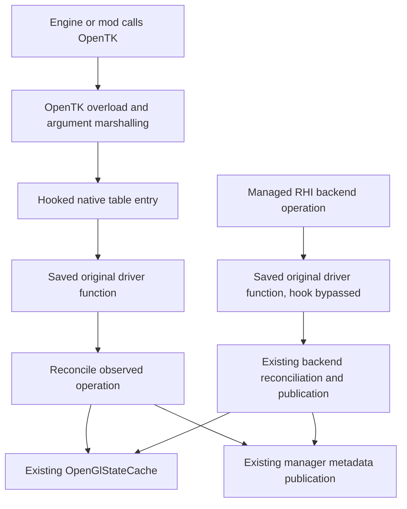

# OpenTK binding-table interception

Status: implemented and focused qualification recorded in subphase 8h of
[Rendering.GpuCommands.todo](Rendering.GpuCommands.todo). This document defines the external interception
boundary of the approved [RHI proposal](Rendering.GpuCommands.Proposal.md) and
[contracts](Rendering.GpuCommands.Contracts.md). Integrated/package/live qualification remains separate.
Interception is observational: forward native calls without throwing into the caller or cancelling dispatch.

## Purpose and scope

Observe selected OpenGL operations at OpenTK's native dispatch boundary, independently of the caller's
assembly. Generated native callbacks replace engine call-site rewriting for those operations.

Coverage includes both `OpenTK.Graphics.OpenGL.GL` and `OpenTK.Graphics.OpenGL4.GL`, for supported
Core, Ext and Arb operations. Excluded auxiliary owners and legacy compatibility features stay excluded.
Other graphics libraries and independently cached driver pointers are outside this boundary.
Hook queries/content-only operations only where an explicit observation contract requires them.

The chosen boundary is the supported installed OpenTK tables, irrespective of caller assembly.
Engine-only caller rewriting was considered, but native interception is the approved replacement.
Caller rewriting and its exact managed adapter catalogs are removed for these operation families.

## Dispatch design

OpenTK wrappers load driver function pointers from their binding tables and invoke them. Replace
selected entries with ABI-compatible callbacks, retaining the original driver pointers privately.

An external `GL.DepthMask(false)` would execute the original driver function once and update existing
depth-write knowledge when its effect is established. For `GL.BufferData<T>`, OpenTK still pins the
array; the callback receives a native pointer and byte count without needing the managed element type.
Backend-owned calls bypass interception and retain their existing admission and reconciliation.
External observation never suppresses even a known-equal call; OpenGL receives the original arguments.

## Generated callbacks and handwritten observers

Cache-owned static post-call observation methods declare their native symbols with `InterceptOpenGL`.
Equivalent core/ARB/EXT symbols may annotate the same method when their ABI and effects agree.
Generated callbacks invoke these methods directly; the installation class does not own a parallel set
of forwarding observers. Bound and named variants normalize into shared domain effect logic.
A dedicated Roslyn generator reads the exact `OpenTK.Graphics` PE reference supplied by the compiler.
It recovers native entrypoint names from binding-table initialization and decodes wrapper `calli`
signatures for the supported GL roots and Core/Ext/Arb owners. This is build-time metadata inspection;
it neither loads OpenTK into the analyzer host nor executes its static constructors. Attributes select
operations; no separately maintained native-signature file is required. Managed convenience overloads
retain their native call-site ABI. Unknown symbols, incompatible observer signatures, duplicate
registrations, conflicting native signatures and unsupported binding layouts are compilation errors.
The generator then emits callback factories and the registration catalog. The generated
callback calls the immutable original pointer once, checks whether observation remains enabled,
then invokes the observer with native arguments and any return value. Observer exceptions are contained;
no per-call lifetime counter is needed.
OpenTK retains managed overload marshalling; native pointer arguments remain valid during observation.

Scalar state observers receive the selected `OpenGlStateCache` and name a handwritten `Withdraw`
method on `InterceptOpenGL`. That method takes the cache followed by the exact native arguments,
returns void, and withdraws only affected knowledge. It performs no native dispatch or acquisition.
The generator resolves and signature-checks optional `nameof` classifiers and the required withdrawal
method. Classifiers distinguish established changes, proven rejection and uncertainty using native
arguments and already captured context facts. Generated delivery selects/captures the origin once, leaves rejected
fields intact, withdraws uncertain fields and commits established effects only to the same live origin.
It contains delivery failures by invoking the same domain-owned withdrawal method. Domain classifiers
and assignments remain handwritten; generated code contains no cache-category mapping, GL acceptance
rules or semantic interpreter.
Indexed/selector-dependent state effects and resource reconciliation retain their focused domain logic
and targeted recovery through the existing cache/manager.
Each post-call operation keeps classification, targeted withdrawal, manager publication and cleanup
within one call. Represented-effect classification precedes resource-operation interruption and
metadata withdrawal: numeric uniform contents and ignored locations do not disturb certification.
Unsigned uniform setters have no sampler/image metadata observer. No observation receipt crosses a caller-managed begin/complete boundary. Routing and
selector effects preserve prior values on proven rejection. Metadata acquisition retains manager-owned
completion exclusion; a nested observed mutation interrupts certification of the outer candidate.
Controlled backend vertex configuration and program assignment own actual native execution and its
failure cleanup synchronously, with no externally exposed observation receipt.
They cannot invoke or cancel the original operation. Cached prior facts may be reused only while valid;
reentrant native calls and post-call output changes must not be mistaken for unchanged pre-call state.
No reflection, dynamic invocation or per-call delegate allocation belongs in generated dispatch.

The generator also emits consumed `OpenGLDriverCalls` overloads from compiler-selected OpenTK methods.
Exact managed parameter signatures identify their native slots, including indexed overloads that share
a managed name. Backend calls use saved originals without external observation; no handwritten bypass
overload inventory is maintained.

## Responsibility boundaries

| Component | Responsibility |
| --- | --- |
| Binding installation | Validate the installed OpenTK layout, capture original addresses, install callbacks and participate in binding reload/teardown. |
| Native callbacks | Forward original arguments once, preserve native return values, contain observer failures and reconcile effects without throwing or vetoing dispatch. |
| OpenGL backend | Execute managed RHI operations through the saved native route without duplicate interception. |
| `OpenGlStateCache` | Retain the single executed-state authority, eligible suppression, operation exclusions and restoration knowledge. |
| `GpuResourceManager` | Retain canonical metadata, associations, availability, dependencies and exactly-once publication. |

Pointer handling and native conversion stay inside the OpenGL backend. Extract shared effect logic;
do not invoke an exact adapter that issues another OpenTK call and recurses. Resource wrappers and
portable RHI contracts gain no native details, registry, cache or metadata authority.

## Installation and lifetime

- Validate the installed layout and native signatures. Experimental slot indices are not stable APIs.
  Match calling conventions and widths, including `GLboolean` and pointer-sized lengths.
- Install before tracked rendering, retaining callbacks and original pointers for their full lifetime.
  Pre-installation state remains initially unknown and uses existing acquisition rules.
- Reinstall after `LoadBindings`, which overwrites hooks. Capture newly loaded driver addresses,
  never our own callbacks as originals.
- Coordinate new binding-table lookups with incomplete host binding loads/replacement. Already-fetched
  immutable callbacks may finish concurrently. Loader finalization reconciles partially loaded tables
  even after loader failure; if observation was disabled during loading, restore late writes only where
  they still point to this installation's callbacks. Shared binding tables and thread-local cache
  knowledge have different lifetimes; completion cannot modify a foreign cache.
- Capture capabilities explicitly during context admission. A native observer must not initialize
  capabilities or consume the caller's pending error queue. A context without its current cached
  capability snapshot can publish capability-independent effects. Context selection uses an explicit
  nonthrowing result for ordinary absence; limit/profile-dependent effects use available facts or
  withdraw only their uncertain fields. Discovery remains outside native callbacks.
- Uninstall disables further observation and atomically restores only entries still owned by this
  installation, preserving later loader results or other components' replacements. It does not wait for
  executing calls. Retain callback delegates and immutable original pointers for process lifetime so
  already-fetched callbacks remain callable and forward normally. An observer already admitted may finish;
  cache/resource destruction remains coordinated by the existing rendering lifecycle.

Saved-pointer backend dispatch is the preferred bypass because it avoids a broad suppression flag
that could accidentally hide an external call made during a nested callback. Binding aliases and nested
native dispatch still require explicit exactly-once qualification.

## Observation and failure policy

The interception layer is an observer, not an authority deciding whether an external GL call is allowed.
Every intercepted call reaches the saved driver function exactly once, including calls with invalid
arguments and calls conflicting with managed resource or rendering assumptions. OpenGL determines
native acceptance and error behavior. Preserve return values, output arguments and the native error queue.

Observation runs only after native dispatch. There are no preparation hooks or paired before/after hooks.
Contain post-call observer failures; never retry a native call because reconciliation failed.
Observer failures neither escape through the native callback nor become deferred exceptions delivered
to the external caller. Debug diagnostics may identify an observation defect without altering dispatch.

If observation cannot establish the result, withdraw only affected facts whose correctness is uncertain
and invalidate dependent certificates as necessary. Do not retain stale facts as known, invent success,
or purge unrelated state. A completed canonical publication remains authoritative even if a recipient
notification fails; use the existing publication and recovery rules rather than rolling back native work.

Existing boundary, immutable-configuration and resource-operation guards must not be reused as vetoes
in external callbacks. A conflicting native mutation must reach the driver and be reflected in existing
cache/manager bookkeeping, including interruption of an affected managed operation or withdrawal of
invalid configuration evidence. This requires adapting shared observation logic, not merely catching a
rejection from an old adapter and returning before forwarding. Managed RHI API validation remains a
separate contract; the interception path adds no command-admission policy.

Native return alone does not establish command acceptance. Reuse the approved operation/query policy:
propagate established defined effects, preserve prior facts after proven rejection, and withdraw only
affected knowledge after interruption or an outcome that cannot be established. Preserve native errors;
do not add universal `GetError`, `Is*`, verification queries or retry.

## Bounded feasibility evidence

The isolated experiment used installed OpenTK 4.9.4.0 on Windows x64, .NET 10.0.14 and one hidden
OpenGL 4.5 context. Copied binding assemblies matched the installed binaries by SHA-256.

| Check | Observed result |
| --- | --- |
| Legacy and OpenGL4 scalar calls, plus a delegate | Hooked `DepthMask` callbacks forwarded each call once; native state matched. |
| Generic integer and floating-point uploads in both binding families | Hooked `BufferData` callbacks received pinned data once; GPU readback matched. |
| Saved original pointer | Executed without interception reentry. |
| Binding reload and reinstallation | Reload removed the hooks; reinstalling from true original addresses restored interception. |
| Contained managed rejection | The experiment skipped the native effect and returned normally. Skipping dispatch is incompatible with the agreed observational policy. |

This proves representative mechanical feasibility, not every signature, alias, already-inlined wrapper,
concurrent reload, reentry, context transition, platform or driver. The experiment predates the agreed
always-forward policy: observer-failure cases still need qualification proving dispatch occurs once,
native outputs/errors are preserved, and only uncertain affected knowledge is withdrawn. Unchecked
exception escape was deliberately not tested and is not part of the proposed design.

Local experiment artifacts, which may not be retained in a checkout:
`artifacts/interception-feasibility/native/` contains source, build/run logs, results and binary identity;
`artifacts/interception-feasibility/engine/` contains the installed-engine call-site inventory.
That inventory found 697 static GL call sites across 11 scanned assemblies, with no OpenGL4 calls,
GL delegate construction or transform-feedback begin/end/pause/resume calls found.
It is static evidence, not proof of all runtime-generated behavior or startup/JIT coverage.

## Adoption and qualification

Implementation must qualify exact native signatures, loader/context lifetime, original-pointer bypass,
always-forward observer-failure handling and exactly-once effects using representative native-state and
error oracles. The bounded probe does not substitute for these obligations. No benchmark or timing gate
is required.

Replace each operation family's caller rewriting and exact execution adapters together
with its hook, shared effect logic and dependent tests. Remove superseded routes in the same unit;
do not leave two observers active or introduce temporary forwarding shims. Retain unrelated engine
integration hooks whose purpose is broader than GL interception.

The implementation tasks and dependency ordering are recorded in subphase 8h of the RHI task list.
