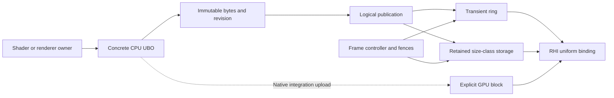

# Uniform buffer layouts and publication lifetimes

Uniform data has three distinct owners: a concrete UBO defines and packs the CPU layout, a logical
publication tracks its committed revision, and a renderer-owned allocator protects the physical GPU
range while commands may still use it. Capturing inputs freezes CPU data; execution allocates,
uploads and binds the required GPU version.

## Layout ownership

Every concrete `CpuUniformBuffer` implements the immutable `SizeBytes` property. The base constructor
accepts publication usage and allocates the declared extent. Fixed layouts return a class-owned size
constant. A variable-size subclass must initialize its size before the base constructor runs.

The concrete UBO also owns field packing, packing validation, exposed field offsets and array strides.
Renderers and shader wrappers pass named values or operations to its setters. Mixed control vectors
and operation/flag components are assembled inside the UBO; positions, directions and colors can
remain natural vector inputs. Capability checks and byte
inspection use owner constants or typed accessors instead of duplicating byte positions. Cached
native snapshots retain semantic values; UBO-owned encoders produce their material byte candidates.
Generated shader contracts supply resource bindings and reflected minimum extents;
matching byte counts alone do not establish that two layouts mean the same thing.

Typed setters and complete-block edits share write guards, byte-change detection and dirty revision
tracking. The bulk `SetBytes` operation is protected so only a UBO implementation can commit packed
bytes. Arbitrary-payload test fixtures expose their own explicit test-only API. Custom writable-span
or array edits inside a UBO must call `MarkDirty`. Packing and capture
remain CPU-only. Decode wire fields according to the declared layout rather than assuming a host
vector or other managed structure has the same representation.

See [runtime shader inputs](ShaderAuthoring.md#choose-runtime-inputs) for authoring rules and
[uniform interface validation](GPU.UniformContractValidation.md) for reflected extent checks.

## Ownership and publication



`CpuUniformBuffer` retains packed bytes, content revision and edit/capture guards. Its
`UniformPublication` owns the usage policy and last successfully committed physical version.
Named and prepared-slot binding paths share that publication authority.

`GpuProgram.OwnUniformBuffer` registers explicit ownership and attaches the shader's mutation and
terminal-lifetime guards. A binding source may borrow a block without owning it. The frame controller
coordinates allocator epochs and fences; allocation, range identity and retirement stay with the
storage owners. RHI performs resource binding through the backend state cache.

`Capture` retains immutable bytes and their revision. Later edits cannot alter an already captured
submission. Physical storage is selected when that snapshot executes.

## Usage policies

Usage is fixed for a logical buffer instance. It describes GPU reuse, not how frequently the CPU may
edit the buffer.

| Policy | Reuse rule |
| --- | --- |
| `SingleDraw` | Independent publication reserves a fresh transient range. Execution consumes the committed version; activation alone is not a draw. Scope restoration may conservatively reserve another range. |
| `SingleFrame` | Unchanged contents may reuse a committed range in the same open allocation epoch. This is the default policy. |
| `MultiFrame` | Unchanged contents retain a size-class storage version across frames until replacement or owner retirement. |

Shared camera/light snapshots, liquid inputs, surface-shadow/composition parameters and most compute
or debug inputs use `SingleFrame`. `LumOnWorldProbeResolveParamsUbo` uses `MultiFrame` for its retained
atlas dimensions. Each concrete type declares its policy; shader longevity does not determine it.

The native LumOn frame/world-probe and terrain chunk-slot paths use concrete CPU layout owners with
explicitly managed `GpuUniformBuffer` uploads and bindings. Their GPU resources follow their owning
integration's lifetime rather than the logical publication allocator.

## Storage and frame boundaries

The renderer's uniform frame controller owns the transient ring and retained storage. Allocations
respect native uniform-buffer alignment. Transient ranges remain immutable until their allocation
epoch retires. Retained pages group aligned slots by size; a new content version gets a separate
range while an older version may still be in flight.

Every `BeginFrame`, including a repeated frame index, opens a new epoch. If an earlier open epoch
contains writes, it is sealed before another page is reused. `EndFrame` closes publication until the
next begin. A transient page is recycled only after its fence completes; waits flush pending commands
and reject failed fences.

Retained storage has a bounded resident-byte budget. Exhaustion fails publication without overwriting
a live range. Released slots become reusable only after their latest recorded use completes, and a
completed fence does not release a still-owned current version. Retained pages remain resident for
reuse until allocator teardown. Their collection polls fences without blocking for capacity.

Both conventional uploads and persistent mapped storage use the same range ownership rules. Mapped
writes use coherent access or explicit flushing. Alignment, page sizing and resident budgets are
allocator policy, separate from the concrete UBO's layout size.

## Commit and failure behavior

A successful logical bind records latest use even when the backend suppresses a redundant native
bind. Scope restoration republishes through the same owner. Rebinding a retained version extends its
last-use protection.

```text
capture immutable bytes and revision
validate the prepared interface
prepare a reusable version or reserve and upload a candidate
if binding succeeds:
    commit the candidate and record its use
    clear pending edits only if the captured revision is still current
otherwise:
    abort the candidate
    preserve the previous committed version and pending CPU edits
```

An aborted transient reservation remains immutable until its epoch retires. Newly reserved retained
ownership is released through its allocator's retirement rules. Successfully published blocks stay
committed if a later block in the same submission fails; resource publication is not a transaction
across all blocks.

Prepared bindings reject undersized blocks before publication, including after shader reload.
Compatible slot changes may rebind the same version. A semantically different layout requires the
caller to supply correctly packed data even when its byte size happens to match.

## Disposal and context ownership

Disposing a `UniformPublication` is terminal for that publication and queues retained storage for safe
retirement. `CpuUniformBuffer.Dispose` resets its publication while preserving CPU bytes, allowing a
standalone block to capture a fresh logical publication later.

A shader's terminal disposal retires its explicitly registered blocks. Executable reload and disposal
of a borrowing shader do not transfer or release the owner's block. Attached shader guards still
prevent reuse after the owning shader's terminal disposal.

Allocators and physical ranges belong to their renderer/context lifetime. Dispose them while that
context is current, before teardown. Storage references cannot be retargeted to a replacement
allocator or context. See [shader ownership](GPU.ShaderDemandLoading.md#graphics-ownership) and
[pipeline boundary lifetime](Rendering.AuthoritativePipelineState.md#shader-ownership-and-boundary-lifetime).

## Diagnostics and validation

Debug diagnostics count allocation, copied bytes, logical binding and fence polling/waits. Resident
budgets, allocation epochs, pending retirement and completion serials remain functional bookkeeping
in every configuration. Counter reductions alone do not establish frame-time improvement.

Behavioral tests cover CPU mutation/capture guards, allocation and publication failure/retry, immutable
GPU ranges, shared and borrowed ownership, retained last-use retirement, and native upload paths.
Detailed commands, results and package/source identities are retained in the
[ownership verification capture](../artifacts/ubo-ownership/20261114T022123Z-verification/verification-summary.json).
Its separate cloud-traversal failure and retained-binary comparison are recorded there. Headless
correctness and package checks do not establish live appearance or performance acceptance.
