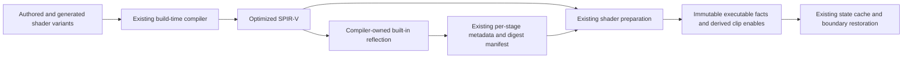
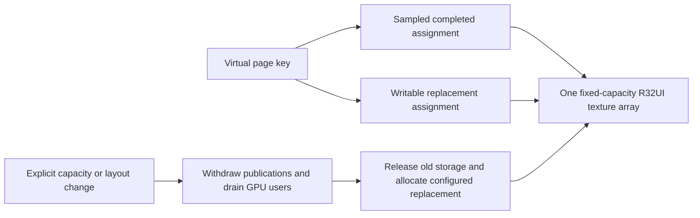
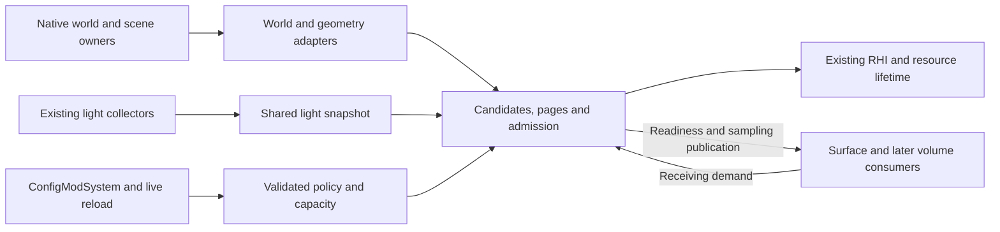

# Virtual shadow map implementation contracts

This is the implementation design for the [shared virtual shadow map proposal](Rendering.VirtualShadowMaps.Proposal.md).
It specifies interfaces and invariants. Native input publication and the bounded dependency primitives
described below, GPU candidate traversal, projection providers, page storage and shared sampling are implemented.
Native shadow rendering is qualified through controlled integration. The current-frame admission gate
is implemented for controlled integration; production lighting consumers remain disconnected.
The [implementation plan](Rendering.VirtualShadowMaps.todo)
controls delivery. Numerical profiles are provisional, not measured shipping defaults.
The [qualification protocol](Rendering.VirtualShadowMaps.Qualification.md) defines the evidence needed
before performance, completeness or appearance can be claimed.

## Custom clipping: decision history and current boundary

Custom shader clip distances now derive their enables from compiler metadata through existing pipeline
owners. The earlier exclusion was an explicit scope decision, not evidence that OpenGL 4.5 or the
shader compiler could not implement them. The decision history below preserves that rationale;
the current implementation is described separately. The [pipeline contract](Rendering.AuthoritativePipelineState.md) and
[engine state ownership contract](Rendering.EngineStateSwitching.md) continue to govern execution.

### Decision history

Historical paths below are relative to the repository at the named revision and can be inspected with
`git show <revision>:<path>`. Deleted planning documents are historical evidence, not current contracts.

| Revision (2026-10-06) | Evidence | What it establishes |
| --- | --- | --- |
| `f2d21f3229f0e968f7c8182fbfecf3f96159fee7` | `docs/Rendering.AuthoritativePipelineState.todo`, “Configurable clipping and compatibility raster state”; `VanillaGraphicsExpanded/Rendering/Pipeline/Descriptions/RasterizerDesc.cs` | Custom clipping was implemented with an authored `ClipDistances` mask, capability checks and state application/restoration. It was not merely forgotten in the original API. |
| `a1a322c79866f3cbccb83c18ab0a9982a9b1401b` | `VanillaGraphicsExpanded/Rendering/Spirv/CompiledClipDistance.cs`; the same historical TODO, “Prepared graphics pipelines and executable compatibility” | A handwritten SPIR-V parser supplied compiled output evidence for mask validation, including specialization-dependent extents and final vertex-producing stage selection. This was runtime machinery, subsequently removed. |
| `c552c4d6^` | `docs/Rendering.AuthoritativePipelineState.todo`, “Package shader interfaces and derive hardware clipping state” | A proposed correction would derive enablement from compiler-owned metadata instead of authored masks or a handwritten parser. Its unchecked tooling proof included optimized/unused built-ins, stripped binaries, specialization-dependent activity/extents and vertex/tessellation/geometry precedence. These requirements document the complexity under discussion; they do not prove that the correction shipped or that tooling could not meet it. |
| `c552c4d68f4953bc7197ef051c5505352622de9c` | `docs/Rendering.AuthoritativePipelineState.todo:574–620`, “Package and validate shader interfaces”; corresponding code diff | The recorded decision says the user removed custom shader clipping support, superseding shader-derived enablement, finite-domain and native dependency-analysis proposals. The completed task explicitly removes custom clipping “and its special-case complexity”: authored/prepared masks, reflection/parsing, specialization-domain tables, optimizer dependency and clipping-only fixtures. It retains ordinary numeric specialization, numeric interface packaging, engine-state restoration, clip-control conventions, frustum clipping and depth clamp. |

The supported explanation is deliberate feature removal to avoid the associated analysis/tooling
complexity. The history distinguishes the implemented authored-mask/parser route from the proposed
compiler-derived replacement. The removal checklist names both removed machinery and abandoned proposals;
it is not evidence that every proposed optimizer or finite-domain mechanism was previously implemented.
The original discussion's complete reasoning and any unrecorded experiments have not been recovered.

### Present enforcement and callers

Paths in this table describe current owners. Method names identify the relevant boundary without
depending on historical class locations.

| Boundary | Current behavior and source |
| --- | --- |
| Authored pipeline | [RasterizerDesc](../VanillaGraphicsExpanded/Rendering/Pipeline/Descriptions/RasterizerDesc.cs) has no custom clip mask. [PipelineFixedFunctionValidation.ValidateRaster](../VanillaGraphicsExpanded/Rendering/Pipeline/Descriptions/PipelineFixedFunctionValidation.cs) validates the native clip-limit representation, not a supported authored plane selection. |
| Managed draw application | [GraphicsStateRelevance](../VanillaGraphicsExpanded/Rendering/Pipeline/GraphicsStateRelevance.cs) retains the executable's derived clip count. [CompleteApplication](../VanillaGraphicsExpanded/Rendering/RHI/Backends/OpenGL/State/FixedFunction/OpenGlStateCache.CompleteApplication.cs) passes it to `ApplyPipelineRasterizer`, which sets every supported clip enable through the state cache. Clipping-to-none therefore disables previously enabled distances. |
| Engine boundary | [BoundaryRasterizer](../VanillaGraphicsExpanded/Rendering/RHI/Backends/OpenGL/State/Boundaries/OpenGlStateCache.BoundaryRasterizer.cs) captures/restores individual enables. [ExternalCapabilities](../VanillaGraphicsExpanded/Rendering/RHI/Backends/OpenGL/State/Observation/OpenGlStateCache.ExternalCapabilities.cs) tracks native changes; [RasterParameters](../VanillaGraphicsExpanded/Rendering/RHI/Backends/OpenGL/State/FixedFunction/OpenGlStateCache.RasterParameters.cs) retains the guarded per-index setter and knowledge bits. These mechanisms preserve engine state; they are not an authored VGE clipping API. |
| Compilation and metadata production | [ShaderInterfaceReflection](../ShaderBuildTool/Spirv/ShaderInterfaceReflection.cs) uses SPIRV-Cross built-in resource/type/activity queries for each selected entry point. Existing [ShaderInterfaceCache](../ShaderBuildTool/Spirv/Records/ShaderInterfaceCache.cs) and [ShaderInterfaceExtraction](../ShaderBuildTool/Spirv/ShaderInterfaceExtraction.cs) retain build ownership and exact binary association. |
| Packaging and runtime preparation | [PackagedShaderInterface](../VanillaGraphicsExpanded/Rendering/Spirv/PackagedShaderInterface.cs) includes separate input/output activity and extent facts. [PackagedInterfaceValidation](../VanillaGraphicsExpanded/Rendering/Spirv/PackagedInterfaceValidation.cs) checks schema/extractor/selection and exact binary association. [GraphicsClipDistances](../VanillaGraphicsExpanded/Rendering/Spirv/GraphicsClipDistances.cs) validates linkage and device limits, then records final VS/TES/GS enablement in the executable interface, including driver-cache installations. |

Reflection rejects unresolved clip extents, malformed built-in shapes and combined active clip/cull
interfaces without a supported combined-limit contract. Generic rejection remains for unsupported
execution modes, user interface blocks without member handling, missing numeric locations and
unsupported numeric shapes. Runtime preparation rejects absent clipping facts rather than silently
treating them as inactive. The retained source-only RHI route does not acquire custom clipping support.
The [incremental build contract](ShaderBuild.Incremental.md) still governs metadata/cache/publication
identity; clipping support does not bypass that owner.

### Mechanisms that must not be conflated

| Mechanism | Meaning and relationship to the exclusion |
| --- | --- |
| Custom shader clip distances | Shader-written `gl_ClipDistance[]` values define additional clipping half-spaces, with compiler-derived native enables. Correct output evidence must account for the final vertex-producing stage and its declared/written distances. |
| Homogeneous frustum clipping | Normal clipping of projected `gl_Position` against the view volume remains part of rasterization. Disabling user clip-distance enables does not disable it. |
| Clip control | `RasterizerDesc.ClipOrigin` and `ClipDepth` select coordinate conventions. They do not supply additional planes and remain supported. |
| Depth clamp | `RasterizerDesc.DepthClamp` controls depth clamping in place of near/far depth clipping. It is separately applied by `ApplyPipelineRasterizer`; it does not supply a custom page rectangle. |
| Scissor | `RasterizerDesc.Scissor` enables a window-coordinate rectangle; [DynamicPipelineState.Scissor](../VanillaGraphicsExpanded/Rendering/Pipeline/Descriptions/DynamicPipelineState.cs) declares the draw-supplied value and [RHIDynamicState.Scissor](../VanillaGraphicsExpanded/Rendering/RHI/Descriptions/RHIDynamicState.cs) carries it. This is a separate raster restriction, not shader-defined planes or evidence of viewport-array support. |
| Fragment rejection | Material cutout/discard and page-renderability checks reject shader work or writes at fragment processing. They do not enable primitive clipping. The approved atomic shadow path still requires exact page authorization and material rejection before writes; a rectangular clipping boundary would not identify sparse holes or protected retained tiles. |

### Reasons that remain applicable and unresolved questions

The evidence separates the reasons for removal from constraints any support reassessment must respect:

- **Intentional scope and tooling complexity — explicit decision.** The removal record is direct
  evidence. It does not establish that custom clipping was intrinsically too expensive to render.
- **Interface/architectural constraints — documented historical requirements, still relevant.** The
  proposed correction required compiler-derived facts associated with exact optimized binaries, correct
  final-stage/specialization interpretation, no guessed output coverage and no handwritten replacement
  parser. The new built-in metadata supplies activity/extent facts separately from numeric interface
  reflection; complete-path output and native execution remain verification obligations.
- **Engine state ownership — enduring implementation constraint.** Managed draws must not inherit the
  engine's enabled distances, and boundaries must preserve the engine's state through existing owners.
  Preservation was retained when support was removed; it is not evidence that ownership makes support
  impossible.
- **Compiler/backend limitations and portability — not established as the removal's cause.** The prior
  plan required tooling proof and a decision for unsupported cases. Available evidence does not prove
  an unavoidable compiler/SPIRV-Cross limitation or an OpenGL 4.5 prohibition. Current omission and
  explicit disabling alone establish neither support feasibility nor infeasibility.
- **Measured performance — no causal evidence located.** Historical numeric packaging/build receipts
  do not measure a clipping-versus-no-clipping VSM workload. No GPU/frame-time benefit, regression or
  suitability for carried lights is inferred from this source investigation.

The reassessment below records the subsequently approved metadata direction and its qualification
requirements. Historical offline probe receipts establish only their named boundaries.

## Compiler-derived clipping support assessment

**Decision, 2026-11-10:** the user approved reflecting clip-distance usage from compiled SPIR-V and
packaging the result in the existing shader metadata. Production shaders remain precompiled SPIR-V.
This selects the metadata ownership approach; the decision alone was not runtime qualification.
The existing per-stage interface payload inside `spirv-digests.json` is the appropriate location, beside
other compiler-derived interface facts. Clip distances are built-ins, not ordinary uniform locations or
resource bindings. Do not introduce a second manifest, authored enable mask, runtime GLSL compilation,
runtime SPIR-V instruction parser or a separate reflection registry.

### Recommended contract and evidence

Use compiler-owned reflection for the selected entry point and stage. Retain built-in input/output
activity and concrete array shape separately: a declared array alone is not proof of use. Derive a
contiguous enable set from the final vertex-producing stage (geometry, otherwise tessellation evaluation,
otherwise vertex). A proven inactive output enables no distances; unavailable or incompatible metadata
must not be interpreted as proven inactivity. Preserve exact binary, entry-point, structural-selection,
configuration and extractor association through preparation, including driver-program-cache loads.

The replacement payload uses interface schema 3 and extractor identity
`spirv-cross-2.23.0;interface-v3`. Each stage records separate clip input and output facts:
an activity Boolean and declared literal extent, with zero extent meaning no declaration.
Missing facts are invalid metadata, not inactive outputs. An active array must have a positive
supported literal extent. Compiler extraction rejects unresolved or malformed array shapes;
an inactive declaration retains its shape without enabling clipping. Existing interface-cache
identity and complete-generation publication own invalidation and deployment of this payload.

For the initial VSM shaders, recommend four literal-sized outputs, all written after final material
deformation and projection. Plane values vary with the view's uncached-page rectangle; the array size
does not vary with light motion. The metadata mechanism should represent supported literal extents
generally, rather than hard-code four into shared pipeline state. Keep ordinary numeric specializations
unrestricted. Do not add a general specialization-expression solver: require a resolved clip interface
for a clip-capable variant, and use structural variants when the interface changes. An unsupported
extent must fail explicitly. Reflection activity does not prove defined writes on every control-flow
path; generated shader construction and native execution fixtures must establish that separately.



A delegated offline probe used pinned `dotnet-shaderc 1.2.2` with target `opengl4.5`, optimization `-O`,
and Debug `-g` versus stripped Release, then `Silk.NET.SPIRV.Cross 2.23.0` reflection. All five fixtures
compiled and were inspected in both configurations. `CompilerUpdateActiveBuiltins` /
`CompilerHasActiveBuiltin` plus built-in `ValueTypeId` array queries produced these observations:

| Fixture | Active clip output | Literal extent |
| --- | --- | --- |
| Four-distance vertex writer | Yes | 4 |
| Declared but unused vertex output | No | 4 |
| Vertex shader without explicit clip output | No | 1 implicit declaration |
| Four-distance tessellation-evaluation writer | Yes | 4 |
| Four-distance geometry writer | Yes | 4 |

Receipts, exact commands, source/binary hashes and logs are under
[clipping-support-probe](../artifacts/virtual-shadow-maps/clipping-support-probe/), particularly
`environment.json`, `compile-receipts.json`, `reflection-receipts.json` and `probe-build-receipt.json`.
The harness built with zero warnings/errors. These are observed standalone compiler/reflection results,
not a production metadata integration test. The tessellation/geometry fixtures recompute outputs and do
not exercise active input propagation. Stage linking, specialization-dependent interfaces, complete-path
writes, native GL execution, images and performance remain unqualified. No new compiler dependency was
needed for this probe.

The [GLSL 4.50 specification, section 7.1](https://registry.khronos.org/OpenGL/specs/gl/GLSLangSpec.4.50.pdf)
defines clip-distance arrays and the obligation to write enabled values. The
[OpenGL 4.5 specification, section 13.5](https://registry.khronos.org/OpenGL/specs/gl/glspec45.core.pdf)
provides user clipping in the baseline API. Four distances fit the minimum supported clip-distance count;
actual stage interface capacity and driver link validation still matter. This establishes API availability,
not qualification of the complete production shader route.

### Cross-system work and unchanged owners

Paths below are relative to `VanillaGraphicsExpanded/` unless they start with a sibling project name.
The dependency order is metadata production, validated executable facts, pipeline application, then
material-compatible shadow integration. Do not publish partial support between those owners.

| Owner and inspected files | Required work or retained responsibility | Verification obligation |
| --- | --- | --- |
| `ShaderBuildTool/Spirv/ShaderInterfaceReflection.cs`, `ShaderInterfaceExtraction.cs`; `Rendering/Spirv/PackagedShaderInterface.cs` | Extend existing per-stage metadata with built-in activity and shape. Select the entry point before querying built-ins; retain input/output distinction. No manual instruction decoding or uniform-location substitution. | Fixed extents, unused/implicit declarations, missing facts, unsupported extents, all relevant stages, optimized/no-name artifacts. |
| `ShaderBuildTool/Spirv/Records/ShaderInterfaceCache.cs`, `ShaderVariantRecord` owners, `Identity/ShaderBuildIdentities.cs`, publication owners; `Rendering/Spirv/ShaderBinaryDigest.cs`, `PackagedInterfaceValidation.cs` | Version the changed payload/extractor, invalidate stale reflection/cache receipts, reject old or malformed clip facts and bind them to exact binaries. Reuse current complete-generation publication, repair and failure preservation. No second cache or manifest. | Cold/incremental/cache-hit outputs, corrupt or mismatched metadata, variant removal, failed publication, Debug/Release and package identity. |
| `Rendering/ProgramBinaries/PreparedProgramBinary.cs`; `Rendering/ShaderCompilation/ShaderExecutableInputs.cs`; `Rendering/RHI/Shaders/RHIShaderStageDescription.cs`, `RHIShaderDescription.cs` | Carry validated compiler facts into immutable executable preparation. Current `CreateStage` passes bytes/entry point/specializations without the packaged interface: this handoff must be extended coherently. Distinguish validated inactivity from absent metadata on lower-level raw inputs. | Wrong binary/stage/entry point/selection, missing metadata, driver-cache loading, failed and superseded candidate publication. A raw source path does not gain clipping support by guessing a count. |
| `Rendering/RHI/Backends/OpenGL/Shaders/OpenGLBackend.ShaderCreation.cs`; `Rendering/Spirv/GraphicsExecutableInterface.cs`; `Rendering/Pipeline/GraphicsInterfaceValidation.cs` | Compose final producer facts after successful executable creation. Validate supported stage interfaces and device limits without treating numeric input/output reflection as built-in reflection. Keep source and program-cache installation behavior consistent. | Vertex-only, VS/TCS/TES, VS/GS and tessellation-plus-GS producer precedence; producer/consumer mismatches; inactive final output despite an earlier-stage output; native link failures. |
| `Rendering/RHI/Backends/OpenGL/Pipelines/OpenGLBackend.GraphicsPipelineCreation.cs`, `OpenGLGraphicsPipelineRealization.cs`; `Rendering/Pipeline/GraphicsStateRelevance.cs` | Store the derived enables in prepared realization data. Existing `RHIGraphicsPipelineDescription` equality/hash already retains exact shader identity; avoid a second independently authored mask. Retain the shader generation through immediate and recorded submissions. | Equal/different generation identity, recorded work across reload/disposal, context retirement, relevant versus discarded raster state. |
| `Rendering/RHI/Backends/OpenGL/State/FixedFunction/OpenGlStateCache.PipelineRasterizer.cs`, `CompleteApplication.cs`, `RasterParameters.cs`; boundary and observation owners | Replace unconditional relevant clip disabling with the prepared selection. Use existing per-index setters, admission, suppression, knowledge and restoration; disable previous enables when switching to a non-clipping executable. | A-to-B-to-A and clipping-to-none, warm suppression, external engine enables, failure cleanup and exact restoration. |
| `Rendering/GraphicsCapabilities.cs`, `GpuSupport.Graphics.cs` | Reuse `MaxClipDistances`. Account for added varying components and combined clip/cull limits if such a combination is admitted; initially VSM does not require cull distances. Add only missing preparation-time capability facts actually needed; no per-draw discovery. | Native limits, over-limit rejection and baseline feature constraints; driver linking remains authoritative for executable capacity. |
| `SourceCodeMutator/GlStageIoNode.cs`, `GlInterfaceBlockHeaderNode.cs`, `GlslSchema.cs`; `ShaderBuildTool/Spirv/ShaderSourceLayout.cs`; `PBR/Tessellation/TerrainTessellationStages.cs`; draft `Rendering/Shadows/Geometry/ShadowLayerStages.cs` | Reconcile source generation with built-in arrays/blocks: current material-output copying rejects arrays and output blocks, so blindly inserting clip declarations before that copying is unsafe. Generate or preserve built-ins separately, then precompile supported shadow variants through the existing build/catalog owners. Replace the obsolete layer-routing generator together with its consumers. | Final deformation/displacement before distances, correct declarations through participating stages, all four writes before every geometry emission, opaque/cutout/material variants, diagnostics for unsupported native source combinations. |
| `ShaderBuildCatalog`, `ShaderBuildModel`, generated binding contracts; `Rendering/Shaders/GpuProgram.Spirv.cs`; asset copy and Cake packaging | Declare supported shadow structural variants and bind view/rectangle data through existing contracts. Clip metadata itself needs no separate uniform binding or pool attribute. Publish matching SPIR-V and metadata through existing deployment owners. | Build all supported native-material variants; runtime selects packaged artifacts; missing variants fail visibly. Packaged production path must not silently generate/compile GLSL. |

Existing `RHIShader` retirement, shader-generation references, command recording, native enable observation,
boundary capture/restore, resource binding and uniform publication mechanisms can be retained. Their
contracts need regression coverage, not parallel replacements. The clip enable does not change per
page or per light when the same four-output shader is used; rectangle values belong to view data.
Mesh-pool traversal, chunk identity and geometry ownership need no new registry, enumeration or hooks
for this feature. Shader binding declarations remain authoritative for resources; built-in reflection
does not replace them.

For tessellation, the evaluation shader is the final producer unless a geometry shader follows it.
The control stage only needs clip-value propagation when the selected next stage consumes those values;
recomputing distances after displacement avoids relying on pre-displacement distances. Where stages
consume built-ins, declare matching interfaces and verify linking. A geometry shader must write the
selected values for each emitted vertex. Do not add a geometry stage merely to obtain clip support.

### Raster restriction, batching and work bounds

Use four homogeneous clip distances around the uncached-page rectangle and a separate
per-fragment renderability check before atomic writes. These mechanisms have distinct responsibilities:
rectangle clipping limits raster work; exact page assignment/renderability and material rejection
authorize writes. A rectangle can contain cached or retained tiles and sparse holes.

| Restriction | Batching and likely work bound | Assessment |
| --- | --- | --- |
| Four shader clip distances | Rectangle values can differ by view within compatible batches; clipping removes regions outside each rectangle before ordinary fragment processing. Work inside a large sparse bounding rectangle remains. | Recommended with compiler-derived metadata. Adds four output components and stage/state validation; no measured speedup is claimed. |
| Scissor grouped by view/rectangle | Existing scissor state gives one window rectangle per compatible submission; different rectangles require separate groups or additional indexed-state support. Native indirect commands can still batch within each group. | Viable comparison, not selected as a silent substitute. Group count grows with lights/faces/regions, not necessarily with individual pages. |
| Fragment rectangle/page rejection only | Preserves broad batching, but primitives can generate fragments across their full projected raster footprint before rejection. Correct guarded writes alone do not bound that cost well for moving lights. | Useful correctness/reference mode; insufficient evidence to choose as the primary performance design. |
| Cropped projection/viewport | Ordinary frustum clipping can restrict a region, but texel density, virtual-coordinate reconstruction and viewport dimensions must agree; differing regions can split batches. | Requires its own mapping/coverage proof; not equivalent to toggling depth clamp. |

All options require bounded view/command/raster admission. Clamp nothing silently: virtual raster
dimensions must fit effective viewport/framebuffer limits, or use explicitly mapped bounded regions
whose union preserves required coverage. Charge repeated geometry work when splitting regions. Sparse
rectangles can still be costly with clip distances; the scheduler must estimate/admit that work and
fall back through the approved detail/availability policy. Carried point lights, all six faces, simultaneous
moving sun/moon and dense/sparse demands belong in qualification. These are analytical bounds and risks,
not measured timings.

### Scope estimate, qualifications and remaining constraints

This is a medium-sized cross-system change, not a single rasterizer field: one metadata/schema/cache
work package, one immutable preparation/validation package and one state-application package must be
completed together. Native material source generation and precompiled variant coverage are the larger
integration uncertainty. They must be resolved before native shadow draws are claimed complete. No new
top-level delivery phase is required; the implementation plan assigns foundations and controlled fixtures
before actual native integration. No elapsed-time estimate is supported by this investigation.

Recommended verification extends existing `ShaderInterfaceReflectionTests`, `PackagedInterfaceValidationTests`,
`RHIShaderCreationTests`, `PreparedGraphicsPipelineTests`, `ConfigurableRasterizerGpuTests`,
`DriverProgramCacheTests`, `SpirvGraphicsLifecycleTests` and `RHICommandListTests`, plus generated terrain
stage and shadow raster fixtures. Test metadata, linkage, state restoration and actual clipped atomic
images as separate boundaries. Preserve protected tiles and cube-face/near-plane coverage; compare
scissor and clipping only on matched workloads. Use the canonical build, strict content verification,
package and native acceptance routes in the [qualification protocol](Rendering.VirtualShadowMaps.Qualification.md).
The offline probe does not replace any of those production checks.

The system's established baseline is OpenGL 4.5 plus `GL_ARB_gl_spirv`, or core SPIR-V ingestion support.
The user reaffirmed this existing requirement on 2026-11-10. The packaged route in `ShaderExecutableInputs`
supplies SPIR-V, and `OpenGLBackend.ShaderCreation.BeginShaderCandidate` already requires
`SupportsArbGlSpirv` when installing those stages. Clipping adds no new shader-loading route or platform
requirement. Earlier VSM wording describing unextended 4.5 was incorrect. Production qualification uses
packaged SPIR-V; historical GLSL fixture receipts demonstrate only their exercised fixture routes.

Other remaining proofs are active input propagation/linking, supported specialization behavior,
complete-path writes, exact native-material variant coverage, clipping numerics at view/face boundaries,
and dynamic-workload cost. They are explicit implementation/qualification dependencies. The assessment
selects a feasible reflection direction for the inspected fixed-output cases; it does not claim those
remaining proofs already exist.

## Implemented input boundaries

`VgeLightsRenderer` freezes source keys with the existing illumination payload after held attachment
resolution. `NativeShadowLightSources` records the actual entity/hand or registered `IPointLight` at
admission, and retains the collection's world-to-view matrix, dimension and integer-origin inputs.
Movement and list ordering do not define identity. Weak owner lifetimes, hand replacement tracking,
provider removal and world reset prevent reuse by replacement sources. Authored `PunctualLight.Source`
supplies equivalent identity. Block-entity providers additionally retain integer block position.
Unknown keys or unavailable collection coordinates leave illumination intact without cached-shadow input.
Independent solar/lunar direction and irradiance are retained from the coherent atmosphere publication;
existing lighting consumers still use their current direct-light selection until consumer migration.

`NativeShadowWorldAdapter` bootstraps under `ClientWorldMap.chunksLock`, then drains bounded native
dictionary-coordinate notifications. Load/replacement and unload interception observes writes in the
native owning methods. The existing `ChunkDirty` event and native dirty-queue boundary mark content
pending. Native chunk upload/removal hooks withdraw old certificates before range changes; no mesh-pool
method is patched or classified. Tessellation carries its pre-read center/edge content revisions through
native queue merging to upload. Required and uploaded revisions remain separate after success, so a late
older upload cannot restore stale readiness. Edge-only work does not falsely replace the center's revision.
A later edit, unknown queued-work stamp, missing range or exception cannot certify a current replacement.
`Capture` retains the entire loaded envelope per dimension, including offscreen chunks, or returns
incomplete on capacity/probe exhaustion. `TryUse` rechecks the frozen publication under the mutation
gate before a consumer submits work. Native ranges are descriptions, not owned geometry or a drawing API.
The terrain adapter must additionally acquire the existing RHI borrowed-storage certificates before draws.

Lookup completeness is distinct from per-chunk drawable readiness. Missing coordinates inside the
envelope, pending content and missing geometry remain unknown. Cached Empty and connectivity values
are published as advisory metadata. Proven-fresh bits remain clear; the native asynchronous connectivity
freshness claim is retained separately for diagnostics. This implementation does not certify voxel
emptiness, solid classification or connectivity-based pruning. Bounds-only candidate traversal remains
the required route until those proofs are available.

The packed lookup uses 64-byte std430 records and bounded linear probing with an explicit unsigned hash.
Native indices, lifetimes and revisions use low/high 32-bit words; coordinates remain signed integers.
Native range descriptions are 32 bytes. CPU and GPU retain absolute chunk identity; bounded relative
conversion rejects integer overflow. `ShadowWorldGpuBuffers` uploads only changed complete publications
through RHI-owned SSBOs. Adapter owner identity scopes generations across reconnect/reconfiguration;
invalid inputs withdraw the upload certificate. Candidate traversal borrows this exact upload certificate.

`ShadowSceneChanges` bounds non-terrain history, retains previous/current bounds and relevant revisions,
and advances a broad invalidation epoch before dropping unknown or exhausted history. Pending changes
prohibit certification. `ShadowReceivingCoverage` checks depth-inclusive bounds and applied dependency
watermarks independently of page identity. Native entity preparation advances the broad change epoch
when deformed bounds are unknown; terrain drawing retains the native moving-chunk transform and
rechecks it before submission. Production frame scheduling remains a separate integration boundary.

The native input JSON configuration is `VirtualShadows.Inputs`: `ChunkCapacity` (65536),
`RangeCapacity` (524288), `ChangeCapacity` (8192), and `ProbeLimit` (128). These are provisional finite
input allowances, not the total shadow budget or shadow enablement. The existing `ConfigModSystem`
materializes/sanitizes them; reload withdraws the frozen publication while preserving pending edits,
failed uploads and queued tessellation stamps. Retained work drains when a smaller allowance is applied;
new work cannot silently discard its history. A genuine native map reset or world exit ends that history.
GPU resources are lazy. Candidate, page, temporal and drawing settings are described in their respective
sections below; their finite defaults remain tuning hypotheses rather than measured performance guarantees.

## GPU chunk occlusion candidates

`ShadowCandidateRequest` anchors a receiver box and either a complete directional cap or point-source
movement box. All candidate bounds use chunk-grid units; native world envelopes are converted from
block units and must match in full. Integer domain origins preserve absolute XYZ/dimension identities.
Relative extents beyond the supported arithmetic range are rejected, never shortened. Directional cap
component extrema are analytic, including interior poles; a fixed-sign axis or up to six overlapping
signed dominant-axis sectors supplies conservative slope bounds. Point requests do not impose another
attenuation radius. Current demand remains responsible for using the lighting radius convention.

`shadows/candidates.csh` executes the proposed whole-slab interval products and finite segment inequalities
in double precision on the OpenGL 4.5 baseline. Closed boundary coverage includes both touching cells.
The existing packaged-SPIR-V compute loader owns this shader together with page allocation, tile clear
and sampling. The canonical offline catalog compiles its generated contracts and packages matching
interface metadata. Shadow owners use `ComputeShaderAsset.TryCreateFromAssets`, including the normal
reload and cache path. There is no shadow-specific runtime GLSL factory or fallback.
Arithmetic bounds expand outwards: local inputs are limited to 2^21 chunk units, domains to a 2^20
index span, and the short arithmetic chains use an absolute 1e-7 plus relative 1e-11 allowance in chunk
units. This intentionally admits boundary false positives. No mesh bounds, triangle inspection or
CPU candidate enumeration participates in production selection.

`ShadowCandidatePool` allocates a fixed number of headers, each owning a fixed span of 64-coordinate
segments and a bounded hash table. The entire layout, including unused, building and retiring spans,
counts against `AllocatedBytes`. Old and replacement associations occupy separate slots in this same
allocation. Retirement withdraws the handle and polls an RHI fence before slot reuse. Allocation checks
cached SSBO limits and the configured memory allowance; it never silently reduces the declared domain.
Native world buffers are borrowed input allocations and remain charged to their input owner. A later
shared scheduler must account both owners within the total shadow budget.

The generated binding contract declares six SSBOs: persistent per-slot inputs, 128-byte headers,
16-byte absolute coordinate entries, dedup storage, changed partitions and the current 64-byte native
lookup. Selection stays on GPU. Headers distinguish clearing, traversal, dependency validation,
complete spatial selection, capacity exhaustion and stale inputs; a complete spatial set with a nonzero
unresolved count cannot certify drawable coverage. Slab/cell/probe/change allowances are separate.
Hash clearing and partial collision probes are resumable work. Each batch permits at most one slice per
slot, conservatively reserves its work against aggregate ceilings, and preserves cursors across batches.

`BeginBatch` requires a contiguous, complete changed-partition interval and an exact current native
upload. Before use, `Advance` checks source lifetime, world owner, domain/influence generations, motion,
receiver containment and history epoch, then queues bounded GPU checks. Repeated intervals retain their
change cursor. Changed partitions are checked against conservative covered regions; native publication
changes trigger bounded lookup validation over the retained coordinates. Missing or pending cells remain
unresolved. Cached empty/connectivity metadata never removes coordinates; connectivity pruning is disabled.
The future frame coordinator supplies the contiguous interval before consumers and may not use an
association whose slice was not admitted or whose current GPU certificate is incomplete.

Candidate coverage ignores projection generation deliberately. A different light basis/position still
invalidates depth separately. `NeedsRefresh` and the GPU header's refresh flag expose the configured guard
for replacement scheduling; predictions never extend validity. Later admission/rendering integration owns
light selection, replacement scheduling and depth publication. Shader replacement requires a fresh pool.

The accepted `VirtualShadows.Candidates` controls are provisional: `MemoryMiB` 16, `HeaderCapacity` 32,
`SegmentsPerAssociation` 64, `DedupCapacity` 8192, `ProbeLimit` 128 and `ChangeCapacity` 8192. Slice ceilings
are 64 slabs, 4096 cells, 32768 probes and 256 changed partitions; corresponding whole-batch ceilings are
1024, 65536, 524288 and 8192. `RefreshGuardFraction` defaults to 0.25. Invalid fields sanitize to finite
defaults; incompatible aggregate memory/hardware layouts reject allocation. Pools freeze the policy at
creation; live rendering reconfiguration and the total resource budget belong to the later coordinator.

## Projections, physical pages and sampling

### Replacement storage contract

The physical pool uses one R32UI two-dimensional texture array. `TileColumns` and `TileRows`
(initially 16 each), `ArrayLayers` (initially four) and `PageSize` (initially 128) define the
requested layout. Allocate the full validated capacity at creation: width and height are the page
extent times the corresponding tile count, and capacity is tile columns times tile rows times
array layers. These integer settings describe whole tiles and layers, so no partial-layer rounding
or hidden capacity growth applies. Reject layouts exceeding texture dimensions, array-layer limits,
bounded table indices or the memory allowance. Charge all allocated texels, metadata and in-flight
retirement, including unoccupied tiles. One array sampler and one array image replace bank dispatch;
validate their availability in every participating consumer before allocation.

Page-table words 17, 18 and 19 hold explicit array layer, tile X and tile Y respectively. Assignment
generations still identify ownership. Sampling reads those fields rather than treating a hash-table
slot as a texture-array layer. Writable replacement and sampled completed entries remain distinct.
Each physical tile is uniquely owned within the bounded allocator; a retired tile cannot be reused
until its scheduled GPU users finish. A whole-layer clear cannot initialize individual replacements.



Both assignment paths address a layer and tile in the same allocation. A replacement uses a distinct
tile while the old completed result remains eligible; publication switches only after complete drawing.

Store finite conventional depth in [0,1] as unsigned IEEE-754 float bits, canonicalizing negative
zero to positive zero. Unsigned atomic minimum selects the nearest depth; `0x3f800000` (1.0) is
empty/clear depth. Fetch integer texels and decode before explicit comparison. Reject nonfinite,
out-of-range and invalid-address writes before atomics. The encoding introduces no quantization
beyond the existing float depth representation and requires no floating-point atomic extension.

Selective compute clearing and graphics atomic writes use the existing RHI image bindings and
barriers. Only admitted replacement assignments are writable; resident completed or retained tiles
are protected even inside a view's raster rectangle. Complete publication still requires all
geometry, material rejection, depth-inclusive coverage and source/assignment checks. Atomicity
does not certify that drawing completed.

`DirectionalShadowProjection` owns one sun or moon basis, a depth interval fitted to all eight
represented-domain corners and levels whose world texel widths double. Page keys use absolute light-space
XY; snapping the camera's clipmap center changes selected pages without changing matching mappings.
`Update` retains an unchanged mapping and advances projection generation for basis/depth changes.
`PointShadowProjection` uses fixed +X, -X, +Y, -Y, +Z, -Z faces with deterministic X/Y/Z tie ownership.
Position, near/far or face-resolution changes advance its generation. Both providers expose page-local
normalized-device coordinates and retain double precision until bounded page/local-texel conversion.
Sampling inputs split positions into signed integer 32-block chunk origins and relative double coordinates;
origins outside the native signed coordinate range are rejected before packing.
Out-of-range coordinates fail instead of wrapping. Source keys retain world, dimension and lifetime.

Depth is conventional near=0/far=1, empty=1, with explicit less-or-equal comparisons. Point near distance
is a positive configurable value (initially 0.05 metres); the far distance is supplied from represented
influence, preserving the lighting radius convention. Directional depth includes configurable padding
around represented caster coverage. Bias shifts the receiver along its unit normal and subtracts a
bounded texel-scaled depth adjustment, including slope. Each adjustment is capped at four texels.
Native shadow variants retain two-sided/cutout material behavior; front-face culling is not a substitute
for receiver bias. Packaged raster fixtures exercise material rejection and near-source crossings.
Installed-game appearance and workload qualification remain separate from those headless checks.
Four compiler-derived clip outputs restrict each view's uncached rectangle after final deformation.
The final VS or TES owns these outputs; no geometry stage is added solely for clipping.

`ShadowPagePool` allocates metadata and the entire configured texture array together, with one
level, nearest sampling and no gutters or multisampling. Demand allocates, evicts and reuses page
assignments inside that fixed resource; it never grows or shrinks storage. Actual fragment/compute
image and sampler limits and supplied consumer slots are checked before allocation; lighting
integrations must recheck their real binding availability. Failed allocation leaves the pool unavailable
and releases partially constructed resources rather than publishing reduced or incomplete storage.

The GPU table has fixed 512-byte slots plus a separate 16-byte writable token per slot. State distinguishes free, building, ready and retired assignments;
these bounded slot sets also serve as the free and retirement queues. Full source/projection/face/page
identity is checked after bounded hash probing. Exhaustion reports failure; no hash-only equality or
CPU selection readback exists. A pool incarnation plus monotonic assignment counter prevents reuse of
old completion tokens; counter exhaustion rejects allocation. Unreferenced entries can be withdrawn
before required entries, but their tiles remain unavailable until the submitted batch fence signals.
All page users submit inside `BeginBatch`/`SealBatch`; fence polling never waits for GPU completion.

Rendered coverage occupies a separate depth-inclusive enclosure with world/scene epoch/sequence stamps.
`Require` accumulates the current required enclosure independently of the rendered certificate. An
allocation cannot enlarge that certificate. A complete replacement must cover the current enclosure,
including any additional requests that arrived while it was building, and publish the exact allocated
region/dependencies/assignment after complete drawing. Old depths retain only their old region until
replacement publication. Enclosing multiple regions requires complete caster selection for that enclosure.
`CancelReplacement` retires only the exact unfinished assignment, allowing a larger replacement after safe
retirement while the old certificate continues to cover its original region. Stale cancellation tokens fail.
One fixed enclosure and bounded probes keep metadata and containment work finite. The actual admission
owner must supply complete current requirements before eviction/allocation and a truthful draw-completion
certificate. Native submission supplies the complete-drawing boundary; the production demand coordinator
must still establish current consumer requirements before invoking it.

Explicit capacity/layout configuration changes use `Reconfigure`, which withdraws all publications and
drains the old allocation before creating the replacement, preventing two full pools. There is no
incremental growth or bank shrink interface. `Withdraw` handles disable/world leave and cancels pending
recreation; source/dimension retirement is a GPU operation. Allocation failure keeps publications
unavailable. Report the old allocation's bytes until its fences drain. The existing client
rendering lifetime's publication callback withdraws the pool synchronously on shader reload; context
retirement closes the owner through the existing RHI lifetime. Physical
pages do not own or retain engine geometry. The coordinator must continue polling a withdrawn owner until
its tracked allocations drain. Terminal disposal uses the existing RHI resource retirement boundary.

The shared `includes/shadows/sampling.glsl` resolves all nine filter taps through virtual addressing and
coverage/dependency lookup, then performs point-fetched comparisons through one integer array sampler.
Cube-edge taps reconstruct the ray and evaluate conventional depth in the destination face on the biased
receiver's radial shell. Directional levels use the same world receiver with their own texel width; there
is no depth averaging or implicit fallback level. The same tap resolver is available to demand producers.
The compute entry returns all nine page addresses plus visibility, a diagnosed invalid-tap mask and a
separate permitted-stale tap mask. A query is current only when every tap is current; permitted stale
requires every tap to be eligible and at least one retained tap.
Any invalid tap returns unshadowed visibility for the query. Production per-light readiness, diagnostic
aggregation and overlays remain owned by the later frame/consumer integration.

Accepted `VirtualShadows.Pages` controls are provisional: `MemoryMiB` 128, `PageSize` 128,
`TileColumns` 16, `TileRows` 16, `ArrayLayers` 4, `ProbeLimit` 128 and `OperationsPerBatch` 256. Projection/bias
controls are `PointNear` 0.05, `DepthBiasTexels` 0.5, `NormalBiasTexels` 0.5 and `SlopeBiasTexels` 1.
Layer count is bounded by the validated hardware, table and memory limits, not a four-texture interface.
`ArrayLayers` accepts positive integers up to 8,192 before effective validation; the total table also
has an 8,192-page ceiling, and actual hardware and memory limits may be lower. Invalid numeric fields
sanitize to defaults; an unsupported effective layout is rejected. Per-page storage is 512 bytes of
table data, 16 bytes of writable tokens and four bytes per depth texel, plus 608 fixed command/result
bytes per pool. Empty capacity costs the same allocated bytes as occupied capacity.
The pool validates depth plus metadata/command/result storage against its allowance, integer and hardware
limits; `AllocatedBytes` includes resident retirement storage. `ShadowSampler` separately reports its
800-byte query/output allocation. Candidate, input, sampler and command storage remain charged to
their owners and must all fit the eventual total budget. Driver overhead is outside these nominal counts.

### Retained projection and temporal eligibility

Each completed entry retains its canonical rendered projection, depth-inclusive coverage, rendered
timestamp and first invalidation timestamp. `Invalidate` marks a completed key; repeated invalidation
can shorten its deadline but cannot restart it. A dependency mismatch without a known invalidation
timestamp is unavailable. Source/world withdrawal, invalid ownership and resource retirement remain
hard failures, independent of temporal policy.

`ShadowSampleRequest` is constructed in the retained projection using the current receiver and filter
footprint. `WithTemporal` separately supplies the current light projection and clock. All demanded
coverage must fit the rendered certificate. Both age limits and motion tolerance must pass: point
motion uses Euclidean distance in metres; directional motion uses angular separation in degrees.
Current illumination is never reconstructed from the retained shadow projection.

`VirtualShadows.Temporal` persists `MaxRenderedAgeSeconds` 0.25, `MaxStaleAgeSeconds` 0.1,
`MaxPointTranslationMetres` 0.15 and `MaxDirectionalAngleDegrees` 0.25. These are initial engineering
defaults, not measured quality thresholds. Ages accept [0,10] seconds, point displacement [0,4] metres
and direction [0,10] degrees; all must be finite, and stale age cannot exceed rendered age. Zero for
either age limit selects strict current-only sampling. Runtime qualification must calibrate defaults
against carried-light and celestial motion workloads.

Replacement follows allocation, frozen writable mapping, selective clear, complete drawing, ordered
image visibility and publication. Publication requires the exact assignment and current batch token,
projection and coverage; a generated completion command cannot allocate or freeze a batch. Old sampled
tiles never enter the writable mapping. Insufficient replacement space leaves only independently
eligible retained depth or unavailable shadows.

### Compact views and bounded raster targets

`NativeShadowTerrainGeometry.WithViews` borrows native geometry through a private VAO and adds one
integer two-component selector at location 10, with an eight-byte instanced stride. Its components
identify the object and view; object instancing must be expanded by the native adapter without losing
its original instance identity. It does not modify native mesh-pool storage or attach page matrices.

`ShadowDrawView` describes one directional level or point face and a virtual texel rectangle, with a
contained uncached rectangle and an explicit world origin. Absolute virtual texels use 64-bit host
coordinates; packing splits them into a signed 32-bit page origin and a nonnegative within-page texel
offset. The complete region must fit the page-key range. Fragment addressing adds only small local
texels before resolving the absolute page, so a large valid world origin cannot overflow a 32-bit
absolute texel. Its sixteen RGBA32UI texels contain the projection, rectangles, source/view identity,
page origin and batch limits. `ShadowViewBuffer` freezes these records
for texture-buffer access and validates actual vertex/TES limits. A shared R8 attachment supplies the
existing RHI's raster-pass target; shadow depth remains in R32UI images. Each pass uses an origin-zero
viewport of the selected region. Records and attachment bytes stay charged until the batch fence
completes. No native framebuffer calls bypass RHI ownership.

Drawing controls include `ViewCapacity` 128, `ViewInstances` 32768 and aggregate `RasterPixels`
16777216. Regions exceeding viewport/texture or memory limits are rejected and require explicit
budgeted splitting. The eventual admission owner must charge every in-flight batch, command and
repeated geometry workload as well as these resources.

### Shader generation and variant provenance

`ShadowVirtualStages` replaces the layer-routing generator. Compact selection is inserted before
terrain material varyings are propagated. Final projection and the four clip writes are inserted
after VS or TES deformation has been assembled; built-in arrays are not copied as material varyings.
The final material body is called from a generated wrapper so its early returns cannot bypass final
clip writes. Fragment material discard occurs before page authorization and atomic depth. Existing
clip declarations other than the explicit four-plane output, cull declarations and redeclared final
`gl_PerVertex` output blocks are diagnosed rather than guessed or duplicated. A geometry-producing
material requires its own complete-emission variant.

Offline roots import ordinary GLSL interface declarations before their shared view/writing helpers.
Those declarations own clipping outputs, selectors and resources; generation only wraps the material
entry point. Shared helper observations, source bytes, generator/tool identity, structural selection, compiler options,
binary digest and schema/extractor facts remain part of ordinary build provenance and publication.
Missing packaged material variants fail visibly; no runtime GLSL fallback is authorized.

The deformation kernel receives an explicit input structure. Owned material bindings construct it
from VGE-named fields; the installed-game patch constructs it from native uniforms at that integration
boundary. Adaptive terrain authors its outputs directly, with native tessellation symbol translation
confined to the existing generator adapter.

| Structural family | Required final producer and material behavior | Integration boundary |
| --- | --- | --- |
| Ordinary terrain | VS with shared authored deformation and native cutout semantics | Borrow ordinary native inputs; select packaged terrain variant |
| Displaced ordinary terrain | VS/TCS/TES, final clipping after TES displacement | Generate material interfaces before built-ins; retain native tessellation policy |
| Shader-storage terrain, with/without displacement | Existing native layout with VS or TES final output | Preserve native addressing and supported material declarations; added projection access remains a texture buffer |
| Static and instanced objects | Final VS with original object/instance transform and opacity behavior | Preserve original instance identity while expanding object/view work |
| Animated objects | Final deformed VS, or explicitly supported final stage | Preserve pose/material revisions and offscreen preparation |

These families use authored packaged material executables and borrowed native input adapters.
Source dependencies remain inside the mod asset root. The shared authored deformation kernel
defines the conservative selection envelope and the matching visible-surface motion. Material raster fixtures complement the shared
`tests/shadow-virtual` view/fragment fixture and clipping-stage precedence checks. Source/linkage and
headless raster evidence do not qualify installed-game appearance or measured performance.

## Ownership and source layout

Keep shared storage, scheduling and validity independent of native scene classes and lighting consumers.
The names below are intended steady-state responsibilities, not placeholder files to create now.
Each named type gets its own file; directories provide context. No generic scene registry is needed.

| Location beneath `VanillaGraphicsExpanded/` | Responsibility and allowed dependencies |
| --- | --- |
| `Rendering/Shadows/Lights/ShadowLightSnapshot.cs`, `ShadowSourceKey.cs` | Immutable source identity, emission and influence contracts; no engine pool types |
| `Rendering/Shadows/World/ShadowWorldPublication.cs`, `ShadowChunkIdentity.cs` | Fixed chunk coordinates, availability and publication revisions; no mesh ownership |
| `Rendering/Shadows/Geometry/ShadowGeometryPublication.cs`, `ShadowSceneChanges.cs` | Borrowed range batches, material/transform revisions and bounded change streams |
| `Rendering/Shadows/Projections/DirectionalShadowProjection.cs`, `PointShadowProjection.cs` | Clipmaps and six faces, conservative coverage mapping and projected depth |
| `Rendering/Shadows/Candidates/ShadowCandidateHeader.cs`, `ShadowCandidateTraversal.cs` | GPU spatial associations, bounded continuation and pruning dependencies |
| `Rendering/Shadows/Pages/ShadowPageTable.cs`, `ShadowReceivingCoverage.cs`, `ShadowPagePool.cs` | Page lookup, certified receiving regions, allocation and retirement |
| `Rendering/Shadows/Scheduling/ShadowAdmission.cs`, `ShadowReadiness.cs` | Complete page admission, aggregate budgets, stable light selection and consumer readiness |
| `Rendering/Shadows/Configuration/ShadowSettings.cs`, `ShadowQualityProfile.cs`, `ShadowEffectiveCapacity.cs` | Persisted schema, finite policy data and validated effective limits |
| `Rendering/Shadows/ShadowFrameCoordinator.cs` | Thin frame orchestration over those responsibilities, RHI and existing resource lifecycle |
| `Rendering/Integration/Shadows/NativeShadowWorldAdapter.cs`, `NativeShadowTerrainAdapter.cs`, `NativeShadowEntityAdapter.cs` | Native world/geometry lifecycle translation, once-per-frame preparation; depend inward on shared contracts |
| Existing `Rendering/VgeLightsRenderer.cs`, `VgeLightsUniformBuffer.cs` and `PBR/HeldLighting/` owners | Collect and publish source keys alongside the existing illumination payload |
| `PBR/Shadows/SurfaceShadowDemand.cs`, `SurfaceShadowBindings.cs` | Surface demand and consumer bindings; depend on shared contracts, not native pool internals |
| `ModSystems/VirtualShadowModSystem.cs` | Config/lifetime composition only; implement existing live-reload boundary |
| `assets/vanillagraphicsexpanded/shaders/shadows/` and `shaders/includes/shadows/` | Separate candidate, expansion, clear, depth, readiness and shared lookup assets; existing shader catalog/contract generation owns compilation |

Fog will use the same demand/sampling contract through its owning lighting integration. Do not create
a fog renderer, alternate geometry owner, or production compatibility facade merely to reserve that seam.



Native `poolsByRenderPass[renderPass][atlas]` remains the category authority. A bounded batch visits
that table once to establish compatible groups; the adapter does not persist reverse membership,
copy meshes, scan each pool per page or mutate native culling arrays/statistics/VAOs.
Ranges from ordinary and shader-storage terrain require distinct decoding/binding support.
Existing liquid geometry borrowing is not a universal terrain adapter.

## Publication interfaces

These are semantic input/output contracts, independent of eventual C#/GLSL packing. CPU/GPU field
widths, alignment and capacities must be explicit in the generated binding contract when implemented.
All variable-length fields are bounded spans into charged storage, never unbounded per-page containers.
Every operation returns a completion state with a reason; an empty result and unfinished work differ.

| Interface | Required inputs and publication | Ownership and certification |
| --- | --- | --- |
| Light capture | Frame/world/dimension; source key and lifetime; source kind; current direction or position; calibrated emission payload; influence bound/revision | Existing collectors produce one frozen snapshot used by demand, depth and illumination. Preserve the 100-entry illumination contract independently of shadow admission. Unknown keys cannot own cached shadows. |
| World capture | Dimension-aware integer chunk XYZ/native index, chunk lifetime, availability, geometry revision, empty/connectivity values and freshness, complete loaded envelope and domain revision | One native publication adapter; safe bootstrap followed by deltas. Frozen render batch; pending changes prohibit certification. An input batch cannot shrink the declared domain. |
| Geometry capture | Terrain: chunk identity plus current native pool ID/range. Non-terrain: native scene owner/lifetime and its own draw inputs. Both carry storage/range generation, detail eligibility, material and transform/deformation revisions; bounded compatible groups | Borrowed geometry, with native ownership and a safe retirement interval. Exclude stale ranges before submission. Neither group membership nor geometry is owned by the candidate cache; entities are not forced into terrain chunk membership. |
| Projection provider | Source snapshot, requested detail, receiver bounds including filter/bias, represented domain | Immutable basis, face/level transforms, near/far depth convention, page coordinates and coverage mapping. Directional levels double texel width; point faces have fixed consistent axes. |
| Surface/volume demand | Consumer, frame/light snapshot, receiving world regions including depth, filter and bias footprints, requested detail | Current complete requests before the first participating consumer. All contributing transparent layers count. History can prioritize only. Late categories supply conservative early bounds. |
| Candidate build/resume | Receiver coverage, light key, full covered motion/influence, world domain, pruning dependencies, work allowance, continuation cursor | Header plus coordinate spans, unresolved cells and completion. GPU traversal, deduplication and publication; CPU never reads selections to decide geometry draws. |
| Scene change publication | Sequence, source lifetime, prior/current conservative bounds, geometry/pose/material/eligibility revisions; creation/removal flags | Existing scene adapters report all relevant changes, including new casters absent from previous draws. Bounds include deformation. Apply every change since cached publication. |
| Page lookup | Source/lifetime, projection generation, level/face and virtual XY; request receiving region | Mapping to layer/tile XY/assignment generation plus separately certified coverage and dependencies. Bounded probes; collision exhaustion cannot alias or silently drop entries. |
| Page admission | Complete candidates, current terrain/non-terrain inputs, union of currently required receiving regions, remaining aggregate limits | Admit only complete updates before clearing. Count every preparation/expansion pass and repeated geometry cost. Unfinished selection produces no publishable page. |
| Readiness publication | Complete current demand and valid covering page results for one light/consumer/frame | All surface paths share one result for that interval; sun and moon independent. Fog has separate readiness and cannot displace an admitted surface result. |
| Shared sampling | Same light/readiness snapshot, world receiving position and bounded bias/filter parameters | Visibility in [0,1] attenuates only that light's direct term. Explicit virtual lookup for each tap; unexpected failure returns 1 and records a per-light failure. This guard does not satisfy the readiness contract. |

Stable keys comprise world session, dimension, source kind, native owner lifetime and emission slot.
Sun and moon have distinct fixed slots in that world/dimension. Entity and player IDs need lifetime
generations; player hand distinguishes held slots. Block keys include integer position, slot and
emitter lifetime. Authored providers supply equivalent identity. Replacing an emitter at the same
position/hand advances its lifetime; moving it does not. Never infer keys by matching positions or
frame-list indices. Required collector coverage remains a completion obligation.

Retain the frame's world-to-view transform and integer origin with the snapshot. Convert native view-space
positions using that same frame convention for world-space candidate/projection work; never combine a
retained view-space light payload with a later camera transform. Direction, position and receiving-region
coordinate spaces must be explicit in generated contracts.

Retain the point influence convention in
[VgePointIlluminance](../VanillaGraphicsExpanded/assets/vanillagraphicsexpanded/shaders/includes/pbr_photometric.glsl):
authored `payload.w > 0` gives radius; native radius is `min(25, length(max(payload.xyz, 0)))`
before intensity calibration, and contribution is zero at or beyond that radius.
Changes to emission/influence can invalidate candidate coverage independently of position.
Keep independent solar and lunar contributions through atmosphere publication, intensity bounds,
deferred and forward paths; current single-emitter properties are not the target contract.

World identity uses native dimension/Y encoding and fixed 32-block partitions. GPU arithmetic uses
an integer origin plus a bounded remainder as in [FrameWorldSpaceBridge](../VanillaGraphicsExpanded/Rendering/FrameWorldSpaceBridge.cs).
Origin shifts change coordinate interpretation, not native identity. Preserve range checks instead
of overflowing large world coordinates. Unknown interior cells remain unresolved; outside the complete
loaded envelope is the explicitly declared client-data limitation, not another caster-distance cap.

## Generations, failure and lifetime

Generation equality is scoped to the owning world/source, not a globally interchangeable integer.
Use monotonically increasing versions with an explicit reset/withdrawal before wrap or identity reuse.
GPU packing may use smaller epochs only with proof that no retained work can collide after rollover.

| Generation | Changes when | Consequence |
| --- | --- | --- |
| Source lifetime | Emitter replacement, world/dimension identity changes | Withdraw all old source results and selection history |
| Light snapshot | Current payload capture changes | Consumers agree on the same frame; motion does not invent a new source |
| Projection | Directional basis, point position, relevant projection/depth/detail mapping changes | Old depths cannot count as current; matching snapped translated pages may retain identity only when their mapping is unchanged |
| World/domain | Availability, domain or chunk lifetime changes | Recheck swept regions and unknown cells before candidate/page certification |
| Geometry/scene change | Range/storage, pose, material, eligibility or relevant world content changes | Invalidate intersecting cached depths, even at unchanged transform/range |
| Candidate | Complete replacement association is published | Old/new lists have distinct lifetimes; motion inside certified bounds may reuse current candidates despite depth invalidation |
| Physical assignment | Tile reassigned, storage recreated or replaced | Old page references never address a new owner's depth |
| Coverage | Complete replacement depths and their certified receiving regions publish together | Metadata-only growth cannot authorize additional receivers |
| Readiness | Consumer's certified result/detail/availability changes | Shared consumer snapshot and fog history reject obsolete results |

Bounds-only candidates retain empty coordinates and consult current eligibility at consumption.
Omitting coordinates based on emptiness or connectivity creates pruning dependencies that must be
recorded and invalidated on change or loss of freshness. Native face connectivity is not an exact
solid flag or a straight-ray test. No duplicate voxel analysis is permitted; use bounds-only selection
unless both freshness and shadow-opacity equivalence are proven.

| State/reason | Required behavior |
| --- | --- |
| Unknown source identity | Illumination continues; no cached shadows, diagnostic identifies missing source integration |
| Unknown/pending chunk or geometry | Keep unresolved coverage; no fresh certificate. A previously complete result remains usable only if its separate temporal/coverage eligibility is known; otherwise the affected light is unready |
| Pending traversal, deduplication or invalidation | Retain bounded continuation only under valid dependencies; never certify unfinished output |
| Stale source lifetime, range or assignment | Reject completion and lookup, withdraw affected publications; retire storage safely |
| Changed projection or scene dependencies | Current certification fails; separately evaluate complete retained depths against recorded invalidation, rendered projection, current coverage and temporal limits |
| Capacity/probe/command/request overflow | No truncation-as-success; bounded detail retries, then stable light withdrawal while illumination continues |
| Unsupported hardware/consumer capacity | Report requested/effective capacities and reason; reduce supported capacity or leave shadows unavailable, without enabling optional features implicitly |
| Lost change history or unknown change bounds | Invalidate potentially affected current certificates before dropping history. Retention requires a known first invalidation time and all other eligibility facts; unknown eligibility withdraws. Broad invalidation may use an epoch without an unbounded immediate scan |
| Disabled/context lost/world left | Withdraw first, stop admitting work, retire owned resources; native buffers stay native-owned |
| Unexpected sampler miss | Return unshadowed visibility and record light/page/coverage reason; investigate demand/readiness defect rather than accept page-shaped fallback |

A non-terrain change stream retains a consumed watermark per cached result or an equivalent conservative
region/epoch scheme. Creation has current bounds, removal has prior bounds, and motion has both.
Unfinished change processing prevents certification even if the old draw list did not contain the caster.

Page identity is never receiving coverage. Coverage includes world receiving depth, projected XY and
filter/receiver-bias support. Test containment even with all identities unchanged. Replacing a union
with its enclosing box requires complete caster selection for that entire box. A new receiver outside
the certified region requires rendering the union of **currently required** regions. Publish depth and
coverage together only after all draws. An old valid result can serve only its old certified region.
Fog expansion preserves all current surface requirements; defer fog if safe replacement cannot fit.

```text
freeze current source and scene publications; apply relevant changes
generate complete current demand for each light and consumer
resume or replace candidates only within their covered motion and dependencies
admit complete page replacements within aggregate storage and work limits
freeze writable tokens; clear selected replacement integer tiles; render all required geometry/view work
publish depths with receiving coverage and dependency versions
reduce current or explicitly eligible retained coverage to per-light consumer readiness before shading
retire superseded storage only after its scheduled GPU users finish
```

Publication means GPU ordering and visibility before consumers, not a CPU wait for completion.
Use storage barriers between compute outputs/inputs, command barriers before indirect draws and vertex
fetch barriers for generated instance attributes. Pass attachment/texture transitions follow existing
RHI contracts. Poll lifetime fences without blocking; barriers alone do not authorize buffer reuse.
If native storage can change before shadow submission, reject its captured publication. Adapter integration
must establish safe submission/retirement ordering rather than attempt to extend native ownership.

## Rendering and admission contract

The established baseline uses OpenGL 4.5 plus SPIR-V ingestion, compute selection, bounded initialized
indirect intervals and compact integer object/view selectors addressed by base-instance. Projection
records are separate texture-buffer data so positive vertex/TES/geometry SSBO limits are unnecessary.
A selected geometry/view pair can cover multiple physical pages. Object instancing remains explicit;
physical layers do not multiply geometry commands. Optional draw parameters, GPU counts and bindless
access remain unnecessary. Native material-compatible variants are precompiled through existing owners.

The replacement storage contract above defines R32UI tiles and ordered atomic depth. Four compiler-derived
clip distances restrict the uncached rectangle after final deformation, while exact fragment page/assignment
checks and material rejection authorize each write. All virtual raster dimensions fit effective viewport
and framebuffer limits or require explicitly mapped, bounded region splits charged to geometry work.

Admission includes aggregate candidate visits, pair deduplication, inactive command slots, counting/emission
passes, view records, tessellation amplification, repeated region geometry, virtual raster area and conservative
overdraw estimates. Allocate admitted replacements and freeze their assignment and batch tokens before
selectively clearing and drawing them. An uncleared replacement remains forbidden to fragment writes even
when its assignment is frozen. Completed sampled tiles never enter that mapping. Once frozen, allocation/cancellation
cannot change its interpretation within the batch. Replacement publication removes write authorization;
lookup residency never grants it. Integer clears, atomics and publication use ordered RHI barriers.

`NativeShadowScene` composes a bounded terrain capture and the native entity
preparation publication. Terrain capture traverses the existing render-pass/atlas
table and retains its native ranges, detail eligibility and storage borrows.
Entity capture uses the existing preparation traversal, retaining body palettes,
third-person held-item attachments and dropped-item materials. Unknown renderer
families withdraw complete-scene admission until their owners provide an adapter.
Static object inputs preserve original instance streams; selectors use a separate
binding and do not rebase those streams. Object commands are restricted to the
source's semantic dimension.

GPU selection uses unique native command indices to deduplicate geometry/view
pairs directly. It initializes all command slots, including inactive slots, and
rejects the whole selection on a work-limit failure. The scene certificate binds
the exact terrain and object arrays to the world publication. Native storage,
membership, pose, material and candidate dependencies are rechecked before and
after drawing. The world owner retains its mutation gate across submission;
callers retain prepared draws and borrowed inputs until their GPU users retire.
Only a complete replacement batch publishes fresh sampled depth. Failure retires
pending replacements without modifying retained sampled tiles.

Authored shadow sources decode the native mesh ABI without importing or extracting
installed game shader bodies. `VertexDeformationPatches` redirects supported visible
material deformation entry points to the same authored kernel used by shadow stages.
The shared model changes foliage, liquid, world-warp and perception motion together;
it is not a claim of numerical equivalence to the game's original deformation.
Skinning and object/instance placement precede material deformation, which precedes
virtual projection. Static-item suppression and quarter-strength motion retain their
visible material semantics. Shader compilation and packaging use owned asset inputs.
Successful surface patching declares SharedVertexDeformation through the existing
capability owner; native-source recovery withdraws that declaration. Frame-gate
integration must require the capability before certifying fresh matching shadows.

Native terrain selection expands fixed chunk partition bounds by a conservative
deformation envelope derived from the shared kernel, including the active displacement bound. Moving chunks and
objects without proven spatial bounds use conservative complete-view selection.
Admission charges tessellation amplification and triangle-by-view raster area
before clears or draws; fragment rejection does not reduce that charge.

Manual 3-by-3 PCF resolves every tap in the selected rendered projection, fetches and decodes integer
texels, and averages comparison results. Point-face seams reproject reference depth; directional levels
retain world-space consistency. Near-source behavior, depth precision, clipping numerics and material
compatibility require actual raster evidence. Retained depth requires temporal and receiving-coverage
eligibility independently of currentness; no partial depth or incompatible old/new projection mixture
can establish readiness.

The frame gate follows current light capture and precedes the earliest affected surface shading.
Demand includes opaque/cutout, entity/foliage, water and every contributing transparent layer, using
current deformation and alpha rules. Transparent demand must not hide later layers through depth writes.
Prepare offscreen casters as needed, advance animation once, and charge preparation to the shadow budget.
The dropped-item adapter advances visible and offscreen poses after native animation finishes,
before publishing preparation. Its qualified native drawing hook skips the corresponding
interpolation block for prepared items and rebuilds the visible matrix without advancing
collision damping, spin or water bobbing twice. Unprepared items preserve native drawing behavior.
The existing late opaque receiver resolve is insufficient. Consumers migrate coherently to one selected
shadow provider; no second native attenuation or hidden coarse fallback. Native work can remain only for
explicitly owned remaining consumers.

## Current-frame demand and readiness

`ShadowFrameRenderer` runs at opaque order -9999, immediately after `VgeLightsRenderer`'s
current capture at -10000. Its source receives that exact immutable light snapshot and
the gate's shared ledger before preparation or demand work. Explicit construction requires
a complete surface-receiver owner; ordinary startup does not install the new shadow provider.
Downstream visible draw order is unchanged.
The Done-stage callback seals page users after surface submission. Each borrowed publication is
permanently withdrawn at that boundary; beginning a later page batch cannot revive an older packet.
Configuration changes queue a complete generation replacement, withdraw consumer eligibility and
poll the final old-user fence before allocating the replacement. Occupancy never grows the pool.

`NativeShadowFrameSource` composes existing world, terrain and entity preparation owners.
`IShadowSurfaceReceiverSource` supplies current conservative deformation-inclusive bounds
for opaque, cutout, entity, foliage, water and transparent receivers, including every contributing
layer and early bounds for late categories. All six categories must declare completion.
Bounds demand deliberately performs no transparent depth writes and does not depend on
previous-frame feedback. Exact visibility rejection can reduce requests but cannot remove a
contributing layer. Missing categories and overflow fail completeness.

`ShadowSurfaceDemand` projects depth-inclusive receiver enclosures, expands them for the
manual PCF and bounded normal-bias footprint, and unions the current receiving regions sharing
a page. Directional extrema use all eight corners. Point requests intersect the illumination
influence enclosure and bound each cube face; source-plane crossings conservatively include
the affected face. Extra conservative demand and duplicate visits are charged. One virtual
region spans multiple physical pages rather than duplicating geometry per tile or array layer.
Directional depth intervals include the loaded domain and current receiver bounds. Directional
native draws use depth clamp to preserve near/far primitives, and the atomic writer explicitly clamps
finite directional fragment depth to [0,1]. Hardware depth-value clamping belongs to the depth test,
which this attachment-free atomic path does not use (see the
[depth-clamp specification](https://registry.khronos.org/OpenGL/extensions/ARB/ARB_depth_clamp.txt)).
Nearer off-interval occluders therefore write zero depth rather than disappearing at the near plane.
The far-clamped value cannot occlude an earlier receiver. Point views retain their
finite near/far clipping. Receiving candidate enclosures are rounded outward to whole chunk partitions.

`ShadowFrameBudget` is a single monotonic ledger for preparation, traversal, demand, expansion,
groups, command slots, geometry instances, raster work, clears, retries and owned bytes.
`NativeShadowScene.EstimateWork` includes complete native command intervals, tessellation costs,
repeated virtual regions and conservative triangle/raster samples before drawing. Candidate
slices attach that same ledger. Unknown bounds do not reduce the admission estimate.

`ShadowScheduler` admits complete minimum acceptable alternatives before refinement. Directional
and local shares receive separate opportunities before borrowing; sun and moon remain distinct
sources. Local limits do not alter illumination. Stable identity ties, carried-source preference,
bounded waiting, challenger margins and eligible incumbent hold times control selection.
Incumbent protection requires a delayed observed complete GPU status with unchanged demand,
mapping and dependency fingerprints inside its original finite age deadline. Unknown feedback
does not grant a hold. A three-slot nonblocking ring copies only sixteen status bytes per light;
it neither reads page/depth data nor authorizes sampling. Current GPU coverage remains authoritative.
Local priority weights emission by conservative projected receiver extent and influence attenuation;
celestial priority uses projected receiver extent. These estimates include all supplied contributing layers.
Preparation uses the same scheduler history. Every source receives its minimum-demand opportunity
before any source generates refinement demand. Covered candidate associations start a bounded
replacement inside the motion guard; GPU selection prefers a complete replacement and otherwise
uses the complete covered old association. Pending traversal cannot certify coverage.
Delayed timestamp feedback changes subsequent estimates, with no current-frame query wait.
The time target is an estimate and never a completeness certificate or exact execution ceiling.

`NativeShadowFrameGate` freezes views and writable assignments, orders native complete-scene
submission, then dispatches `ShadowReadinessPool` before surface consumers. Readiness is reduced
on GPU from all demanded page enclosures using the same temporal and coverage implementation
as sampling. One missing page withdraws that light's surface shadows; other lights remain
independent. A coherent complete retained generation can be selected only when it covers
current demand in its own rendered projection and passes finite age/motion bounds. The selected
request interval accompanies GPU readiness so consumers can retain the chosen mapping while
illuminating from the current light snapshot. Individual old/new projection sets are never mixed.

`ValidateCurrent` checks cached dependencies without resetting an existing first-invalidation
time. `ReuseCurrent` protects a complete current cache hit from redundant replacement writes.
Unfinished scene inputs prohibit fresh admission but can still reach separate retained-coverage
checks. Recovery requires consecutive complete current frames at the selected detail; no fade
extends temporal expiry. Surface shader capability changes withdraw readiness synchronously.
Ordinary capture/admission failures preserve duty history and publish unavailable status for known
current sources; they do not restart denominators. World/context or shader capability loss resets
the affected history. Selection diagnostics expose bounded waiting and age of the last refresh attempt.
Coarse coverage remains usable while finer detail accumulates consecutive complete frames. A late
native submission failure cancels replacement publication, retains charged private inputs through
their fences and separately checks eligible old depths. It cannot damage a protected retained tile.
Private draw captures, view records and selection buffers remain charged through nonblocking
retirement. Growing world-input buffers similarly retain old allocations until their fence
signals; fitting updates reuse existing storage without creating untracked orphan generations.


The Virtual Shadows debug view reads the GPU readiness buffer directly for current/stale/unavailable,
detail, missing coverage, stale fraction, recovery, rendered age, stale duration, motion and current/stale
duty rows. A separate candidate mode displays unfinished traversal, unresolved cells and guard state;
the page mode displays physical residency, invalidation, array/tile address, assignment generation and source.
Readiness reason codes distinguish incomplete demand (1), recovery (3), missing/reassigned pages (4),
receiver containment (5), mapping mismatch (6), unknown dependencies/invalidation (7), rendered-age
expiry (8), stale-age expiry (9), source motion (10), physical-address loss (11), arbitration (12)
and surface capability loss (13). Zero means eligible. The final readiness row displays that code.
Its text panel reports source identity, candidate age/covered motion, CPU admission estimates,
traversal allowances, tracked/draining bytes and rejected ceiling causes separately. Delayed GPU
timings name their original frame and remain distinct from conservative estimates. Neither
view downloads depth images or page tables. These counters do not establish live appearance or
measured moving-light performance; the qualification protocol controls those claims.

## Persisted settings and effective policy

The opt-in `VirtualShadows` object in [VgeConfig](../VanillaGraphicsExpanded/LumOn/VgeConfig.cs)
exposes input-publication, candidate, physical-page, drawing, temporal and whole-frame scheduling allowances.
Scheduling controls live in `VirtualShadows.Scheduling`. Its types live in `Rendering/Shadows/Configuration`, avoiding further
growth of unrelated nested settings. [ConfigModSystem](../VanillaGraphicsExpanded/ModSystems/ConfigModSystem.cs)
continues to load/sanitize, materialize missing defaults and apply ConfigLib paths; it remains the configuration
owner. The existing ConfigLib asset exposes page/drawing memory, view/raster limits and temporal controls. Its event handler must not become a second
writer racing ConfigLib saves. [LiveConfigReload](../VanillaGraphicsExpanded/ModSystems/LiveConfigReload.cs)
delivers sanitized settings; the shadow owner converts them to immutable requested/effective policies
at a scheduling boundary. Cache enablement until its determining inputs change.

The schema below defines scheduling policy units and validation. Scheduling properties are persisted
directly under `VirtualShadows.Scheduling`; candidate, page, drawing and temporal controls retain
their existing typed configuration objects. `RefreshGuardFraction` belongs to `Candidates`.
Advanced ceilings are explicit typed properties rather than a separate `Advanced` JSON object.
All floating-point values must be finite. Byte arithmetic uses checked 64-bit integers; dispatch and
shader indices additionally fit their signed/unsigned packing and hardware limits.

| Property | Type/unit; initial value | Validation and meaning |
| --- | --- | --- |
| `Enabled` | Boolean; false during development | Production default is settled after qualification; no partial surface path enabled |
| `MemoryMiB` | Positive integer; 256 | Total tracked shadow allocations, including retirement and scratch; insufficient minimum layout yields unavailable shadows |
| `GpuTargetMilliseconds` | Positive float; 2 | Scheduling estimate for all shadow work, not a guaranteed ceiling |
| `MaxShadowedLocalLights` | Nonnegative integer; 8 | Clamp effective limit to available illumination sources and capacity; zero disables local shadows only |
| `DirectionalMemoryShare`, `DirectionalWorkShare` | Fractions [0,1]; 0.5 each | Local reserved share is the remainder; borrowing of unused shares, independent sun/moon opportunities |
| `Quality` | Named profile; `Balanced` | Versioned policy data; unknown value resets to supported default with diagnosis |
| `DirectionalCoverageDegrees` | Float (0,180); 1 | Full spherical cap radius; sector partitioning covers its interior |
| `PointCoverageHalfExtentMetres` | Three positive floats; (2,2,2) | Anchored source box; all intermediate positions must lie inside |
| `RefreshGuardFraction` | Float (0,1); 0.25 | Begin replacement at normalized distance 0.75 for default; expiration still invalidates |
| `ChallengerMargin` | Nonnegative float; 0.2 | Challenger exceeds incumbent score by this fraction |
| `MinimumHoldSeconds` | Nonnegative float; 0.5 | Hold applies only while current or independently eligible for bounded temporal reuse; it cannot extend reuse deadlines |
| `RecoveryCompleteFrames` | Positive integer; 8 | Consecutive complete current frames before restoring shadows |
| `Advanced` | Optional validated overrides | Work ceilings, detail/projection/bias controls and supported page sizes; omitted fields inherit the selected profile |

A quality profile contains finite positive integer ceilings for input chunk/range visits, pool groups,
changed-region checks, slab advances, cell visits, association segments/entries, dedup probes, demand
requests, coverage regions/containment checks, page/range intersection tests, temporary pairs, command
slots, geometry/view instances, estimated post-tessellation primitives, clears, resident lookup entries and retries.
All ceilings are **per whole frame batch**, including every layer/group/retry; storage capacities are
also bounded over retained generations. Paused cursors and change backlogs count against storage.
Optional advanced overrides use the same checks; unbounded work is not an accepted setting and overflow never means success.

Profile resolution must supply every field before admission is enabled. Positive integers fit Int32;
checked cross-products/byte sizes must fit allocated buffers and hardware ranges. Derive effective storage
counts from actual record strides and budget shares, not an assumed all-depth budget. Exact initial work
counts and density/bias values are selected with the first working producers and calibrated using the
qualification protocol; until supplied and validated, the profile is incomplete and cannot enable work.
This preserves explicit finite fields without pretending unmeasured operation counts are shipping defaults.

Projection/detail fields include desired and minimum acceptable world/screen texel density, bounded
refinement count, directional level count/ranges, point near distance, depth range policy, constant/slope/
normal bias and maxima in documented texel/depth units. They must produce finite invertible mappings,
positive near distance, far greater than near and filter/bias footprints covered by demand. There is no
independent directional caster horizon. Physical format is R32UI with ordered conventional float-depth encoding and PCF width fixed at three;
unsupported format/filter requests are rejected rather than treated as implemented quality modes.

Effective capacity reports requested bytes, allocated live bytes, scratch, building replacements,
retired-but-in-flight bytes, page/table/candidate/command capacities, available array sampler/image bindings and every
limiting reason. Driver overhead is separately described as untracked; the setting is not a process VRAM cap.
Validate texture/layer/framebuffer limits, per-stage and combined sampler use, SSBO sizes/bindings, vertex
inputs, compute dispatch limits and integer address ranges through the existing capability owner. Missing
required capability facts prevent certification; do not create a second probing subsystem in the allocator.

| Change | Scheduling-boundary behavior |
| --- | --- |
| Invalid numeric/null/malformed setting | Sanitize offending fields to supported defaults and diagnose; reject an invalid effective layout, without reusing stale capacities as current |
| Capacity/layout change | Withdraw cached publications, drain old resources and recreate the fully configured array within validated hardware/memory limits; allocation failure leaves shadows unavailable |
| Reservation reclaim | Change page admission, detail or light selection within fixed storage; demand and occupancy never resize the allocation |
| Format/page-size/shader mapping replacement | Withdraw affected publications, retire old pool before replacement within allowance; no implicit second full pool |
| Policy/coverage change | Advance relevant policy dependencies; reuse only results proven compatible with new demand/motion bounds |
| Disable/world leave/context loss | Withdraw before retirement, clear world-specific identity/readiness; preserve borrowed ownership |
| Enable/recreate | Validate capacity and current publications anew; qualify complete coverage before readiness recovery |

Priority uses visible direct contribution and cost, carried-source preference, bounded waiting age and
stable-key tie breaks. Reserve opportunities for both contributing celestial lights. Seek affordable
complete coverage before refinement; bounded retries then light withdrawal if even minimum detail cannot
fit. Nonblocking timing updates later estimates. Recovery or fades require complete current or independently eligible retained depths;
unexpected coverage loss switches immediately to unshadowed illumination.

## Native boundary evidence and remaining verification

Static inspection on 2026-11-09 targets `G:/Vintagestory/VintagestoryLib.dll`, assembly 1.22.7.0,
MVID `8a3ad3aa-2940-4c39-ae1b-881de9e65346`, SHA-256
`E08F22B493B92FEAF0AAEB79D22437EA0F7EFC38AA7F72A04A47F98BC0E40DF0`.
The existing [spatial](../artifacts/virtual-shadow-maps/chunk-spatial-inspection.txt) and
[traversability](../artifacts/virtual-shadow-maps/chunk-traversability-inspection.txt) receipts match
that binary. The [native-boundary receipt](../artifacts/virtual-shadow-maps/native-boundaries-inspection.txt)
adds selected method IL and a targeted call-site index. These are source evidence, not runtime race,
rendering or performance proof. Recheck supported assembly identity on upgrade.

| Boundary rechecked | Current evidence | Verification owner and required proof before integration |
| --- | --- | --- |
| Bootstrap/load/replacement | Adapter bootstraps under `ClientWorldMap.chunksLock`; notifications observe actual native dictionary writes in `loadChunkMT` and `OverloadChunkMT` | Required proof: bounded source fixtures and installed-IL interception checks; later live streaming qualification measures availability/cost and retained full envelopes |
| Unload/moving chunk removal | `HandleChunkUnload` dictionary removal and native chunk center/edge range retirement withdraw publications; world exit detaches the owner | Required proof: executed native retirement and adapter replacement checks; actual moving-chunk draw preparation remains owned by the scene adapter |
| Mesh upload/replacement | Pre-read tessellation stamps survive native `MergeIfEqual`; per-part required/uploaded revisions reject late obsolete replacements; terrain scenes retain those publications through complete submission | Native merge/upload and revision-order fixtures establish publication behavior; packaged ordinary/SSBO raster checks establish borrowed drawing, not live streaming performance |
| Geometry binding/category | Existing [TerrainPassDrawHook](../VanillaGraphicsExpanded/HarmonyPatches/TerrainPassDrawHook.cs) follows native table selection; [EngineGeometryInputs](../VanillaGraphicsExpanded/Rendering/Integration/OpenGL/EngineGeometryInputs.cs) withdraws borrowed inputs on structural mutation | World publication task owns revisions/lifetime; actual terrain adapter task owns ordinary/SSBO layouts, detail/cutout/displacement and shadow-specific inputs; do not treat liquid culling ranges as general input |
| Frame gate | Native render loop orders Before, ShadowFar/Near and then Opaque/OIT. [VgeLightsRenderer](../VanillaGraphicsExpanded/Rendering/VgeLightsRenderer.cs) captures at Opaque -10000; [receiver resolve](../VanillaGraphicsExpanded/PBR/SceneColor/SceneColorParticleCapture.cs) is 8.5 and [direct lighting](../VanillaGraphicsExpanded/PBR/DirectLightingRenderer.cs) is 9 | Light publication task preserves capture consistency; demand/readiness integration task proves position before every participating surface and audits actual registered draw order |
| Entity preparation | `SystemRenderEntities.OnBeforeRender` remains the enumeration/animation owner; the adapter supplements offscreen preparation and checks retained membership directly | Exact native shape/player/item adapters require current poses and materials; unsupported renderer families reject complete admission. Frame-gate integration must preserve visible dropped-item pose preparation when replacing native shadow drawing |
| Empty/connectivity | Adapter retains cached Empty/connectivity and the native freshness claim separately from proven-fresh flags | Proven-fresh flags remain clear; candidate selection must keep the bounds-only path unless synchronized freshness and shadow-opacity equivalence are established |

The implemented world and drawing boundaries are described above. The plan retains executed verification
and completion review separately from these source receipts. Native metadata publication alone does not
certify drawing: selection and complete-scene submission require their own current input checks.
The additional [publication/merge IL](../artifacts/virtual-shadow-maps/publication-boundaries-inspection.txt),
[dictionary writers](../artifacts/virtual-shadow-maps/native-dictionary-writers.txt),
[tessellation ordering](../artifacts/virtual-shadow-maps/tessellation-order-inspection.txt) and
[upload ordering](../artifacts/virtual-shadow-maps/upload-order-inspection.txt) receipts retain the inspected
native source boundaries. Hook installation rejects an unqualified engine module identity instead of
assuming a changed binary preserves these private contracts.

Native shape, player and dropped-item pose capture additionally qualifies
`G:/Vintagestory/Mods/VSEssentials.dll`, MVID
`0d8db7e9-fd74-4129-bbe8-1ff82baf23fc`, SHA-256
`A28565C5C9181F8CC84B98A2B7457AB824B8ECB7763714448DA1F7C245AECD6E`.
Capture scopes restore mutable native model and player smoothing/shadow-pass state.
Assembly qualification establishes the private-method contract; executed adapter
fixtures and packaged GPU raster tests provide separate behavior evidence.
