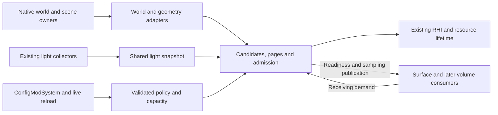

# Virtual shadow map implementation contracts

This is the implementation design for the [shared virtual shadow map proposal](Rendering.VirtualShadowMaps.Proposal.md).
It specifies interfaces and invariants. Native input publication and the bounded dependency primitives
described below, GPU candidate traversal, projection providers, page storage and shared sampling are implemented.
Native shadow rendering, complete frame admission and production lighting consumers are **not implemented**.
The [implementation plan](Rendering.VirtualShadowMaps.todo)
controls delivery. Numerical profiles are provisional, not measured shipping defaults.
The [qualification protocol](Rendering.VirtualShadowMaps.Qualification.md) defines the evidence needed
before performance, completeness or appearance can be claimed.

## Implemented input boundaries

`VgeLightsRenderer` freezes source keys with the existing illumination payload after held attachment
resolution. `NativeShadowLightSources` records the actual entity/hand or registered `IPointLight` at
admission, and retains the collection's world-to-view matrix, dimension and integer-origin inputs.
Movement and list ordering do not define identity. Weak owner lifetimes, hand replacement tracking,
provider removal and world reset prevent reuse by replacement sources. Authored `PunctualLight.Source`
supplies equivalent identity. Block-entity providers additionally retain integer block position.
Unknown keys or unavailable collection coordinates leave illumination intact without cached-shadow input.
Independent solar/lunar direction and irradiance are retained from the coherent atmosphere publication;
existing lighting consumers still use their current direct-light selection until consumer migration.

`NativeShadowWorldAdapter` bootstraps under `ClientWorldMap.chunksLock`, then drains bounded native
dictionary-coordinate notifications. Load/replacement and unload interception observes writes in the
native owning methods. The existing `ChunkDirty` event and native dirty-queue boundary mark content
pending. Native chunk upload/removal hooks withdraw old certificates before range changes; no mesh-pool
method is patched or classified. Tessellation carries its pre-read center/edge content revisions through
native queue merging to upload. Required and uploaded revisions remain separate after success, so a late
older upload cannot restore stale readiness. Edge-only work does not falsely replace the center's revision.
A later edit, unknown queued-work stamp, missing range or exception cannot certify a current replacement.
`Capture` retains the entire loaded envelope per dimension, including offscreen chunks, or returns
incomplete on capacity/probe exhaustion. `TryUse` rechecks the frozen publication under the mutation
gate before a consumer submits work. Native ranges are descriptions, not owned geometry or a drawing API.
The terrain adapter must additionally acquire the existing RHI borrowed-storage certificates before draws.

Lookup completeness is distinct from per-chunk drawable readiness. Missing coordinates inside the
envelope, pending content and missing geometry remain unknown. Cached Empty and connectivity values
are published as advisory metadata. Proven-fresh bits remain clear; the native asynchronous connectivity
freshness claim is retained separately for diagnostics. This implementation does not certify voxel
emptiness, solid classification or connectivity-based pruning. Bounds-only candidate traversal remains
the required route until those proofs are available.

The packed lookup uses 64-byte std430 records and bounded linear probing with an explicit unsigned hash.
Native indices, lifetimes and revisions use low/high 32-bit words; coordinates remain signed integers.
Native range descriptions are 32 bytes. CPU and GPU retain absolute chunk identity; bounded relative
conversion rejects integer overflow. `ShadowWorldGpuBuffers` uploads only changed complete publications
through RHI-owned SSBOs. Adapter owner identity scopes generations across reconnect/reconfiguration;
invalid inputs withdraw the upload certificate. Candidate traversal borrows this exact upload certificate.

`ShadowSceneChanges` bounds non-terrain history, retains previous/current bounds and relevant revisions,
and advances a broad invalidation epoch before dropping unknown or exhausted history. Pending changes
prohibit certification. `ShadowReceivingCoverage` checks depth-inclusive bounds and applied dependency
watermarks independently of page identity. Actual entity/moving-caster adapters are still unimplemented.

The native input JSON configuration is `VirtualShadows.Inputs`: `ChunkCapacity` (65536),
`RangeCapacity` (524288), `ChangeCapacity` (8192), and `ProbeLimit` (128). These are provisional finite
input allowances, not the total shadow budget or shadow enablement. The existing `ConfigModSystem`
materializes/sanitizes them; reload withdraws the frozen publication while preserving pending edits,
failed uploads and queued tessellation stamps. Retained work drains when a smaller allowance is applied;
new work cannot silently discard its history. A genuine native map reset or world exit ends that history.
GPU resources are lazy. Candidate-specific settings are described below; the remaining settings schema
is intended design, not accepted configuration.

## GPU chunk occlusion candidates

`ShadowCandidateRequest` anchors a receiver box and either a complete directional cap or point-source
movement box. All candidate bounds use chunk-grid units; native world envelopes are converted from
block units and must match in full. Integer domain origins preserve absolute XYZ/dimension identities.
Relative extents beyond the supported arithmetic range are rejected, never shortened. Directional cap
component extrema are analytic, including interior poles; a fixed-sign axis or up to six overlapping
signed dominant-axis sectors supplies conservative slope bounds. Point requests do not impose another
attenuation radius. Current demand remains responsible for using the lighting radius convention.

`shadows/candidates.csh` executes the proposed whole-slab interval products and finite segment inequalities
in double precision on the OpenGL 4.5 baseline. Closed boundary coverage includes both touching cells.
The existing SPIR-V-only compute loader is not the runtime route for this shader: the narrow
`ComputeShaderAsset.CreateBaselineFromAssets` boundary loads its self-contained GLSL source through
RHI shader creation and the same generated binding contract. The canonical offline catalog still
compiles and validates the shader. The existing `ShaderSourceCode` preprocessor applies generated fixed
defines (including `VGE_SPIRV_BUILD`); unapplied structural/specialization options are rejected. No optional
SPIR-V driver-ingestion capability is needed; other shader owners keep their existing loading policy.
Arithmetic bounds expand outwards: local inputs are limited to 2^21 chunk units, domains to a 2^20
index span, and the short arithmetic chains use an absolute 1e-7 plus relative 1e-11 allowance in chunk
units. This intentionally admits boundary false positives. No mesh bounds, triangle inspection or
CPU candidate enumeration participates in production selection.

`ShadowCandidatePool` allocates a fixed number of headers, each owning a fixed span of 64-coordinate
segments and a bounded hash table. The entire layout, including unused, building and retiring spans,
counts against `AllocatedBytes`. Old and replacement associations occupy separate slots in this same
allocation. Retirement withdraws the handle and polls an RHI fence before slot reuse. Allocation checks
cached SSBO limits and the configured memory allowance; it never silently reduces the declared domain.
Native world buffers are borrowed input allocations and remain charged to their input owner. A later
shared scheduler must account both owners within the total shadow budget.

The generated binding contract declares six SSBOs: persistent per-slot inputs, 128-byte headers,
16-byte absolute coordinate entries, dedup storage, changed partitions and the current 64-byte native
lookup. Selection stays on GPU. Headers distinguish clearing, traversal, dependency validation,
complete spatial selection, capacity exhaustion and stale inputs; a complete spatial set with a nonzero
unresolved count cannot certify drawable coverage. Slab/cell/probe/change allowances are separate.
Hash clearing and partial collision probes are resumable work. Each batch permits at most one slice per
slot, conservatively reserves its work against aggregate ceilings, and preserves cursors across batches.

`BeginBatch` requires a contiguous, complete changed-partition interval and an exact current native
upload. Before use, `Advance` checks source lifetime, world owner, domain/influence generations, motion,
receiver containment and history epoch, then queues bounded GPU checks. Repeated intervals retain their
change cursor. Changed partitions are checked against conservative covered regions; native publication
changes trigger bounded lookup validation over the retained coordinates. Missing or pending cells remain
unresolved. Cached empty/connectivity metadata never removes coordinates; connectivity pruning is disabled.
The future frame coordinator supplies the contiguous interval before consumers and may not use an
association whose slice was not admitted or whose current GPU certificate is incomplete.

Candidate coverage ignores projection generation deliberately. A different light basis/position still
invalidates depth separately. `NeedsRefresh` and the GPU header's refresh flag expose the configured guard
for replacement scheduling; predictions never extend validity. Later admission/rendering integration owns
light selection, replacement scheduling and depth publication. Shader replacement requires a fresh pool.

The accepted `VirtualShadows.Candidates` controls are provisional: `MemoryMiB` 16, `HeaderCapacity` 32,
`SegmentsPerAssociation` 64, `DedupCapacity` 8192, `ProbeLimit` 128 and `ChangeCapacity` 8192. Slice ceilings
are 64 slabs, 4096 cells, 32768 probes and 256 changed partitions; corresponding whole-batch ceilings are
1024, 65536, 524288 and 8192. `RefreshGuardFraction` defaults to 0.25. Invalid fields sanitize to finite
defaults; incompatible aggregate memory/hardware layouts reject allocation. Pools freeze the policy at
creation; live rendering reconfiguration and the total resource budget belong to the later coordinator.

## Projections, physical pages and sampling

`DirectionalShadowProjection` owns one sun or moon basis, a depth interval fitted to all eight
represented-domain corners and levels whose world texel widths double. Page keys use absolute light-space
XY; snapping the camera's clipmap center changes selected pages without changing matching mappings.
`Update` retains an unchanged mapping and advances projection generation for basis/depth changes.
`PointShadowProjection` uses fixed +X, -X, +Y, -Y, +Z, -Z faces with deterministic X/Y/Z tie ownership.
Position, near/far or face-resolution changes advance its generation. Both providers expose page-local
normalized-device coordinates and retain double precision until bounded page/local-texel conversion.
Sampling inputs split positions into signed integer 32-block chunk origins and relative double coordinates;
origins outside the native signed coordinate range are rejected before packing.
Out-of-range coordinates fail instead of wrapping. Source keys retain world, dimension and lifetime.

Depth is conventional near=0/far=1, empty=1, with explicit less-or-equal comparisons. Point near distance
is a positive configurable value (initially 0.05 metres); the far distance is supplied from represented
influence, preserving the lighting radius convention. Directional depth includes configurable padding
around represented caster coverage. Bias shifts the receiver along its unit normal and subtracts a
bounded texel-scaled depth adjustment, including slope. Each adjustment is capped at four texels.
The planned material convention preserves native winding/back-face culling where appropriate and retains
two-sided/cutout material behavior; front-face culling is not a substitute for receiver bias. Actual material
rasterization, near-source crossings and depth-clamp evaluation remain scene-adapter qualification work.
No custom clipping is introduced.

`ShadowPagePool` owns D32F two-dimensional array layers with one level, nearest sampling and no gutters or
multisampling. It allocates metadata once and grows one resident array per request. The planned shared
binding layout reserves four statically named array samplers; actual fragment/compute limits and supplied
consumer slot availability are checked before allocation. The final lighting integrations must recheck
their real binding availability. Array groups are explicit: slot / layers-per-array selects the group,
slot modulo layers-per-array selects its layer.

The GPU table has fixed 256-byte slots. State distinguishes free, building, ready and retired assignments;
these bounded slot sets also serve as the free and retirement queues. Full source/projection/face/page
identity is checked after bounded hash probing. Exhaustion reports failure; no hash-only equality or
CPU selection readback exists. A pool incarnation plus monotonic assignment counter prevents reuse of
old completion tokens; counter exhaustion rejects allocation. Unreferenced entries can be withdrawn
before required entries, but their layers remain unavailable until the submitted batch fence signals.
All page users submit inside `BeginBatch`/`SealBatch`; fence polling never waits for GPU completion.

Rendered coverage occupies a separate depth-inclusive enclosure with world/scene epoch/sequence stamps.
`Require` accumulates the current required enclosure independently of the rendered certificate. An
allocation cannot enlarge that certificate. A complete replacement must cover the current enclosure,
including any additional requests that arrived while it was building, and publish the exact allocated
region/dependencies/assignment after complete drawing. Old depths retain only their old region until
replacement publication. Enclosing multiple regions requires complete caster selection for that enclosure.
`CancelReplacement` retires only the exact unfinished assignment, allowing a larger replacement after safe
retirement while the old certificate continues to cover its original region. Stale cancellation tokens fail.
One fixed enclosure and bounded probes keep metadata and containment work finite. The actual admission
owner must supply complete current requirements before eviction/allocation and a truthful draw-completion
certificate; controlled synthetic pages do not establish that future geometry integration.

`SetArrayTarget` withdraws excess groups and exposes their bytes until fences allow disposal. `Withdraw`
handles disable/world leave; source/dimension retirement is a GPU operation. `Reconfigure` withdraws and
drains the old layout before allocating its replacement, preventing two full pools. The existing client
rendering lifetime's publication callback withdraws the pool synchronously on shader reload; context
retirement closes the owner through the existing RHI lifetime. Physical
pages do not own or retain engine geometry. The coordinator must continue polling a withdrawn owner until
its tracked allocations drain. Terminal disposal uses the existing RHI resource retirement boundary.

The shared `includes/shadows/sampling.glsl` resolves all nine filter taps through virtual addressing and
coverage/dependency lookup, then performs point-fetched comparisons through statically named samplers.
Cube-edge taps reconstruct the ray and evaluate conventional depth in the destination face on the biased
receiver's radial shell. Directional levels use the same world receiver with their own texel width; there
is no depth averaging or implicit fallback level. The same tap resolver is available to demand producers.
The compute entry returns all nine page addresses plus visibility and a diagnosed invalid-tap mask.
Any invalid tap returns unshadowed visibility for the query. Production per-light readiness, diagnostic
aggregation and overlays remain owned by the later frame/consumer integration.

Accepted `VirtualShadows.Pages` controls are provisional: `MemoryMiB` 128, `PageSize` 128,
`LayersPerArray` 256, `ArrayCapacity` 4, `ProbeLimit` 128 and `OperationsPerBatch` 256. Projection/bias
controls are `PointNear` 0.05, `DepthBiasTexels` 0.5, `NormalBiasTexels` 0.5 and `SlopeBiasTexels` 1.
The four-bank ceiling is the implemented shader interface, not a hard-coded shadow-memory budget.
The pool validates depth plus metadata/command/result storage against its allowance, integer and hardware
limits; `AllocatedBytes` includes resident retirement storage. `ShadowSampler` separately reports its
672-byte query/output allocation. Candidate, input, sampler and future command storage remain charged to
their owners and must all fit the eventual total budget. Driver overhead is outside these nominal counts.

## Ownership and source layout

Keep shared storage, scheduling and validity independent of native scene classes and lighting consumers.
The names below are intended steady-state responsibilities, not placeholder files to create now.
Each named type gets its own file; directories provide context. No generic scene registry is needed.

| Location beneath `VanillaGraphicsExpanded/` | Responsibility and allowed dependencies |
| --- | --- |
| `Rendering/Shadows/Lights/ShadowLightSnapshot.cs`, `ShadowSourceKey.cs` | Immutable source identity, emission and influence contracts; no engine pool types |
| `Rendering/Shadows/World/ShadowWorldPublication.cs`, `ShadowChunkIdentity.cs` | Fixed chunk coordinates, availability and publication revisions; no mesh ownership |
| `Rendering/Shadows/Geometry/ShadowGeometryPublication.cs`, `ShadowSceneChanges.cs` | Borrowed range batches, material/transform revisions and bounded change streams |
| `Rendering/Shadows/Projections/DirectionalShadowProjection.cs`, `PointShadowProjection.cs` | Clipmaps and six faces, conservative coverage mapping and projected depth |
| `Rendering/Shadows/Candidates/ShadowCandidateHeader.cs`, `ShadowCandidateTraversal.cs` | GPU spatial associations, bounded continuation and pruning dependencies |
| `Rendering/Shadows/Pages/ShadowPageTable.cs`, `ShadowReceivingCoverage.cs`, `ShadowPagePool.cs` | Page lookup, certified receiving regions, allocation and retirement |
| `Rendering/Shadows/Scheduling/ShadowAdmission.cs`, `ShadowReadiness.cs` | Complete page admission, aggregate budgets, stable light selection and consumer readiness |
| `Rendering/Shadows/Configuration/ShadowSettings.cs`, `ShadowQualityProfile.cs`, `ShadowEffectiveCapacity.cs` | Persisted schema, finite policy data and validated effective limits |
| `Rendering/Shadows/ShadowFrameCoordinator.cs` | Thin frame orchestration over those responsibilities, RHI and existing resource lifecycle |
| `Rendering/Integration/Shadows/NativeShadowWorldAdapter.cs`, `NativeShadowTerrainAdapter.cs`, `NativeShadowEntityAdapter.cs` | Native world/geometry lifecycle translation, once-per-frame preparation; depend inward on shared contracts |
| Existing `Rendering/VgeLightsRenderer.cs`, `VgeLightsUniformBuffer.cs` and `PBR/HeldLighting/` owners | Collect and publish source keys alongside the existing illumination payload |
| `PBR/Shadows/SurfaceShadowDemand.cs`, `SurfaceShadowBindings.cs` | Surface demand and consumer bindings; depend on shared contracts, not native pool internals |
| `ModSystems/VirtualShadowModSystem.cs` | Config/lifetime composition only; implement existing live-reload boundary |
| `assets/vanillagraphicsexpanded/shaders/shadows/` and `shaders/includes/shadows/` | Separate candidate, expansion, clear, depth, readiness and shared lookup assets; existing shader catalog/contract generation owns compilation |

Fog will use the same demand/sampling contract through its owning lighting integration. Do not create
a fog renderer, alternate geometry owner, or production compatibility facade merely to reserve that seam.



Native `poolsByRenderPass[renderPass][atlas]` remains the category authority. A bounded batch visits
that table once to establish compatible groups; the adapter does not persist reverse membership,
copy meshes, scan each pool per page or mutate native culling arrays/statistics/VAOs.
Ranges from ordinary and shader-storage terrain require distinct decoding/binding support.
Existing liquid geometry borrowing is not a universal terrain adapter.

## Publication interfaces

These are semantic input/output contracts, independent of eventual C#/GLSL packing. CPU/GPU field
widths, alignment and capacities must be explicit in the generated binding contract when implemented.
All variable-length fields are bounded spans into charged storage, never unbounded per-page containers.
Every operation returns a completion state with a reason; an empty result and unfinished work differ.

| Interface | Required inputs and publication | Ownership and certification |
| --- | --- | --- |
| Light capture | Frame/world/dimension; source key and lifetime; source kind; current direction or position; calibrated emission payload; influence bound/revision | Existing collectors produce one frozen snapshot used by demand, depth and illumination. Preserve the 100-entry illumination contract independently of shadow admission. Unknown keys cannot own cached shadows. |
| World capture | Dimension-aware integer chunk XYZ/native index, chunk lifetime, availability, geometry revision, empty/connectivity values and freshness, complete loaded envelope and domain revision | One native publication adapter; safe bootstrap followed by deltas. Frozen render batch; pending changes prohibit certification. An input batch cannot shrink the declared domain. |
| Geometry capture | Terrain: chunk identity plus current native pool ID/range. Non-terrain: native scene owner/lifetime and its own draw inputs. Both carry storage/range generation, detail eligibility, material and transform/deformation revisions; bounded compatible groups | Borrowed geometry, with native ownership and a safe retirement interval. Exclude stale ranges before submission. Neither group membership nor geometry is owned by the candidate cache; entities are not forced into terrain chunk membership. |
| Projection provider | Source snapshot, requested detail, receiver bounds including filter/bias, represented domain | Immutable basis, face/level transforms, near/far depth convention, page coordinates and coverage mapping. Directional levels double texel width; point faces have fixed consistent axes. |
| Surface/volume demand | Consumer, frame/light snapshot, receiving world regions including depth, filter and bias footprints, requested detail | Current complete requests before the first participating consumer. All contributing transparent layers count. History can prioritize only. Late categories supply conservative early bounds. |
| Candidate build/resume | Receiver coverage, light key, full covered motion/influence, world domain, pruning dependencies, work allowance, continuation cursor | Header plus coordinate spans, unresolved cells and completion. GPU traversal, deduplication and publication; CPU never reads selections to decide geometry draws. |
| Scene change publication | Sequence, source lifetime, prior/current conservative bounds, geometry/pose/material/eligibility revisions; creation/removal flags | Existing scene adapters report all relevant changes, including new casters absent from previous draws. Bounds include deformation. Apply every change since cached publication. |
| Page lookup | Source/lifetime, projection generation, level/face and virtual XY; request receiving region | Mapping to array/layer/assignment generation plus separately certified coverage and dependencies. Bounded probes; collision exhaustion cannot alias or silently drop entries. |
| Page admission | Complete candidates, current terrain/non-terrain inputs, union of currently required receiving regions, remaining aggregate limits | Admit only complete updates before clearing. Count every preparation/expansion pass and repeated geometry cost. Unfinished selection produces no publishable page. |
| Readiness publication | Complete current demand and valid covering page results for one light/consumer/frame | All surface paths share one result for that interval; sun and moon independent. Fog has separate readiness and cannot displace an admitted surface result. |
| Shared sampling | Same light/readiness snapshot, world receiving position and bounded bias/filter parameters | Visibility in [0,1] attenuates only that light's direct term. Explicit virtual lookup for each tap; unexpected failure returns 1 and records a per-light failure. This guard does not satisfy the readiness contract. |

Stable keys comprise world session, dimension, source kind, native owner lifetime and emission slot.
Sun and moon have distinct fixed slots in that world/dimension. Entity and player IDs need lifetime
generations; player hand distinguishes held slots. Block keys include integer position, slot and
emitter lifetime. Authored providers supply equivalent identity. Replacing an emitter at the same
position/hand advances its lifetime; moving it does not. Never infer keys by matching positions or
frame-list indices. Required collector coverage remains a completion obligation.

Retain the frame's world-to-view transform and integer origin with the snapshot. Convert native view-space
positions using that same frame convention for world-space candidate/projection work; never combine a
retained view-space light payload with a later camera transform. Direction, position and receiving-region
coordinate spaces must be explicit in generated contracts.

Retain the point influence convention in
[VgePointIlluminance](../VanillaGraphicsExpanded/assets/vanillagraphicsexpanded/shaders/includes/pbr_photometric.glsl):
authored `payload.w > 0` gives radius; native radius is `min(25, length(max(payload.xyz, 0)))`
before intensity calibration, and contribution is zero at or beyond that radius.
Changes to emission/influence can invalidate candidate coverage independently of position.
Keep independent solar and lunar contributions through atmosphere publication, intensity bounds,
deferred and forward paths; current single-emitter properties are not the target contract.

World identity uses native dimension/Y encoding and fixed 32-block partitions. GPU arithmetic uses
an integer origin plus a bounded remainder as in [FrameWorldSpaceBridge](../VanillaGraphicsExpanded/Rendering/FrameWorldSpaceBridge.cs).
Origin shifts change coordinate interpretation, not native identity. Preserve range checks instead
of overflowing large world coordinates. Unknown interior cells remain unresolved; outside the complete
loaded envelope is the explicitly declared client-data limitation, not another caster-distance cap.

## Generations, failure and lifetime

Generation equality is scoped to the owning world/source, not a globally interchangeable integer.
Use monotonically increasing versions with an explicit reset/withdrawal before wrap or identity reuse.
GPU packing may use smaller epochs only with proof that no retained work can collide after rollover.

| Generation | Changes when | Consequence |
| --- | --- | --- |
| Source lifetime | Emitter replacement, world/dimension identity changes | Withdraw all old source results and selection history |
| Light snapshot | Current payload capture changes | Consumers agree on the same frame; motion does not invent a new source |
| Projection | Directional basis, point position, relevant projection/depth/detail mapping changes | Old depths cannot count as current; matching snapped translated pages may retain identity only when their mapping is unchanged |
| World/domain | Availability, domain or chunk lifetime changes | Recheck swept regions and unknown cells before candidate/page certification |
| Geometry/scene change | Range/storage, pose, material, eligibility or relevant world content changes | Invalidate intersecting cached depths, even at unchanged transform/range |
| Candidate | Complete replacement association is published | Old/new lists have distinct lifetimes; motion inside certified bounds may reuse current candidates despite depth invalidation |
| Physical assignment | Layer reassigned, storage recreated or replaced | Old page references never address a new owner's depth |
| Coverage | Complete replacement depths and their certified receiving regions publish together | Metadata-only growth cannot authorize additional receivers |
| Readiness | Consumer's certified result/detail/availability changes | Shared consumer snapshot and fog history reject obsolete results |

Bounds-only candidates retain empty coordinates and consult current eligibility at consumption.
Omitting coordinates based on emptiness or connectivity creates pruning dependencies that must be
recorded and invalidated on change or loss of freshness. Native face connectivity is not an exact
solid flag or a straight-ray test. No duplicate voxel analysis is permitted; use bounds-only selection
unless both freshness and shadow-opacity equivalence are proven.

| State/reason | Required behavior |
| --- | --- |
| Unknown source identity | Illumination continues; no cached shadows, diagnostic identifies missing source integration |
| Unknown/pending chunk or geometry | Keep unresolved coverage; affected page is not complete, affected surface light unready |
| Pending traversal, deduplication or invalidation | Retain bounded continuation only under valid dependencies; never certify unfinished output |
| Stale source/projection/range/assignment | Reject completion and lookup, withdraw affected publications; retire storage safely |
| Capacity/probe/command/request overflow | No truncation-as-success; bounded detail retries, then stable light withdrawal while illumination continues |
| Unsupported hardware/consumer capacity | Report requested/effective capacities and reason; reduce supported capacity or leave shadows unavailable, without enabling optional features implicitly |
| Lost change history or unknown change bounds | Mark all potentially affected pages invalid before dropping history; broad invalidation may use an epoch without an unbounded immediate scan |
| Disabled/context lost/world left | Withdraw first, stop admitting work, retire owned resources; native buffers stay native-owned |
| Unexpected sampler miss | Return unshadowed visibility and record light/page/coverage reason; investigate demand/readiness defect rather than accept page-shaped fallback |

A non-terrain change stream retains a consumed watermark per cached result or an equivalent conservative
region/epoch scheme. Creation has current bounds, removal has prior bounds, and motion has both.
Unfinished change processing prevents certification even if the old draw list did not contain the caster.

Page identity is never receiving coverage. Coverage includes world receiving depth, projected XY and
filter/receiver-bias support. Test containment even with all identities unchanged. Replacing a union
with its enclosing box requires complete caster selection for that entire box. A new receiver outside
the certified region requires rendering the union of **currently required** regions. Publish depth and
coverage together only after all draws. An old valid result can serve only its old certified region.
Fog expansion preserves all current surface requirements; defer fog if safe replacement cannot fit.

```text
freeze current source and scene publications; apply relevant changes
generate complete current demand for each light and consumer
resume or replace candidates only within their covered motion and dependencies
admit complete page replacements within aggregate storage and work limits
clear selected replacement layers; render all required current geometry
publish depths with receiving coverage and dependency versions
reduce current coverage to per-light consumer readiness before shading
retire superseded storage only after its scheduled GPU users finish
```

Publication means GPU ordering and visibility before consumers, not a CPU wait for completion.
Use storage barriers between compute outputs/inputs, command barriers before indirect draws and vertex
fetch barriers for generated instance attributes. Pass attachment/texture transitions follow existing
RHI contracts. Poll lifetime fences without blocking; barriers alone do not authorize buffer reuse.
If native storage can change before shadow submission, reject its captured publication. Adapter integration
must establish safe submission/retirement ordering rather than attempt to extend native ownership.

## Rendering and admission contract

The complete baseline uses OpenGL 4.5 compute, bounded initialized indirect intervals, integer instance
attributes addressed by base-instance, and geometry-shader layer output after final deformation.
`gl_InstanceID` does not include base-instance. Preserve object instancing separately. Optional draw
parameters, GPU count buffers, direct vertex/TES layer output, bindless access and SPIR-V ingestion must
not be required for the baseline; existing GLSL compilation remains the portability route.

Resident pages are D32F array layers, initially 128 by 128, no mip chain, gutters or multisampling.
Depth storage is one part of the total budget. Static named sampler dispatch must fit every actual
consumer's available texture units and shader-stage limits. Validate planned bindings at storage design
and actual bindings during consumer integration. No arbitrary dynamic sampler-array indexing assumption.
One page is neither a chunk nor a complete light face.

Conventional projected depth is compared explicitly. Projection providers own matching near/far and
bias conventions. Start with manual 3-by-3 point-fetched PCF; resolve each tap through page/face/level
mapping. Cube-edge taps use the adjacent face's reference depth; clipmap transitions use consistent
world positions and demand all taps. Near-source geometry, depth spans and bias require actual raster
qualification. Existing `DepthClamp` may be evaluated; custom clipping remains excluded.

Admission counts totals across groups and arrays, including inactive command slots, page/range duplicate
visits, repeat counting/emission passes, tessellation amplification and page-instance geometry repetitions.
One terrain range/array command can have multiple page instances; it does not remove repeated drawing.
Initialize every submitted slot. Preserve the layered attachment on pass entry and selectively clear
admitted layers with full-page geometry, depth writes and an always-passing depth test. A pass clear
would destroy unrelated cached layers. Never clear a page whose complete replacement was not admitted.

The frame gate follows current light capture and precedes the earliest affected surface shading.
Demand includes opaque/cutout, entity/foliage, water and every contributing transparent layer, using
current deformation and alpha rules. Transparent demand must not hide later layers through depth writes.
Prepare offscreen casters as needed, advance animation once, and charge preparation to the shadow budget.
The existing late opaque receiver resolve is insufficient. Consumers migrate coherently to one selected
shadow provider; no second native attenuation or hidden coarse fallback. Native work can remain only for
explicitly owned remaining consumers.

## Persisted settings and effective policy

The opt-in `VirtualShadows` object in [VgeConfig](../VanillaGraphicsExpanded/LumOn/VgeConfig.cs)
currently exposes input-publication, candidate and physical-page allowances. Extend it with the remaining schema below when rendering
policy is implemented. Its types live in `Rendering/Shadows/Configuration`, avoiding further
growth of unrelated nested settings. [ConfigModSystem](../VanillaGraphicsExpanded/ModSystems/ConfigModSystem.cs)
continues to load/sanitize, materialize missing defaults and apply ConfigLib paths; it remains the configuration
owner. Add public ConfigLib mappings in the existing asset. Its event handler must not become a second
writer racing ConfigLib saves. [LiveConfigReload](../VanillaGraphicsExpanded/ModSystems/LiveConfigReload.cs)
delivers sanitized settings; the shadow owner converts them to immutable requested/effective policies
at a scheduling boundary. Cache enablement until its determining inputs change.

The schema below defines units and validation, not actual currently accepted JSON properties.
All floating-point values must be finite. Byte arithmetic uses checked 64-bit integers; dispatch and
shader indices additionally fit their signed/unsigned packing and hardware limits.

| Property | Type/unit; initial value | Validation and meaning |
| --- | --- | --- |
| `Enabled` | Boolean; false during development | Production default is settled after qualification; no partial surface path enabled |
| `MemoryMiB` | Positive integer; 256 | Total tracked shadow allocations, including retirement and scratch; insufficient minimum layout yields unavailable shadows |
| `GpuTargetMilliseconds` | Positive float; 2 | Scheduling estimate for all shadow work, not a guaranteed ceiling |
| `MaxShadowedLocalLights` | Nonnegative integer; 8 | Clamp effective limit to available illumination sources and capacity; zero disables local shadows only |
| `DirectionalMemoryShare`, `DirectionalWorkShare` | Fractions [0,1]; 0.5 each | Local reserved share is the remainder; borrowing of unused shares, independent sun/moon opportunities |
| `Quality` | Named profile; `Balanced` | Versioned policy data; unknown value resets to supported default with diagnosis |
| `DirectionalCoverageDegrees` | Float (0,180); 1 | Full spherical cap radius; sector partitioning covers its interior |
| `PointCoverageHalfExtentMetres` | Three positive floats; (2,2,2) | Anchored source box; all intermediate positions must lie inside |
| `RefreshGuardFraction` | Float (0,1); 0.25 | Begin replacement at normalized distance 0.75 for default; expiration still invalidates |
| `ChallengerMargin` | Nonnegative float; 0.2 | Challenger exceeds incumbent score by this fraction |
| `MinimumHoldSeconds` | Nonnegative float; 0.5 | Hold applies only while valid; cannot retain stale depth |
| `RecoveryCompleteFrames` | Positive integer; 8 | Consecutive complete current frames before restoring shadows |
| `Advanced` | Optional validated overrides | Work ceilings, detail/projection/bias controls and supported page sizes; omitted fields inherit the selected profile |

A quality profile contains finite positive integer ceilings for input chunk/range visits, pool groups,
changed-region checks, slab advances, cell visits, association segments/entries, dedup probes, demand
requests, coverage regions/containment checks, page/range intersection tests, temporary pairs, command
slots, page instances, estimated post-tessellation primitives, clears, resident lookup entries and retries.
All ceilings are **per whole frame batch**, including every array/group/retry; storage capacities are
also bounded over retained generations. Paused cursors and change backlogs count against storage.
Optional advanced overrides use the same checks; unbounded work is not an accepted setting and overflow never means success.

Profile resolution must supply every field before admission is enabled. Positive integers fit Int32;
checked cross-products/byte sizes must fit allocated buffers and hardware ranges. Derive effective storage
counts from actual record strides and budget shares, not an assumed all-depth budget. Exact initial work
counts and density/bias values are selected with the first working producers and calibrated using the
qualification protocol; until supplied and validated, the profile is incomplete and cannot enable work.
This preserves explicit finite fields without pretending unmeasured operation counts are shipping defaults.

Projection/detail fields include desired and minimum acceptable world/screen texel density, bounded
refinement count, directional level count/ranges, point near distance, depth range policy, constant/slope/
normal bias and maxima in documented texel/depth units. They must produce finite invertible mappings,
positive near distance, far greater than near and filter/bias footprints covered by demand. There is no
independent directional caster horizon. Physical format is initially D32F and PCF width fixed at three;
unsupported format/filter requests are rejected rather than treated as implemented quality modes.

Effective capacity reports requested bytes, allocated live bytes, scratch, building replacements,
retired-but-in-flight bytes, page/table/candidate/command capacities, available sampler banks and every
limiting reason. Driver overhead is separately described as untracked; the setting is not a process VRAM cap.
Validate texture/layer/framebuffer limits, per-stage and combined sampler use, SSBO sizes/bindings, vertex
inputs, compute dispatch limits and integer address ranges through the existing capability owner. Missing
required capability facts prevent certification; do not create a second probing subsystem in the allocator.

| Change | Scheduling-boundary behavior |
| --- | --- |
| Invalid numeric/null/malformed setting | Sanitize offending fields to supported defaults and diagnose; reject an invalid effective layout, without reusing stale capacities as current |
| Grow | Allocate incrementally within the new allowance and hardware limits; report allocation failures and reduced effective capacity |
| Shrink/reservation reclaim | Stop new admissions that exceed the target; reduce detail/withdraw lights, retire excess storage, report temporary footprint above the new target until GPU users finish |
| Format/page-size/shader mapping replacement | Withdraw affected publications, retire old pool before replacement within allowance; no implicit second full pool |
| Policy/coverage change | Advance relevant policy dependencies; reuse only results proven compatible with new demand/motion bounds |
| Disable/world leave/context loss | Withdraw before retirement, clear world-specific identity/readiness; preserve borrowed ownership |
| Enable/recreate | Validate capacity and current publications anew; qualify complete coverage before readiness recovery |

Priority uses visible direct contribution and cost, carried-source preference, bounded waiting age and
stable-key tie breaks. Reserve opportunities for both contributing celestial lights. Seek affordable
complete coverage before refinement; bounded retries then light withdrawal if even minimum detail cannot
fit. Nonblocking timing updates later estimates. Recovery or fades require complete current depths;
unexpected coverage loss switches immediately to unshadowed illumination.

## Native boundary evidence and remaining verification

Static inspection on 2026-11-09 targets `G:/Vintagestory/VintagestoryLib.dll`, assembly 1.22.7.0,
MVID `8a3ad3aa-2940-4c39-ae1b-881de9e65346`, SHA-256
`E08F22B493B92FEAF0AAEB79D22437EA0F7EFC38AA7F72A04A47F98BC0E40DF0`.
The existing [spatial](../artifacts/virtual-shadow-maps/chunk-spatial-inspection.txt) and
[traversability](../artifacts/virtual-shadow-maps/chunk-traversability-inspection.txt) receipts match
that binary. The [native-boundary receipt](../artifacts/virtual-shadow-maps/native-boundaries-inspection.txt)
adds selected method IL and a targeted call-site index. These are source evidence, not runtime race,
rendering or performance proof. Recheck supported assembly identity on upgrade.

| Boundary rechecked | Current evidence | Verification owner and required proof before integration |
| --- | --- | --- |
| Bootstrap/load/replacement | Adapter bootstraps under `ClientWorldMap.chunksLock`; notifications observe actual native dictionary writes in `loadChunkMT` and `OverloadChunkMT` | Required proof: bounded source fixtures and installed-IL interception checks; later live streaming qualification measures availability/cost and retained full envelopes |
| Unload/moving chunk removal | `HandleChunkUnload` dictionary removal and native chunk center/edge range retirement withdraw publications; world exit detaches the owner | Required proof: executed native retirement and adapter replacement checks; actual moving-chunk draw preparation remains owned by the scene adapter |
| Mesh upload/replacement | Pre-read tessellation stamps survive native `MergeIfEqual`; per-part required/uploaded revisions reject late obsolete replacements | Required proof: native merge/upload and revision-order fixtures; actual ordinary/SSBO geometry drawing and GPU storage borrowing still require terrain-adapter qualification |
| Geometry binding/category | Existing [TerrainPassDrawHook](../VanillaGraphicsExpanded/HarmonyPatches/TerrainPassDrawHook.cs) follows native table selection; [EngineGeometryInputs](../VanillaGraphicsExpanded/Rendering/Integration/OpenGL/EngineGeometryInputs.cs) withdraws borrowed inputs on structural mutation | World publication task owns revisions/lifetime; actual terrain adapter task owns ordinary/SSBO layouts, detail/cutout/displacement and shadow-specific inputs; do not treat liquid culling ranges as general input |
| Frame gate | Native render loop orders Before, ShadowFar/Near and then Opaque/OIT. [VgeLightsRenderer](../VanillaGraphicsExpanded/Rendering/VgeLightsRenderer.cs) captures at Opaque -10000; [receiver resolve](../VanillaGraphicsExpanded/PBR/SceneColor/SceneColorParticleCapture.cs) is 8.5 and [direct lighting](../VanillaGraphicsExpanded/PBR/DirectLightingRenderer.cs) is 9 | Light publication task preserves capture consistency; demand/readiness integration task proves position before every participating surface and audits actual registered draw order |
| Entity preparation | `SystemRenderEntities.OnBeforeRender` gates `BeforeRender`; existing held collector resolves after current animation | Entity adapter task proves offscreen preparation and once-only advancement, including custom renderers; light publication task retains identity before held associations are cleared |
| Empty/connectivity | Adapter retains cached Empty/connectivity and the native freshness claim separately from proven-fresh flags | Proven-fresh flags remain clear; candidate selection must keep the bounds-only path unless synchronized freshness and shadow-opacity equivalence are established |

The implemented world boundary is described above. The plan retains its executed verification and
completion review separately from these source receipts. No later renderer may treat metadata publication
as proof that native draw preparation, shadow materials or GPU command generation are already implemented.
The additional [publication/merge IL](../artifacts/virtual-shadow-maps/publication-boundaries-inspection.txt),
[dictionary writers](../artifacts/virtual-shadow-maps/native-dictionary-writers.txt),
[tessellation ordering](../artifacts/virtual-shadow-maps/tessellation-order-inspection.txt) and
[upload ordering](../artifacts/virtual-shadow-maps/upload-order-inspection.txt) receipts retain the inspected
native source boundaries. Hook installation rejects an unqualified engine module identity instead of
assuming a changed binary preserves these private contracts.
