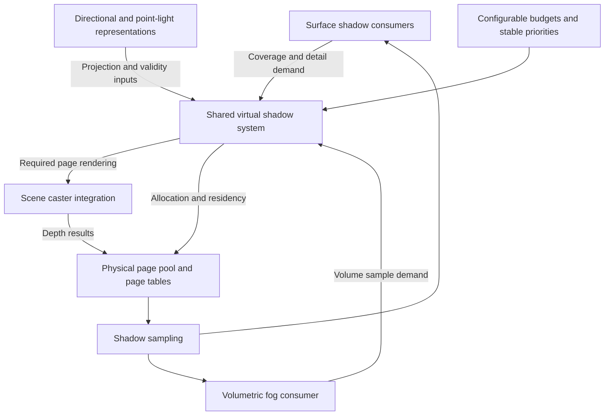

# Shared virtual shadow maps

Status: design discussion in progress. This document records the established direction and
remaining design questions. It describes proposed behavior, not an implemented system.
Renderer integration has not yet been inspected for this proposal. No implementation
checklist or detailed execution plan is established here.

## Purpose and scope

Provide an abstract virtual shadow map system shared by directional lighting and local
point lights. Sunlight, moonlight, stationary local lights, and moving local lights use
the same underlying page infrastructure, with light-specific projection behavior.

The following requirements are established:

- Carried lights and moving light sources in general are primary performance targets
  from the outset.
- Sunlight and moonlight are dynamic: their directions change continuously. Both must
  be able to cast shadows simultaneously.
- Memory and shadow rendering work are bounded by configurable budgets, rather than a
  hard-coded fixed capacity or light count.
- When demand exceeds those budgets, reduce shadow detail and then prioritize which
  lights cast shadows using stable priorities and hysteresis.
- Directional and local shadows share physical page storage, with configurable
  reservations and borrowing of unused capacity.
- Surface shadows are the first implementation priority. Shadowed volumetric fog is
  included in scope, with full fog integration at the end of the proposed work.

## Shared system boundary

A virtual shadow space is a logical depth map divided into pages. Physical storage backs
the pages required by shadow consumers. The shared system manages those pages while
light-specific representations define how world-space locations map into shadow space.

| Responsibility | Intended owner |
| --- | --- |
| Physical page storage, page tables, allocation, residency, and eviction | Shared virtual shadow system |
| Page validity, invalidation, and update scheduling | Shared virtual shadow system |
| Budget arbitration across lights | Shared virtual shadow system, using configurable selection policy |
| Light projection, resolution selection, and world-to-shadow mapping | Light-specific shadow representation |
| Required sampling coverage and resolution | Shadow consumers, interpreted through the light representation |
| Caster discovery and drawing | Scene rendering integration; exact boundary remains open |
| Shadow lookup and filtering | Shared sampling infrastructure with projection-specific handling |

The diagram expresses responsibilities, not a decided render-pass order, CPU/GPU split,
or concrete API. Fog participates in the intended architecture even though its complete
integration follows surface shadows.

## Dynamic lighting and validity

The baseline workload includes changing sun and moon directions, moving local lights,
camera movement, and moving shadow casters. Performance targets must account for this
combined workload; stationary-light cache reuse is an optimization rather than the basis
of the moving-light performance contract.

Light motion, caster changes, and changes in requested coverage have different validity
consequences. The design must distinguish them. In particular:

- For directional lights, changing direction changes the shadow projection. Spatially
  stable clipmaps alone do not preserve depth validity across that change.
- For moving point lights, previously rendered depths may no longer represent the
  current light position, even when the scene geometry is stationary.
- Allocated storage is not sufficient evidence that a page contains valid shadow data.
- Pages generated for an earlier projection must not silently count as current. Any
  temporal approximation requires a separately defined quality policy.

Sun and moon are independent directional-light clients sharing the directional
allocation. Their simultaneous operation must not depend on an exclusive day/night
shadow switch. Exact contribution-based priorities remain to be specified.

## Configurable budgets and allocation

Memory capacity and rendering work are separate constraints. Limiting resident pages
does not alone bound the cost of repeatedly drawing geometry into those pages.

The agreed allocation policy uses a shared physical page pool with configurable
directional and local reservations. Either category may borrow unused capacity. Work
allocation must also account for ongoing directional updates so that reserved storage
does not leave sun or moon shadows without rendering capacity.

Under budget pressure, the system first reduces requested detail and then limits which
lights receive shadows. Selection uses stable priorities and hysteresis to avoid
frequent switching as lights enter or leave view or their importance changes. Lights
excluded from shadow casting continue to contribute illumination.

The following controls have been suggested, but their exact public configuration
contract is not yet settled:

| Candidate control | Intent |
| --- | --- |
| Shadow memory budget | Bound physical page storage and associated cache resources |
| Shadow update budget | Bound scheduled work and target an affordable rendering cost |
| Maximum shadow-casting local lights | Provide an explicit limit on simultaneous shadowed local lights |
| Directional/local reservations | Protect each category while allowing unused capacity to be borrowed |

Configuration requires defaults and validated limits. Units, values, setting names,
runtime adjustment behavior, borrowing/reclamation rules, and priority thresholds remain
open. A GPU time target, if exposed, is a scheduling target rather than a guaranteed
exact per-frame ceiling. Measured-cost scheduling and enforceable work limits are
candidate mechanisms, not yet an approved implementation.

Preferential treatment of the player's carried light has been suggested. The precise
priority policy, including sun/moon contribution and fairness among local lights, remains
to be designed. Page size and other internal tuning details are not established as
user-facing settings.

## Resolution, demand, and coarse coverage

Normal operation targets consistently detailed visible shadows by requesting pages at
the resolution needed by their consumers. Virtualization makes a large logical shadow
map practical through selective physical allocation; it does not require every region
to use the same world-space texel density.

Three distinct concepts must remain separate:

| Concept | Role in this proposal |
| --- | --- |
| Resolution matched to visible detail | Normal demand selection; lower world-space resolution at distance need not look coarse on screen |
| Broad coarse coverage for an additional consumer | Possible coverage requested by effects such as volumetric fog, justified by their sampling needs |
| Reduced resolution under budget pressure | Deliberate quality degradation when requested work exceeds the configured budget |

There is no requirement to render broad coarse coverage for every light before rendering
the pages needed for detailed surface shadows. Such coverage could consume moving-light
work on regions that do not contribute to the image. It must be justified by an actual
consumer or an explicitly chosen fallback policy.

Missing-page behavior remains an open design question. A permanently rendered coarse
map is not assumed. The eventual policy must define what happens when current valid
data cannot be supplied; invalid or outdated pages cannot silently be sampled as valid.

For technical context, Epic's virtual shadow map implementation uses resolution levels
and describes coarse pages for consumers such as volumetric fog and forward-rendered
translucency. It also documents the rendering cost of broad coarse coverage. These are
reference examples, not a requirement to reproduce Unreal's implementation:
[Epic Games: Virtual Shadow Maps](https://dev.epicgames.com/documentation/en-us/unreal-engine/virtual-shadow-maps-in-unreal-engine).

## Receivers, casters, and fog

Surface receiving scope includes opaque and cutout terrain, entities, and foliage, as
well as water and other transparent surfaces. Their demand should reflect the receiving
surfaces that actually need shadow samples. Transparent surfaces may require requests
beyond those derived from opaque surface visibility.

Receivers determine where shadow data is needed. Casters determine what geometry must
be rendered into those pages. Geometry outside the camera view must still be able to
cast shadows onto visible receivers.

Volumetric fog is a required consumer, not an excluded future feature. The shared design
must accommodate its coverage and resolution needs from the outset. Full volumetric
shadow integration follows basic opaque/cutout surface shadows and transparent surface
support. Fog-specific coverage is requested according to its needs rather than imposed
unconditionally on every light.

This establishes a broad dependency order only. It does not prescribe implementation
tasks, milestones, or completion claims.

## Open design decisions and next investigation

The next agreed investigation is the existing terrain, entity, and shadow rendering
paths, before specifying their integration boundary. That inspection has not yet been
performed for this proposal.

The current candidate is a shared caster interface through which renderers expose
bounds, changes, and shadow drawing capabilities while retaining geometry and
material-specific behavior such as cutouts and animation. This interface has been
suggested but is not an established API or an approved integration design.

Other unresolved details include:

- Exact light projections and addressing. Nested orthographic clipmaps for directional
  lights and six perspective faces for point lights are the starting candidates;
  resolutions, page sizes, face-boundary handling, and filtering are undecided.
- Receiver request generation, frame ordering, and coordination between surface and
  volumetric consumers.
- Caster culling granularity, change notifications, and efficient geometry submission
  for repeatedly updated pages.
- Budget units and defaults, work-cost estimation, admission priorities, hysteresis,
  and reservation reclamation.
- Missing-page handling, overload transitions, and any permitted temporal approximation.
- Depth representation, bias, soft-shadow filtering, and resource lifecycle integration.
- Measurable performance and visual acceptance targets for the combined dynamic workload.

These details require further discussion and targeted source inspection. The established
requirements above do not authorize an implementation plan or code changes by themselves.
