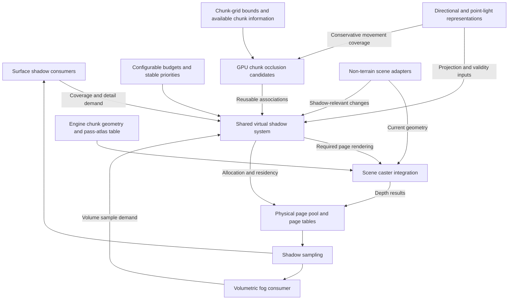

# Shared virtual shadow maps

Status: complete proposal draft for review. This document records established requirements,
recommended design choices, and source-backed integration findings. It describes proposed
behavior, not an implemented system. User-established constraints are binding; the remaining
recommendations require proposal approval. Numerical starting values are tuning hypotheses,
not measured results. Implementation and qualification gates close the document; no
implementation checklist or runtime changes are established here.

## Purpose and scope

Provide an abstract virtual shadow map system shared by directional lighting and local
point lights. Sunlight, moonlight, stationary local lights, and moving local lights use
the same underlying page infrastructure, with light-specific projection behavior.

The following requirements are established:

- Carried lights and moving light sources in general are primary performance targets
  from the outset.
- Sunlight and moonlight are dynamic: their directions change continuously. Both must
  be able to cast shadows simultaneously.
- Memory and shadow rendering work are bounded by configurable budgets, rather than a
  hard-coded fixed capacity or light count.
- When demand exceeds those budgets, reduce shadow detail and then prioritize which
  lights cast shadows using stable priorities and hysteresis.
- Directional and local shadows share physical page storage, with configurable
  reservations and borrowing of unused capacity.
- Surface shadows are the first implementation priority. Shadowed volumetric fog is
  included in scope, with full fog integration at the end of the proposed work.
- Terrain spatial selection uses the existing fixed chunk grid and integer XYZ chunk
  identity, preserving the engine's dimension convention.
- GPU compute shaders generate reusable **chunk occlusion candidates** from fixed
  chunk-grid bounding boxes, without examining mesh geometry or calculating mesh AABBs.
- Candidate associations can be reused across multiple shadow-map updates. Their
  regeneration is amortized over a conservative range of light movement.
- The engine's pass-and-atlas table remains the authority for mesh-pool categories.
  Do not introduce a parallel pool registry, reverse classification map, or a collection
  of hooks that reconstructs relationships the engine already maintains.
- Custom shader clipping is unavailable by design in the pipeline-state system. Shadow
  page routing must respect that constraint; adding or bypassing custom clipping support
  is not part of this proposal.
- OpenGL 4.5 is the required baseline. A complete rendering path must work without
  optional extensions or OpenGL 4.6 features. Additional capabilities may optimize it,
  but cannot be required for baseline correctness or hidden in performance assumptions.

## Recommended architecture and completion decisions

The detailed sections below develop this proposed design. These choices close the design
discussion at proposal level; exact API names, shader layouts, and measured tuning belong
to implementation design and qualification after approval.

| Concern | Recommendation |
| --- | --- |
| Physical pages | Resident D32F depth-array layers; initial tuning size 128 by 128, no mip chain or stored gutter |
| Directional projection | Independent orthographic clipmap levels for sun and moon; adjacent levels double world-space texel width |
| Point projection | Six perspective faces with virtual page addressing and explicit face-edge sampling |
| Baseline routing | OpenGL 4.5 geometry-shader layer output, instance-attribute metadata, bounded indirect command intervals |
| Receiver coverage | A current-frame surface-demand prepass before any participating surface shading |
| Terrain search | Conservative DDA-style slab sweep over fixed chunk partitions and covered light motion |
| World boundary | Engine-published loaded-chunk envelope per dimension, with unresolved interior gaps |
| Candidate cache | Coordinate-keyed headers and segmented candidate lists from bounded GPU storage |
| Sampling | Bounded manual PCF and explicit virtual lookup for every tap; statically addressed array samplers |
| Overload | Complete reduced-detail coverage first, then stable light-level withdrawal and recovery |
| Fog | Separate consumer readiness, full integration after surface shadows |

### Light identity and projection contract

Use stable source keys: distinct sun/moon IDs, entity lifetime plus emission slot, player
lifetime plus hand, and block position plus source slot/lifetime for block-owned emitters.
Authored providers supply equivalent stable keys. Scope every key to its world and dimension.
Source replacement gets a new generation.
Movement changes projection, not identity. Extend the light-collection/publication boundary;
do not infer identity by matching positions or frame-list indices. Required native moving-light
collectors must supply identity before their shadow integration is considered complete.

The [held-source collector](../VanillaGraphicsExpanded/PBR/HeldLighting/HeldLightSources.cs)
already knows player, hand, and admitted frame index but releases that association each frame.
The [light publication](../VanillaGraphicsExpanded/Rendering/VgeLightsUniformBuffer.cs) needs
identity alongside its retained payload. The same current snapshot drives shadow demand,
rendering, and illumination. Unknown identity defensively leaves a light illuminated without
cached shadows; that is not acceptance of missing required source integration.

Keep both solar and lunar direct contributions through atmosphere publication, lighting
evaluation, intensity bounds, water, and other forward consumers. Shadow visibility attenuates
each source's direct term, not ambient/emissive contributions. Preserve the existing lighting
calibration and storage conventions.

Snap directional clipmap placement to texel/page increments in the current light basis.
Camera translation can reuse matching pages; rotation of the light basis changes depth validity.
Fit directional
caster depth to the represented domain, not just camera-visible receivers. Point faces use
consistent fixed axes; changing light position invalidates their old depth. Page keys contain
source/lifetime, projection generation, face/level, and virtual XY coordinates.
Page identity alone does not establish usable receiving coverage; that is recorded separately
under [page coverage and reuse](#page-coverage-and-reuse).

Use conventional projected depth and explicit comparisons in the shared sampler. Point
near-plane distance, bias, and depth range are explicit quality tunables. Near-source geometry
and extreme directional depth spans require validation; clipping cannot silently substitute
for candidate completeness. Existing represented depth-clamp support may be evaluated for
near-plane crossings, without adding custom clipping. Finite-precision shadows still have
contact/bias limitations that visual acceptance must assess.

### Current-frame demand and shading order

Establish surface readiness before the first participating forward or deferred shading
consumer. The recommended sequence is scene/animation preparation, current light capture,
surface-demand prepass, candidate/page work, readiness publication, then normal surface
shading. Do not rely only on opaque receiver resolution at order 8.5: earlier forward draws
may already need shadows. Place the proposed demand/shadow gate after current
[light capture](../VanillaGraphicsExpanded/Rendering/VgeLightsRenderer.cs) and before the
earliest affected world draw, preserving downstream visual shading order.

The demand prepass uses current transforms, deformation, alpha tests, and visibility rules.
Opaque/cutout depth can reject hidden opaque surfaces. Transparent demand covers every
contributing layer; nearest-layer-only demand is insufficient. Use opaque-depth rejection
where valid, without transparent depth writes that hide other contributing layers. Conservative
projected receiver bounds are allowed when cheaper, provided extra demand is budgeted and
coverage is complete. Include filter footprints and any receiver-position bias in demand
and candidate coverage. Late categories must provide conservative requests before the gate.
Previous-frame feedback may prioritize work but cannot certify current newly visible coverage.

Prepare entity animation once and reuse it for demand and shadow draws. Offscreen casters
require current preparation despite camera-visible `BeforeRender` gating. The new prepass
and preparation costs belong to the shadow budget. Unfinished demand or overflow makes
affected lights unready. This is a proposed integration change, not an existing capability.

### World publication and cache contract

Use one adapter at the engine's world-chunk publication boundary. Bootstrap at a safe native
boundary, then consume load/unload/edit changes through existing events and a narrow lifecycle
integration where necessary. Existing `ChunkDirty` use in the
[trace geometry renderer](../VanillaGraphicsExpanded/LumOn/Scene/Geometry/TraceGeometryRenderer.cs)
does not alone prove coverage of every upload/retirement. Verify those boundaries during
implementation; do not replace them with mesh-pool membership hooks or per-page snapshots.

Publish a bounded coordinate-keyed GPU lookup of availability, native identity/generation,
empty/connectivity freshness, and this batch's geometry references. Freeze each render
publication, drain changes before certifying results, and retain the engine's ownership.
Use the envelope of its loaded partitions in the relevant dimension as the finite domain,
including offscreen chunks. Interior missing or pending data is unresolved, not empty.
Outside the envelope is outside the client's represented world; no guarantee is made about
shadows from unloaded terrain. This explicit limitation may cause streaming-edge changes.
It does not authorize an additional caster-distance cutoff within the domain.

Association headers identify light, receiver coverage, dimension, movement interval,
domain/influence generations, completion, and candidate-list spans. Store native coordinates
in segmented lists from one bounded allocator. Exhaustion leaves the replacement incomplete.
Publish a replacement only after complete traversal and deduplication; old and new generations
both count against the memory allowance. When old coverage expires, retire it even if the
replacement is unfinished. No automatic double-sized cache is assumed.

Bounds-only associations retain spatial candidates independently of mesh allocations;
apply current empty/material/geometry eligibility when consuming them. Pruned associations
record the dependency revisions that justified omissions. Process changed partitions against
active covered regions and pruning dependencies in bounded GPU batches. Incomplete invalidation
checks cannot certify affected results. This association data is not a mesh-pool registry.
Deduplication uses bounded hash/bitset storage; capacity failure rejects completeness.

Use spherical directional caps and axis-aligned point-source boxes anchored when an association
is built, enclosing all intermediate movement. Refresh within a guard band before coverage
expires; predictions schedule work but cannot extend validity. Source influence changes must
stay within the covered bound or invalidate it. The actual point-light attenuation contract
is defined by [VgePointIlluminance](../VanillaGraphicsExpanded/assets/vanillagraphicsexpanded/shaders/includes/pbr_photometric.glsl):
authored payloads carry a positive radius; engine payloads derive radius as
`min(25, length(max(payload.xyz, 0)))`, with zero contribution beyond it. Demand follows this
same convention. [PunctualLight](../VanillaGraphicsExpanded/PBR/PunctualLight.cs) supplies
authored radius. Do not invent a different shadow-only illumination range.

### Sampling, allocation, and lifecycle contract

Use bounded GPU page tables and free/retirement queues. Physical assignments are
`(array, layer, generation)`; lookup/probe exhaustion is failure, not aliasing. Allocate
demanded pages, evict invalid/unreferenced entries before current required coverage, and
never overwrite a layer still referenced by scheduled GPU work.

Start with 3-by-3 manual PCF using point-fetched depth and explicit comparisons. Resolve
every tap through virtual addressing and validity. Across point-face edges, map tap direction
to the adjacent face and evaluate its reference depth in that face's projection. Across
directional levels, use world-consistent lookup and request all participating samples.
Never average depth pages into a fallback level. Bias uses a shared texel/depth convention
with bounded slope/normal adjustments and material-aware culling.

Generate a bounded dispatch over statically named depth-array samplers. Point fetches avoid
implicit-derivative requirements in divergent selection. The supported array count is limited
by slots available in every participating shader as well as memory/hardware limits. Optional
bindless access is not required. Larger filters/contact-hardening are later quality modes
only if their coverage and work fit the same contracts; they are not baseline dependencies.

Own resources through the existing RHI and configuration lifecycle. Withdraw publications
before retirement on disable, world leave, context loss, source/dimension removal, shader
replacement, or relevant reconfiguration. Borrowed engine geometry remains engine-owned;
withdraw work if its captured range/transform generation changes. Retain frame storage until
GPU users complete, polling without blocking. Barriers establish visibility, not permission
for premature reuse. Separate source, projection, world, candidate, assignment, and readiness
generations prevent stale work from becoming current.
Cached depths also depend on the [non-terrain change publication](#non-terrain-change-publication)
contract, including changes to casters absent from the page's previous drawing inputs.

Use one shadow provider per participating light/consumer. Migrate sampling coherently so
native shadow stages do not duplicate work or apply a second shadow approximation. Existing
native rendering can remain only where explicitly selected, not as a hidden coarse fallback.

## Terminology

| Term | Meaning |
| --- | --- |
| Shadow receiver | A surface or volume sample where lighting needs to determine whether light is blocked |
| Shadow caster / occluder | Geometry that blocks light and can cast a shadow |
| Chunk occlusion candidates | Other world chunks that could block a light reaching a particular receiving chunk |
| Shadow page | A tile of the light's projected depth map; it is not a world chunk |
| Geometry range | The portion of an existing uploaded mesh selected for drawing |
| Traversability | The engine's information about connected openings between chunk boundary faces |
| Chunk-grid DDA | Incremental grid traversal that treats each fixed-size world chunk as one cell and advances at cell boundaries |
| Indirect drawing | Drawing from commands stored in a GPU buffer, allowing compute shaders to choose geometry without the CPU reading the results |
| Draw batch | Draws submitted together with compatible geometry bindings, shader, material state, and atlas |
| Physical depth atlas | A depth texture whose rectangular tiles store separately assigned shadow pages |
| Page routing | Selecting a draw's light projection and destination page storage, and keeping its output within that page |

Chunk coordinates describe world-space regions. Shadow pages describe light projections.
There is no assumed one-to-one mapping between them. A candidate association is a broad
selection aid; it is not an exact shadow result.

## Shared system boundary

A virtual shadow space is a logical depth map divided into pages. Physical storage backs
the pages required by shadow consumers. The shared system manages those pages while
light-specific representations define how world-space locations map into shadow space.

| Responsibility | Intended owner |
| --- | --- |
| Physical page storage, page tables, allocation, residency, and eviction | Shared virtual shadow system |
| Page validity, invalidation, and update scheduling | Shared virtual shadow system |
| Budget arbitration across lights | Shared virtual shadow system, using configurable selection policy |
| Light projection, resolution selection, and world-to-shadow mapping | Light-specific shadow representation |
| Required sampling coverage and resolution | Shadow consumers, interpreted through the light representation |
| Terrain chunk occlusion candidate generation | Shared shadow system, using GPU compute and existing chunk information |
| Current terrain geometry and render categories | Existing engine chunk references and pass-and-atlas table |
| Selected geometry drawing and entity integration | Scene adapters over borrowed engine geometry and once-per-frame entity preparation |
| Shadow lookup and filtering | Shared sampling infrastructure with projection-specific handling |



The diagram expresses responsibilities. The current-frame demand contract above defines
the proposed ordering; concrete APIs are implementation details. Fog participates in the
architecture even though its complete integration follows surface shadows.

## Dynamic lighting and validity

The baseline workload includes changing sun and moon directions, moving local lights,
camera movement, and moving shadow casters. Performance targets must account for this
combined workload; stationary-light cache reuse is an optimization rather than the basis
of the moving-light performance contract.

Light motion, caster changes, and changes in requested coverage have different validity
consequences. The design must distinguish them. In particular:

- For directional lights, changing direction changes the shadow projection. Spatially
  stable clipmaps alone do not preserve depth validity across that change.
- For moving point lights, previously rendered depths may no longer represent the
  current light position, even when the scene geometry is stationary.
- Allocated storage is not sufficient evidence that a page contains valid shadow data.
- Pages generated for an earlier projection must not silently count as current. Any
  temporal approximation requires a separately defined quality policy.

Sun and moon are independent directional-light clients sharing the directional
allocation. Their simultaneous operation must not depend on an exclusive day/night
shadow switch. The configurable allocation policy below defines their proposed priorities.

## Chunk occlusion candidates

### Spatial basis and computation

Use the predetermined voxel-grid partition of each chunk as its bounding box. The agreed
terrain model is that the chunk's geometry stays within those bounds. Candidate
generation does not inspect triangles, derive a tighter mesh bounding box, or create
another spatial subdivision for terrain.

For each relevant light and receiving chunk, GPU compute determines which other chunks
could contain occluding geometry. Bounding-box relationships deliberately admit false
positives: a chunk may be selected even when its actual mesh blocks none of the relevant
light. Required occluders must not be omitted.

The regular grid should constrain the spatial search. GPU execution alone does not
justify comparing every loaded chunk against every other loaded chunk. The domain,
segmented candidate storage, bounded continuation, and admission policy specified here
constrain that work independently of the number of depth updates.

### Existing spatial ownership

Installed-engine inspection confirmed that `ClientWorldMap.chunks` owns the loaded
terrain chunks in a dictionary keyed by the engine's chunk index. Its coordinate lookup
converts XYZ into that index and looks up the dictionary under `chunksLock`; a missing
entry returns null. `ClientMain.LoadedChunkIndices` copies the dictionary keys into an
array. That property is not a free, incrementally maintained GPU input and should not
be called per receiver, light, or shadow page.

Preserve native chunk identity, including dimension-aware Y encoding. GPU input describes
the existing chunk partitions and their availability; it does not define another mesh-pool
classification or subdivide terrain. Source-side publication must follow the engine's
ownership and mutation rules through the proposed world-publication adapter; the inspected
loaded-index getter itself contains no explicit lock. Coordinate-relative GPU arithmetic
should preserve integer chunk identity, following the project's existing
[world-origin split](../VanillaGraphicsExpanded/Rendering/FrameWorldSpaceBridge.cs).

The [spatial inspection receipt](../artifacts/virtual-shadow-maps/chunk-spatial-inspection.txt)
records the installed assembly identity, hash, fields, and relevant lookup IL. This
establishes available engine relationships, not a completed GPU publication mechanism.

### Search domain and completeness

Receiver coverage and caster search distance are different. Choosing to shadow receivers
near the camera does not justify excluding distant chunks that can shadow them. In
particular, low sun angles can make distant terrain relevant to nearby receivers.

The proposed finite terrain domain follows the engine's available chunk coverage in the
relevant dimension, with a conservative bounding region enclosing it. The world-publication
adapter supplies that envelope. It must include available offscreen chunks and must not shrink
to the subset visited by a work batch merely to make that batch appear complete. Within
this domain, do not impose a second arbitrary caster-distance cutoff. The actual search
visits only grid cells that may intersect the light/receiver relationship described below.

Completeness is relative to this declared world-data domain. Terrain outside available
world coverage cannot be reconstructed from chunk boxes; stopping at its boundary is a
world-data limitation, not proof that farther terrain cannot cast a shadow. This is the
recommended boundary for review, with streaming-edge behavior requiring visual acceptance.
A shorter caster horizon would be a separate approximation requiring explicit discussion.

Within the declared domain, distinguish known empty chunks from unavailable information.
A missing lookup, pending geometry, or stale classification is not proof of emptiness.
Keep a potentially relevant unknown cell in the spatial result or record unresolved
coverage. It cannot establish that a page has complete drawable occluders. Known world
boundaries may terminate search only according to the engine's dimension/world contract.

### Conservative regions for directional and point lights

Let the receiving region be the chunk's fixed partition box, with any additional demand
needed to cover actual shadow filtering handled explicitly. Let the light coverage be
the full angular or positional interval for which the associations will be reused.
Candidate chunk boxes are never replaced with mesh AABBs.

| Light | Conservative region that can contain an occluder |
| --- | --- |
| Sun or moon | All rays starting in the receiving region and travelling toward the light over every direction in the covered angular interval, restricted to the declared world-data domain |
| Moving point light | All segments between points in the receiving region and positions in the light's covered movement region, restricted to the declared world-data domain |

For a directional light, this is a swept region extending toward the light, not a single
ray from the receiving chunk's center. Bound the entire angular interval, including its
interior; testing only the current direction or interval endpoints is insufficient unless
their bounds are proven to enclose that whole interval. Near-horizontal directions must
remain valid inputs: use the finite domain boundary rather than a division by sun elevation
to impose a convenient distance cap. Sun and moon calculate their regions independently.

For a point light, convex boxes for the receiver and source movement region give a useful
conservative construction: the convex hull of those boxes contains every relevant segment.
A grid-search bound can enclose that hull without examining mesh geometry. Geometry beyond
the source along a receiver-to-light ray is not required merely because it is on the same
infinite line. Include the receiver and source chunks when their boxes intersect the region.

This point-light search is finite for bounded receiver and source regions even without
an illumination cutoff. For receiver eligibility, use the existing finite attenuation
radius described above: explicit for authored lights, derived from RGB for legacy engine
payloads. Keep its complete covered bound when caching across changes. A receiver outside
the current radius needs no current contribution, but that does not justify truncating
occluder segments for eligible receivers.

### GPU chunk-grid DDA and bounded continuation

Treat each fixed-size chunk as one voxel of the traversal grid. Chunk XYZ coordinates
are already its integer cell coordinates; traversal operates at chunk resolution and
does not descend into the chunk's individual blocks or mesh triangles. DDA is the
recommended starting traversal primitive: initialize distances to upcoming grid boundaries,
then advance incrementally between cells instead of repeatedly testing every loaded chunk.
The classic reference is
[Amanatides and Woo, A Fast Voxel Traversal Algorithm for Ray Tracing](https://www.eecs.yorku.ca/~amana/research/grid.pdf).

Ordinary ray DDA enumerates cells along one ray. Our association represents all potentially
occluding paths for a receiving chunk over a light-movement interval. A center ray, or a
few rays through box corners, does not by itself cover that volume. The proposed adaptation
combines incremental grid-boundary stepping with conservative beam/slice coverage: enumerate
every chunk cell touched by the bounded cross-section of the swept region at each step.
The concrete candidate below uses a dominant-axis slab sweep. It is a proposed volume
adaptation requiring correctness and performance validation; it is not the classic
single-ray algorithm applied unchanged.

For directional lights, that coverage includes the receiving box and the full angular
interval. For point lights, it includes the receiver-to-source movement volume. Slice
selection and rejection may admit extra cells, but must not leave gaps between sampled
paths. Boundary ties at edges/corners, rays lying on grid planes, zero direction components,
negative coordinates, and entry/exit rounding need explicit conservative treatment.
Chunk-coordinate arithmetic and bounded relative positions preserve the existing world-origin
convention; a camera-origin shift does not change the identity of a cached association.

DDA remains in active use, including hierarchical variants in
[OpenVDB's traversal implementation](https://www.openvdb.org/documentation/doxygen/DDA_8h_source.html).
There is no established fastest variant for this workload. Start with the existing uniform
chunk grid; a hierarchy for skipping larger empty regions would require evidence that its
savings justify storage and update costs. No new hierarchy or mesh-pool registry is required
by this recommendation. GPU memory access, duplicate candidate visits, workgroup divergence,
and the width of conservative light coverage must be measured alongside stepping cost.

#### Candidate algorithm: one-chunk-thick slab sweep

Work in chunk-grid units, so each chunk occupies one unit cell. Select a sweep axis and
advance one cell boundary at a time along it. Each slab is one chunk thick. For the
entire slab, compute a conservative rectangle on the other two axes, then enumerate its
integer chunk cells. Bounds evaluated only at a slab center are insufficient. A chunk
belongs to one owning slab, so the sweep does not repeatedly output it just because a
wide beam overlaps successive reference-ray steps.

This preserves incremental DDA-style stepping while making volume coverage explicit.
The rectangle may contain false positives. A subsequent box/volume test may remove them
only if conservative; such a test is an optimization, not a prerequisite for correctness.

#### Directional-light slab bounds

Choose an axis whose direction component has a fixed sign and a positive lower bound
in magnitude throughout the covered direction set. Prefer a dominant component so
transverse slopes stay bounded. If no single axis satisfies that condition over the
whole movement interval, partition the direction set into covering subsets and union
their results. Do not drop directions to make axis selection easier. For example, the
six signed dominant-axis regions cover all unit directions; each region has a nonzero
component along its selected axis. Overlap between subsets requires deduplication.

Measure the selected axis toward the light, calling that coordinate q. For receiver
extent [r0, r1] along q and slab extent [q0, q1], relevant forward displacement h lies in:

```text
hMin = max(0, q0 - r1)
hMax = q1 - r0
skip the slab if hMax < hMin
```

For each transverse axis, bound its direction component divided by the positive
lightward component over the entire direction subset. This gives a slope interval.
The transverse rectangle is the receiver interval plus the interval product of
[hMin, hMax] and that slope interval. Use the minimum and maximum of the four endpoint
products; a slope may be negative or cross zero. Direction bounds must cover the full
angular interval, not just sampled directions. Outward rounding protects the resulting
cell ranges. No calculation divides by sun elevation specifically.

This is conservative because every relevant point in the slab has a receiver origin,
a forward displacement in the bounded interval, and transverse slopes in the covered
direction set. Ignoring correlations between those quantities adds possible candidates
without removing real ones. Slabs end at the declared domain boundary, not when a
representative center ray leaves it.

#### Point-light slab bounds

For receiver box R and source-position box S, parameterize the segment volume by u
between zero and one. At fixed u, its coordinate bounds are the componentwise linear
interpolations of R and S. Choose a sweep axis with a useful hull extent, preferably
the largest center separation; coincident centers do not require a direction division.

For each slab, restrict u to the interval where the interpolated axial box overlaps
that slab. This is the intersection of [0, 1] with two linear inequalities: the box's
lower axial bound is at most the slab's upper boundary, and its upper axial bound is
at least the slab's lower boundary. Handle zero coefficients as constant inequalities.
If the interval is empty, skip the slab. Otherwise, bound each transverse coordinate
using the endpoint values of its linear lower and upper bounds over that interval.

The rectangle encloses all segment points in the slab because linear functions attain
their extrema at the interval endpoints. This also handles overlapping source/receiver
boxes and lights inside a receiving chunk. It does not extend the search beyond the
segment volume by treating point-light paths as infinite rays.

#### Boundary ownership and pausing

Enumerate every cell whose fixed box touches a computed closed interval. In exact
chunk-coordinate arithmetic, a transverse interval [lo, hi] admits cell indices from
ceil(lo) - 1 through floor(hi), inclusive, before clipping to the domain. This includes
both neighbors at an exact boundary. Floating-point implementations need outward error
bounds as well; an arbitrary inward epsilon is not acceptable. Signed-axis reflection,
negative coordinates, and the initial/final slab must follow the same coverage convention.

A work slice limits both slab advances and enumerated cells. A broad slab must be
resumable within its rectangle, not processed unconditionally as one unit of work.
Retain the direction-subset identifier, slab index, transverse cell cursor, and input
generation needed to resume. Revalidate light coverage, domain availability, and any
pruning dependencies before publication. Intermediate counts and output capacity remain
bounded; subset deduplication work also counts against the allowance.

```text
establish receiver coverage, covered light movement, and world-data domain
choose covering sweep directions and compute conservative slope/segment bounds
advance slabs and enumerate their rectangles within the work allowance
retain candidates or unresolved coverage; save the exact cursor when paused
publish only after all required slabs and direction subsets are complete
```

Empty cells do not terminate traversal. Under the
[world publication and cache contract](#world-publication-and-cache-contract), bounds-only
associations retain their coordinates and skip currently empty geometry during consumption.
Omitting an empty coordinate from the stored list instead creates a pruned association:
record the emptiness revision and invalidate or expand coverage when it changes or becomes
unproven. Current emptiness alone does not justify omitting that dependency.
Connectivity may prune farther search only under the conservative rules below; encountering
a nonempty chunk alone does not prove that it blocks all relevant light paths. The blocking
chunk itself remains an occluder candidate.

A search that exhausts its work or output allowance is unfinished, not complete with a
shorter horizon. Continue it in bounded slices while its covered light movement and
dependencies remain valid, or reject the affected update through the proposed overload
policy. Broader angular/positional intervals trade less frequent regeneration for larger
candidate sets; intervals and refresh scheduling must be evaluated together. The settings
section supplies proposed initial coverage sizes and a refresh guard, subject to measurement.

Chunk availability changes require reconsideration of associations whose swept region
intersects the changed partition, including newly loaded potential occluders. Previously
completed associations cannot remain valid solely because the light stayed in its interval.
Bounded GPU checks against active covered regions and recorded pruning dependencies handle
these changes without a reverse mesh-pool registry. New page uses and filter-neighbor samples
must have association coverage for their full receiving footprint before claiming the page
is valid for them. They must also satisfy the separate
[rendered receiving-coverage check](#page-coverage-and-reuse); new associations alone do not
make old depths valid for additional receivers.

### Reuse across light movement

Candidate associations and shadow depths have different lifetimes. A changed light
projection can require new depth rendering while leaving the candidate associations
usable. Do not rebuild associations merely because a shadow map needs updating.

For the sun and moon, the proposed reuse mechanism covers an angular interval and
starts refreshing within the guard band before the direction leaves it. The calculation must
include potential occluders over the entire interval, rather than calculate only one
exact direction and reuse it until a threshold. Sun and moon retain independent coverage.
Use the anchored spherical cap and configurable radius specified above; its full interior
must be conservatively bounded, including when split across traversal direction sectors.

For moving point lights, the corresponding candidate is a bounded region of source
positions, combined with bounded receiver demand. Any influence cutoff must agree with
the lighting/coverage contract. Use the anchored source box and refresh guard specified
above. This must support carried lights as a primary workload.

| Change | Consequence |
| --- | --- |
| Light moves within the covered range | Candidate associations remain usable; depth validity is evaluated separately |
| Light leaves the covered range | New associations or conservative additional coverage are needed before relying on the old selection |
| Chunk geometry is rebuilt within unchanged bounds | Use the current uploaded geometry; bounds-only associations need not change solely because a mesh was replaced |
| Connectivity changes when used to prune candidates | Associations relying on that connectivity require invalidation or conservative expansion |
| Chunks load or unload | Reflect current availability and any resulting changes to pruning or coverage |
| A new receiving chunk needs shadows | Establish candidate coverage for that receiver |

Opening a passage is particularly important: it can expose previously excluded chunks
without any light movement. Once connectivity is used for pruning, angular or positional
thresholds are not the only association invalidation conditions.

### Existing empty and traversability information

Installed-engine inspection confirmed the following in Vintage Story 1.22.7:

| Existing information | Meaning and limitation |
| --- | --- |
| `IWorldChunk.Empty` | Cached empty-data flag; `WorldChunk.UpdateEmptyFlag` derives it from block and fluid data. Currentness must be established before using it to skip terrain. |
| `ClientChunk.traversability` | A 16-bit field containing connections for 15 distinct pairs of the six chunk faces, including opposite and adjacent pairs |
| `ClientChunk.traversabilityFresh` | Indicates whether the engine considers the connectivity current |
| `ClientChunk.IsTraversable(fromFace, toFace)` | Queries the face-pair connection; returns potentially open when connectivity is stale |

`SystemChunkVisibilityCalc.RegenTraversabilityGraph` follows connected voxel paths using
block `SideOpaque` flags, then connects the boundary faces reached by each region. The
existing `ChunkCuller` uses this information during traversal. Relevant opacity changes
queue recomputation and mark the information stale; calculation runs through the engine's
separate-thread work queue. Its collection is gated by the engine's occlusion-culling
setting, so this optimization cannot assume fresh data is always available.

This is connectivity, not a precise ray test or a complete empty/solid classifier:

- No connected face pairs does not prove every voxel is solid; a sealed internal cavity
  can produce the same result.
- Connections between every face pair do not prove emptiness; a chunk containing a pillar
  can still have all those connections.
- A connected passage can bend. An opposite-face connection does not prove a straight
  ray along that axis can pass through.

No independent, exact completely-solid flag was identified in the inspected chunk
interfaces and implementation. Do not infer one by renaming a connectivity result.

The proposed optimization is to supply existing connectivity and freshness information
to GPU candidate generation, retaining the engine's voxel analysis rather than duplicating
it. A blocked face connection may reject further traversal only where the complete
conservative light coverage permits that conclusion. The blocking chunk remains a
candidate itself. Fully connected chunks can still cast shadows, and stale or unavailable
connectivity must remain potentially open. Sources or receivers inside the chunk also
cannot be classified by an unrelated boundary-to-boundary connection.

Using the engine's opacity rules for shadow rejection still requires validation against
the shadow-casting material rules. Publish metadata and dependency revisions through the
world adapter, retaining bounds-only selection wherever that proof is unavailable. This
requires no new mesh-pool classification hooks or duplicate voxel connectivity analysis.

Evidence: `ClientChunk`, `SystemChunkVisibilityCalc`, `ChunkCuller`, and
`WorldChunk.UpdateEmptyFlag` in the installed `VintagestoryLib.dll`. The
[inspection receipt](../artifacts/virtual-shadow-maps/chunk-traversability-inspection.txt)
contains the relevant IL, assembly version, module identity, and SHA-256. This is static
inspection evidence, not a measured performance or live visual result.

## Configurable budgets, priorities, and allocation

Memory capacity and rendering work are separate constraints. Limiting resident pages
does not alone bound the cost of repeatedly drawing geometry into those pages.

The agreed allocation policy uses a shared physical page pool with configurable
directional and local reservations. Either category may borrow unused capacity. Work
allocation must also account for ongoing directional updates so that reserved storage
does not leave sun or moon shadows without rendering capacity.

Under budget pressure, the system first reduces requested detail and then limits which
lights receive shadows. Selection uses stable priorities and hysteresis to avoid
frequent switching as lights enter or leave view or their importance changes. Lights
excluded from shadow casting continue to contribute illumination.

Expose persisted, validated settings through the existing configuration system, with a
quality profile for internal work ceilings and advanced overrides where useful. Settings
are data, not fixed integer constants embedded in the allocator. These are proposed initial
tuning values, not measured suitable defaults:

| Setting | Proposed starting value and meaning |
| --- | --- |
| Total shadow memory | 256 MiB, including depth, tables, associations, commands, and temporary generations |
| GPU work target | 2 ms per frame for all shadow work, including demand preparation; scheduling target, not a guaranteed time ceiling |
| Shadowed local lights | At most 8 simultaneously; separate from the existing illumination capacity |
| Directional reservation | 50% of memory and scheduled work; local lights reserve the remainder, with unused shares borrowable |
| Surface quality | Balanced profile controlling requested texel density and bounded refinement |
| Directional association coverage | Spherical cap with 1-degree angular radius around its anchor |
| Point association coverage | Source box with 2-metre half extents around its anchor |
| Refresh guard | Start replacement in the outer quarter of covered angular distance or box extent; expiration still invalidates old coverage |
| Selection hysteresis | Challenger score at least 20% higher and 0.5-second minimum hold while valid |
| Recovery | Eight consecutive frames of complete current coverage before restoring a withdrawn light's shadows |

Profiles must supply finite ceilings for input visits, traversal slabs/cells, association
segments, requests, groups, submitted command slots, page instances, tessellation work
estimates, and retry attempts. Validate against hardware capacities and integer limits.
Allocation failure reduces usable capacity and reports it; configuration cannot promise
unsupported resources. Driver overhead means tracked bytes are not an exact process VRAM cap.

Directional priority uses visible direct contribution and estimated cost, with an opportunity
for each contributing sun/moon light within the directional share. Local priority gives the
player's carried source explicit preference, then uses visible contribution and estimated
cost. Bounded waiting age discourages starvation among otherwise comparable lights; stable
source ID breaks ties. Priority cannot guarantee shadows that do not fit even at the minimum
accepted detail. Illumination is independent of shadow admission.

Borrow only unused reservations. Reclaim borrowed capacity at a scheduling boundary through
lower detail or light withdrawal, preserving in-flight resources until their users complete.
A smaller budget drains excess allocations before admitting more; report the temporary
retirement footprint rather than pretending it disappeared immediately. Grow incrementally.
A page-format change withdraws affected publications and retires the old pool before replacing
it within the allowance; do not silently allocate two full pools.

Nonblocking GPU timing feedback adjusts estimates for later frames. Never wait for a timing
result to schedule the current frame. Hard work ceilings bound identifiable operations;
neither a millisecond target nor historical measurements guarantee worst-case execution time.
Score calibration and profile values require qualification on the combined moving-light
workload before being presented as shipping defaults.

## Resolution, demand, and coarse coverage

Normal operation targets consistently detailed visible shadows by requesting pages at
the resolution needed by their consumers. Virtualization makes a large logical shadow
map practical through selective physical allocation; it does not require every region
to use the same world-space texel density.

Three distinct concepts must remain separate:

| Concept | Role in this proposal |
| --- | --- |
| Resolution matched to visible detail | Normal demand selection; lower world-space resolution at distance need not look coarse on screen |
| Broad coarse coverage for an additional consumer | Possible coverage requested by effects such as volumetric fog, justified by their sampling needs |
| Reduced resolution under budget pressure | Deliberate quality degradation when requested work exceeds the configured budget |

There is no requirement to render broad coarse coverage for every light before rendering
the pages needed for detailed surface shadows. Such coverage could consume moving-light
work on regions that do not contribute to the image. It must be justified by an actual
consumer or an explicitly chosen fallback policy.

The proposed missing-page policy below reduces requested detail and then withdraws
shadowing for a light whose current surface coverage cannot be completed. A permanently
rendered coarse map is not assumed. This remains a recommendation for discussion;
invalid or outdated pages cannot silently be sampled as valid.

For technical context, Epic's virtual shadow map implementation uses resolution levels
and describes coarse pages for consumers such as volumetric fog and forward-rendered
translucency. It also documents the rendering cost of broad coarse coverage. These are
reference examples, not a requirement to reproduce Unreal's implementation:
[Epic Games: Virtual Shadow Maps](https://dev.epicgames.com/documentation/en-us/unreal-engine/virtual-shadow-maps-in-unreal-engine).

## Proposed missing-page and overload behavior

### Prefer complete surface coverage for each shadowed light

The recommended normal overload policy is to keep a light's surface shadows enabled only
when its required current coverage is complete at the selected detail. A light whose
coverage cannot be completed contributes illumination without shadow attenuation. This
implements the agreed progression from reduced detail to prioritizing shadow-casting
lights, while avoiding normal fallback boundaries that follow individual missing pages.
It is a proposed quality policy, not an established implementation requirement.

Required coverage means the bounded requests from participating surface receivers for
that light, including the footprint of the chosen shadow filter. It does not mean the
entire world, every virtual page, or all six complete faces of a point light. Opaque,
cutout, water, and other participating transparent receivers must be accounted for.
Sun and moon have independent readiness and selection; one unavailable light does not
invalidate another light's complete shadows.

| Available result | Proposed surface behavior |
| --- | --- |
| Complete current data at requested detail | Use its shadows |
| Complete current coverage at reduced requested detail | Use the reduced-detail result |
| Required coverage remains incomplete after bounded detail reduction | Disable surface shadow attenuation for that light; retain its illumination |
| Previously rendered data is still valid for the current light and scene | Reuse it as part of the complete result |
| Allocated data is stale, partially rendered, or belongs to a reused page assignment | Treat it as unavailable |

Reduced detail is a change to the requested coverage/resolution, not permission to reuse
arbitrary old depths or average depth values into a fallback map. A lower-resolution
alternative is usable only if it is current, compatible with the light projection, and
covers all required sample footprints. The policy does not mandate a second broad coarse
map or render a coarse level before every fine update.

The tradeoff is explicit: one unresolved required page can suppress that light's shadows
throughout the participating surface receiver set. This can cause a noticeable brightness
change, especially for the sun. The recommendation favors a coherent light-level change
over page-shaped light leaks; its appearance still requires user-run visual evaluation.
Regional degradation would be a different policy requiring defined regions and boundaries,
not an unrecorded exception to this one.

### Establish readiness before shading

Page completeness and light readiness are separate. A page becomes valid for its recorded
receiving coverage only after its own complete update, as defined under
[page coverage and reuse](#page-coverage-and-reuse). A light becomes ready when all requests
for its selected surface coverage resolve to current data covering those requests.
Request-list overflow or unfinished demand generation
cannot be mistaken for an empty request list and therefore a ready light.

The GPU can reduce request/page validity into a per-light readiness result before surface
shading, without CPU readback. All participating surface consumers must use the same
result for that rendering interval. This requires demand, including transparent-surface
and filter-neighbor coverage, to be available before the first affected consumer shades.
The proposed demand prepass establishes that contract; the existing integration does not
already provide it. A late miss cannot retroactively withdraw shadows from pixels already shaded.

The proposed scheduler should first seek complete demanded coverage for admitted lights
at an affordable detail, then spend remaining work on refinement. Both choices are subject
to the existing work budgets and stable priorities. Preparing many incomplete light sets
does not establish a useful current result for continuously moving lights. Completed
individual pages may still be retained for reuse only while they remain valid.

As a defensive sampling rule, an unexpected invalid lookup returns unshadowed visibility
and records a demand/validity failure, rather than reading stale or uninitialized storage.
That guard does not replace the normal completeness gate or establish acceptable visual
behavior. Record per-light misses and show the validity overlay specified in qualification.
Fog has its own readiness scope; incomplete fog-only coverage must not withdraw complete
surface shadows.

### Stable recovery without stale-depth fading

Use hysteresis for selecting lights, changing requested detail, and restoring shadowing
after overload. In particular, a light that has lost coverage should demonstrate sustained
ability to complete its current requests before shadowing is restored. The configuration
section gives initial margins and recovery history for tuning. Hysteresis may delay enabling
shadows; it cannot keep invalid depths usable after light motion or geometry changes.

A fade-in is possible while complete current shadow data is available. A planned fade-out
is possible only while current data continues to be supplied, with that work still charged
to the budget. If current coverage is unexpectedly lost, this policy switches immediately
to unshadowed illumination. It does not promise a smooth fade using obsolete depths.
Any temporal approximation would need separate approval of its quality and validity rules.

## Receivers, casters, and fog

Surface receiving scope includes opaque and cutout terrain, entities, and foliage, as
well as water and other transparent surfaces. Their demand should reflect the receiving
surfaces that actually need shadow samples. Transparent surfaces may require requests
beyond those derived from opaque surface visibility.

Receivers determine where shadow data is needed. Casters determine what geometry must
be rendered into those pages. Geometry outside the camera view must still be able to
cast shadows onto visible receivers.

Volumetric fog is a required consumer, not an excluded future feature. The shared design
must accommodate its coverage and resolution needs from the outset. Full volumetric
shadow integration follows basic opaque/cutout surface shadows and transparent surface
support. Fog-specific coverage is requested according to its needs rather than imposed
unconditionally on every light.

At final integration, generate requests from the participating volume sampling cells and
their filter footprints. Reuse compatible surface pages and allocate additional pages only
within the shared budget. Schedule surface coverage first; fog-only work cannot evict pages
needed by an already-admitted surface result. Publish independent per-light fog readiness
before volume lighting; missing fog coverage leaves that light's fog contribution unshadowed.
Surface-page reuse must pass the same [receiving-coverage check](#page-coverage-and-reuse):
a fog sample at a different depth is not covered merely because it addresses the same page.
Wider fog coverage requires a complete, budgeted replacement that also preserves all currently
required surface coverage. If that replacement cannot be supplied safely within the budget,
defer the fog extension without invalidating the complete surface result.
History must reject changed light/projection, page validity, and readiness generations rather
than accumulate obsolete shadowing. Fog resolution, temporal stability, and separate readiness
transitions require qualification after surface behavior is accepted.

This establishes a broad dependency order only. It does not prescribe implementation
tasks, milestones, or completion claims.

## Engine geometry ownership and selected drawing

The existing `ChunkRenderer.poolsByRenderPass[renderPass][atlas]` categorizes pools by
`EnumChunkRenderPass` and texture atlas. Preserve that authority. Chunk coordinates and
their existing geometry references provide spatial identity; a second system that
enumerates pools to rediscover or retain their categories is not part of this design.

Installed-engine inspection traced `ChunkRenderer.AddTesselatedChunk` through
`TesselatedChunk.AddCenterToPools` / `AddEdgeToPools` and
`TesselatedChunkPart.AddToPools`. Upload selects the existing pass-and-atlas entry.
`ClientChunk.centerModelPoolLocations` and `edgeModelPoolLocations` retain the resulting
geometry references. Each location includes the native pool ID, vertex/index ranges,
bounds, detail level, and visibility state, but not the render pass or atlas. Uploaded
chunk-part descriptions are subsequently released.

The recommended drawing contract is:

1. Supply current chunk geometry references as GPU-readable input, using the engine's
   native pool IDs and ranges. Preparing this input does not depend on reading GPU
   candidate results back to the CPU.
2. Traverse the authoritative pass-and-atlas table once for the batch of work to establish
   the compatible drawing groups and their existing resources.
3. GPU compute combines candidate associations, requested pages, and current geometry
   references to generate indirect commands within those groups.
4. The CPU submits the established groups; the GPU consumes their generated commands.
   Temporary commands expire independently of the reusable candidate associations.

This does not require a persistent reverse classification map, copying terrain geometry,
or scanning every pool's individual geometry entries for every page. It still visits
pools in the relevant categories for each batch; the cost has not been measured. The
GPU-readable input is a description of existing geometry for drawing, not another owner
of pool membership or categories. Its publication and refresh cost also require evaluation.
The existing indirect-draw support makes a handoff without candidate readback feasible;
the remaining constraints are described below.

The engine replaces chunk geometry-reference arrays as rebuilt meshes are uploaded.
Draw selection must use the current publication and retain no stale range after its
storage is retired or reused. The native culling path mutates pool draw arrays and
statistics, so temporary shadow selections should preserve that state. Terrain geometry
also contains different detail categories; drawing every retained range indiscriminately
does not preserve the engine's selection rules. Geometry detail is separate from
shadow-map resolution.

Relevant existing source patterns are
[terrain pass selection](../VanillaGraphicsExpanded/HarmonyPatches/TerrainPassDrawHook.cs),
[liquid geometry borrowing](../VanillaGraphicsExpanded/Rendering/Pipeline/EngineLiquidPoolGeometry.cs),
and [borrowed engine inputs](../VanillaGraphicsExpanded/Rendering/Integration/OpenGL/EngineGeometryInputs.cs).
The liquid adapter is specific to its ordinary mesh layout; it is not an already-complete
terrain or animated-entity adapter.

No new generic "caster record" system has been selected. Any integration must preserve
existing geometry and material ownership, including cutouts, deformation, terrain
displacement, animation, and moving-chunk transforms. Entities use their own scene adapter
and current preparation, without forcing them into static terrain chunk membership.

### Non-terrain change publication

Scene adapters publish shadow-relevant changes before cached-page readiness is certified.
Include creation, disappearance, movement, animation/deformation, and material or eligibility
changes even when the mesh range and object transform are unchanged. Supply conservative
previous and current caster bounds for the represented states, including deformation extents;
creation has only current bounds and disappearance only previous bounds. The shared shadow
system invalidates cached depths whose covered light-to-receiver regions may intersect either
extent. Selection must consider newly entering casters, not just the previous draw list.

Apply every relevant change since a cached result's publication before certifying its reuse.
Retain unapplied changes within bounded storage, or invalidate the broader potentially affected
page set before discarding them. Unknown change extents require conservative broader invalidation;
unfinished change processing cannot certify affected pages. Redraw from current scene inputs
before restoring validity. This publication belongs to the proposed scene adapters and existing
scene owners; it does not introduce a mesh-pool registry or force entities into terrain associations.

## Proposed GPU candidate-to-draw handoff

### Existing rendering support

Source inspection establishes that the rendering hardware interface (RHI) already exposes
compute dispatch, indirect graphics drawing, and explicit GPU memory barriers. The
following capabilities are present; a complete terrain shadow path is not:

| Existing capability | Consequence for this proposal | Source |
| --- | --- | --- |
| Indirect indexed and non-indexed drawing | Compute can write commands which graphics subsequently consumes | [OpenGL indirect graphics](../VanillaGraphicsExpanded/Rendering/RHI/Backends/OpenGL/Geometry/OpenGLBackend.IndirectGraphics.cs) |
| Optional GPU draw-count buffer | The GPU can supply the number of commands, bounded by a CPU-supplied maximum, when OpenGL 4.6 or `GL_ARB_indirect_parameters` is available | [Draw descriptor](../VanillaGraphicsExpanded/Rendering/RHI/Descriptions/RHIIndirectDraw.cs), [capabilities](../VanillaGraphicsExpanded/Rendering/RHI/RHICapabilities.cs) |
| Argument-buffer bounds validation without reading generated commands | Integration need not synchronize with the CPU to inspect selections; the producer remains responsible for valid command contents | [Geometry validation](../VanillaGraphicsExpanded/Rendering/RHI/Backends/OpenGL/Geometry/OpenGLBackend.GeometryValidation.cs) |
| `ResourceAccess.Indirect` and `ResourceAccess.ShaderStorage` barriers | Express visibility of compute-written draw arguments and shader-readable data before their consumers run | [Synchronization](../VanillaGraphicsExpanded/Rendering/RHI/Backends/OpenGL/Synchronization/OpenGLBackend.Synchronization.cs) |

For the OpenGL 4.5 baseline, the proposed path submits a bounded command interval with
unused commands initialized to draw zero geometry. GPU-supplied draw counts are an
optional optimization through `GL_ARB_indirect_parameters` or suitable later core support.
The baseline avoids count readback but still has
command-processing cost; it is not free work. Every submitted slot must be initialized
for that submission, so old commands cannot survive in unused slots.

These mechanisms follow the OpenGL contracts for
[multi-draw indirect](https://registry.khronos.org/OpenGL/extensions/ARB/ARB_multi_draw_indirect.txt)
and [indirect parameters](https://registry.khronos.org/OpenGL/extensions/ARB/ARB_indirect_parameters.txt).
The latter also specifies command-barrier visibility for GPU-written count buffers.
Their presence in the RHI is source evidence, not a runtime performance measurement.

### Separate spatial associations from drawing commands

The recommended direction is to retain candidate results on the GPU throughout selection
and command generation. It distinguishes three inputs with different lifetimes:

| Data | Lifetime and meaning |
| --- | --- |
| Chunk occlusion candidates | Reusable spatial associations for a receiving chunk and light, valid within their conservative movement coverage and any pruning dependencies |
| Current geometry descriptions | References to the engine's currently published mesh ranges, refreshed when those ranges change |
| Page drawing commands | Temporary selections for the pages being updated, generated from the other inputs and current page demand |

The receiving chunk's own eligible geometry must also participate for self-shadowing;
an association list described as other chunks must not accidentally exclude it. Several
receiving chunks may request the same page. Their contributions need merging or equivalent
duplicate suppression so that overlapping demand does not multiply identical draws.
The resulting depths are valid for the recorded receiving coverage described below, not
automatically for every future receiver that maps to the same page.

GPU work must publish complete candidate collections before using them. Between compute
passes, shader-storage barriers make generated associations and metadata visible; before
indirect drawing, command barriers make draw arguments and optional counts visible.
Shader-readable drawing metadata also requires the corresponding storage barrier. These
are GPU ordering dependencies, not a requirement for a CPU completion wait. Buffer reuse
and engine geometry retirement still need an explicit lifetime contract.

Association storage, geometry descriptions, generated commands, and command-generation
work all belong within bounded resource accounting. Capping a draw count alone is not a
correct overflow policy: a silently truncated collection can omit required occluders.
If complete selection or drawing cannot fit, affected pages cannot be published as valid.
The response must connect to the agreed detail reduction and light-priority policy and
the proposed missing-page behavior. Previous associations are reusable only while their
coverage and dependencies remain valid. Segmented association storage and bounded page
tables use explicit allocation failure; incomplete output cannot become a published result.

### Page coverage and reuse

Record the receiving regions for which each completed depth page was rendered, alongside
its projection, scene-dependency, and assignment generations. Coverage includes receiver
depth as well as projected XY, and includes filter and receiver-bias footprints. It may be
a union of conservative receiving regions; if an enclosing region replaces that union,
caster selection must be complete for the entire enclosure before certifying it. All coverage
metadata and containment checks count against the existing storage and work budgets.

A cached page can satisfy a request only when the request lies within this recorded coverage
and all depth dependencies are current. Candidate associations for a new receiving region
establish possible occluders but do not extend the coverage of already-rendered depths.
Demand outside the recorded coverage requires a complete replacement rendered for the union
of currently required regions sharing that page. Publish the replacement depths and coverage
together after drawing; changing metadata alone cannot extend validity. Until then, the old
result covers only its previously certified regions, subject to the normal validity rules.

Apply this contract equally to surface and fog requests. For example, two receivers along
the same point-light direction can address the same page while the farther receiver needs
an occluder beyond the nearer receiver's covered region. Reuse requires the containment check
even when the light, scene, projection, and page assignment have otherwise stayed unchanged.

### Bounded expansion and submission

The proposed scheduler bounds selection work before it produces drawing commands, then
admits complete page updates. The proposed profiles and priority rules constrain this work;
exact memory layouts and calibrated limits follow implementation and measurement. All limits
derive from validated configuration and hardware constraints. They need not each become a
separate public setting.

| Work or storage to bound | What the bound must include |
| --- | --- |
| Input preparation | Chunk visits, current geometry descriptions, and native pool groups examined for the work batch |
| Candidate maintenance | Spatial-search steps and association output, separately from depth-update frequency |
| Page expansion | Candidate entries visited, page/range intersection checks, duplicate suppression, and temporary output |
| Indirect submission | Total submitted command slots, including inactive entries, and total compatible groups across destination arrays |
| Drawing | Geometry/page repetitions, tessellation amplification, baseline geometry-shader work, and estimated raster/material cost |
| Page replacement | Selected-layer clear work and all metadata needed to publish complete results |

These limits bound identifiable work and storage, not exact GPU milliseconds. Timing
feedback can adjust estimates without making this frame wait for GPU results. Historical
estimates may guide scheduling, but cannot prove candidate completeness or page validity.

#### Reuse one terrain command across selected pages

For terrain ranges with compatible drawing state, the recommended command organization
is one slot per current geometry range and destination array. The GPU supplies a list
of admitted pages needing that range. The command's instance count is the list length;
its base-instance field addresses the corresponding page-metadata inputs. Each instance
uses its own page projection and layer. Zero selected pages produces a zero-instance command.

For example, one range needed by eight pages in the same array can use one command with
eight page instances. This reduces commands, not the eight repetitions of geometry work.
Different arrays, incompatible shader/material state, or distinct geometry detail ranges
still require separate slots. Existing entity/object instancing cannot be repurposed
without a compatible instance-addressing contract; this recommendation initially concerns
the terrain command organization.

The existing [indirect command layout](../VanillaGraphicsExpanded/Rendering/GpuIndirectBuffer.cs)
contains instance count and base instance, and the
[vertex-input description](../VanillaGraphicsExpanded/Rendering/RHI/Descriptions/RHIVertexAttribute.cs)
supports instance addressing. The mechanism follows
[OpenGL base-instance addressing](https://registry.khronos.org/OpenGL/extensions/ARB/ARB_base_instance.txt).
This establishes API support, not a completed engine geometry adapter or measured speedup.

The CPU can know the number and offsets of submitted command slots from the bounded
geometry input and destination-array set, without reading GPU page selections. The GPU
chooses each slot's instance count and metadata offset within supplied storage. Every
submitted slot is initialized, including inactive ones. Command and instance-reference
capacities are separate: fewer command slots do not make the page lists unbounded.

#### Bound the whole batch rather than each group independently

The sum of command slots across all groups must fit the submission budget. Giving every
pool or array the full configured allowance would multiply that allowance by the group
count. With range-based slots, the conservative command capacity follows the supplied
range counts and eligible destination arrays; the batch must fit that aggregate before
submission. This does not require slots for every loaded chunk or every resident page.

Input preparation must itself stay bounded. Use existing chunk references for a bounded
spatial work region and the authoritative pass-and-atlas table for compatible groups;
do not scan individual pool allocations for every page or build a reverse pool registry.
The proposed world adapter must qualify publication correctness and cost. A page can
be admitted only if its complete required geometry is available within the supplied
inputs. Reaching an input, group, or command limit cannot silently remove its occluders.

Candidate expansion visits established candidate collections and intersects their fixed
chunk bounds with requested page coverage before resolving eligible current ranges. It
does not construct an unconditional product of all pages and all loaded geometry.
Overlapping receivers must produce at most one occurrence of the same eligible range
for a page. Visits and duplicate-processing work count against the budget even when
they produce no draw. Use bounded keyed insertion for the page identity/generation and
native range identity/generation, then prefix-sum compaction into admitted lists. Collision/probe or output
exhaustion rejects completeness; it cannot discard an unknown duplicate as if already present.

#### Admit complete pages before clearing or drawing

Rank work using the agreed stable priorities and hysteresis. Expansion for a page must
establish both complete candidate coverage and all required current geometry, including
self-shadowing and participating non-terrain casters, before the page can be admitted.
Count its range/page references and estimated drawing cost against the remaining limits.
Temporary pair storage, counting, and any second traversal used to emit commands are
also bounded; a counting pass is not permission for unlimited preprocessing.

```text
select bounded input and submission groups
expand page requests in stable priority order within the selection allowance
establish the union of required receiving regions for each replacement page
admit only pages with complete coverage and sufficient remaining resources
build range commands and page-instance lists from admitted pages
clear admitted replacement layers, draw all required geometry, then publish depths and coverage
```

If expansion stops or any output overflows, that page has not demonstrated completeness.
Exclude it from clear/draw/publication, or abandon its temporary result before rendering.
Do not use a truncated candidate list or a partially filled draw list as a valid shadow.
An older page may remain usable only if it independently still represents the current
light and scene and covers the requested receiving regions under
[page coverage and reuse](#page-coverage-and-reuse); retaining its allocation is not enough.

Under sustained pressure, reduce requested detail and then apply the established light
priorities. Lower detail often reduces page count, but does not necessarily reduce the
geometry intersecting each larger page. A page that still cannot fit requires the chosen
missing-page/light fallback, not an endlessly retried same-frame expansion. Reconsidering
requests must itself have bounded work. The proposed missing-page policy withdraws the
affected light's surface shadows if complete current coverage remains unavailable;
it is a review recommendation whose visual behavior requires acceptance.

Candidate maintenance can be resumed across bounded work slices while its covered light
movement and dependencies remain valid. Reusing spatial progress does not authorize
carrying partially rendered depth across changing light projections. Sun, moon, and moving
point lights all use the same accounting; stationary cache hits are not assumed when
assessing the baseline budget.

### Drawing groups remain explicit constraints

An indirect command selects a geometry range and instances; it does not independently
change the shader, atlas, geometry bindings, or framebuffer. The CPU therefore still
submits compatible groups derived from the existing pass-and-atlas organization. This
does not imply one submission for the entire scene or eliminate CPU submission cost.
The engine's ordinary indexed and shader-storage terrain layouts require their own
correct geometry binding and shadow shader support.

The page-routing candidates below address the projection and destination for each selected
draw. The preferred direction preserves compatible drawing groups without requiring a
CPU submission for every page. No existing general shadow-page routing path was
identified in the inspected shaders; indirect support is only part of the required work.

## Page routing within existing pipeline constraints

### Selected route and alternatives

The pipeline-state system deliberately excludes custom shader clipping. The tiled-atlas
route that remaps each draw into a tile and uses custom clip distances to contain it is
therefore excluded. The existing
[rasterizer description](../VanillaGraphicsExpanded/Rendering/Pipeline/Descriptions/RasterizerDesc.cs)
and [pipeline application](../VanillaGraphicsExpanded/Rendering/RHI/Backends/OpenGL/State/FixedFunction/OpenGlStateCache.PipelineRasterizer.cs)
are constraints to preserve, not gaps this proposal should extend or bypass.

The recommended candidate is to render and retain each physical page in a separate
depth-texture-array layer. Its projection uses the normal hardware clip volume and the
full page-sized viewport; the layer isolates its depth writes from other pages. This
does not require custom clip planes or moving projected geometry into an atlas tile.
It can serve both directional and point-light pages. This is a source-supported design
recommendation, not an approved storage format or runtime-qualified rendering path.

| Approach | Tradeoff |
| --- | --- |
| One page per texture-array layer | Many pages can share a compatible draw batch and viewport without custom clipping; capacity per array is limited by available layers, and routing requires shader layer output |
| Render a batch into array layers, then copy completed pages into an atlas | Separates rasterization from resident storage and permits layer reuse; adds depth-copy work, ordering, and a GPU-driven destination-selection question |
| Viewport/scissor arrays | Hardware rectangles can delimit atlas pages without custom clip planes, but the viewport count bounds a batch and the current dynamic-state API exposes only one rectangle; support cannot be assumed |
| Separate CPU submission per page | Straightforward page-specific state, but submission count grows with page demand; not the recommended baseline for moving lights |

The existing RHI supports the necessary attachment representation and shader-stage types:

| Inspected contract | Finding |
| --- | --- |
| [Attachment resolution](../VanillaGraphicsExpanded/Rendering/RHI/Backends/OpenGL/Passes/OpenGLAttachmentIdentity.cs) and [framebuffer creation](../VanillaGraphicsExpanded/Rendering/RHI/Backends/OpenGL/Passes/OpenGLBackend.FramebufferCreation.cs) | A whole array attachment reaches the native layered-texture attachment operation |
| [Pass validation](../VanillaGraphicsExpanded/Rendering/RHI/Backends/OpenGL/Passes/OpenGLBackend.PassTargetValidation.cs) | A depth-only pass can supply its depth attachment without color attachments |
| [Shader creation](../VanillaGraphicsExpanded/Rendering/RHI/Backends/OpenGL/Shaders/OpenGLBackend.ShaderCreation.cs) | Vertex, tessellation, geometry, and fragment stages are represented |
| [Capabilities](../VanillaGraphicsExpanded/Rendering/RHI/RHICapabilities.cs) | Array-layer, texture-size, and framebuffer limits are available for allocation validation |

No layer-selection shader path or dedicated layer-output capability was identified in
the inspected VGE sources. OpenGL 4.5 provides layer output from a geometry shader;
direct output from vertex or tessellation-evaluation shaders is not guaranteed by that
baseline. The latter is an optional optimization through functionality such as
[`GL_ARB_shader_viewport_layer_array`](https://registry.khronos.org/OpenGL/extensions/ARB/ARB_shader_viewport_layer_array.txt).
The extension explicitly adds those stage outputs to the OpenGL 4.5 contract.

For the layered design, the proposed baseline therefore uses a geometry shader that
passes each already-selected triangle through and assigns its layer. It follows vertex
processing for ordinary geometry and tessellation evaluation for displaced terrain.
It emits that triangle once, retaining its positions, winding, UVs, and required material
outputs; it does not duplicate every triangle across all pages or point-light faces.
GPU command selection determines the required page draws first. The same baseline
layer-routing mechanism must support selective page-clear geometry.

The optional direct-output path removes this routing stage where supported, preserving
the same page selection and shadow behavior. Capability selection and shader-language
declarations must be explicit for each shadow variant. The existing terrain tessellation
source generator declares GLSL 4.00; current sources do not become layer-aware merely
because a device supports the extension.

Geometry-stage work is part of the baseline performance target, not a rarely used
fallback that can be excluded from measurements. This is a functional design supported
by the API, not evidence of acceptable moving-light performance. If its measured cost
is unacceptable, page routing must be reconsidered within OpenGL 4.5 and the prohibition
on custom clipping rather than silently requiring an extension.

### OpenGL 4.5 execution contract

| Responsibility | Proposed baseline | Optional optimization |
| --- | --- | --- |
| Candidate generation and command production | Compute shaders and shader-storage buffers | No additional extension required for these mechanisms |
| Selecting the destination layer | Geometry-shader `gl_Layer` output | Vertex/tessellation-evaluation layer output when supported |
| Identifying per-draw page metadata | Integer instance attribute selected using the indirect command's base-instance field | Shader-visible draw/base-instance parameters when supported |
| Submitting generated geometry | Multi-draw indirect over bounded, initialized command intervals | GPU count buffers when supported |
| Sampling multiple depth arrays | Bounded, statically addressed sampler accesses with valid filtering behavior | Bindless access only if separately supported and justified |

Shader-visible draw parameters, indirect count buffers, and direct layer output are
independent capabilities. None follows merely from the presence of another. The bounded
interval sizes and number of array/material groups contribute work even when many entries
draw nothing; scheduling must account for that cost on the baseline path.

Direct resident arrays avoid a transfer after every page update. The intermediate-array
alternative remains possible, but the existing
[texture-copy path](../VanillaGraphicsExpanded/Rendering/RHI/Backends/OpenGL/Textures/OpenGLBackend.TextureTransfers.cs)
takes host-supplied source and destination regions. It is not an indirect copy-list
consumer. A GPU-driven transfer into an atlas would need a separately designed path
and measured cost; it is not automatically supplied by layered rendering.

### Configurable capacity across depth arrays

One layer stores one physical page, not one light, chunk, or entire point-light face.
Pages from all lights continue to share the allocator and its directional/local
reservations. An array's hardware layer limit is a per-resource limit, not a fixed
shadow-light count or the user-facing memory setting.

For square pages with one depth level and no multisampling, nominal depth storage is:

```text
bytesPerPage = storedPageWidth * storedPageWidth * depthBytesPerTexel
pageCapacity = floor(depthStorageBudget / bytesPerPage)
physicalPage = (array identifier, layer index, assignment generation)
```

The selected baseline has no stored borders. The depth-storage allowance
must leave budget for page tables, associations, commands, and other shadow resources;
driver allocation overhead also prevents this formula from being an exact VRAM receipt.
Allocation must satisfy the applicable hardware limits as well as the budget.

For illustration only, 128-by-128 pages at four bytes per texel use 64 KiB each. A
64 MiB depth allowance holds 1,024 such pages; 256 MiB holds 4,096. If an array supports
2,048 layers, the latter needs at least two arrays. These values are not selected defaults
or measurements of the user's hardware. Uniform physical page dimensions do not require
uniform world-space resolution; the light projection determines the area each page covers.

Additional arrays add a bounded submission grouping alongside existing geometry/material
groups. Compute routes commands into those known groups; the CPU need not read back
which individual layers were selected. Multiple arrays also consume sampling resources.
Receiver pixels can select different arrays, so ordinary sampler-array indexing cannot
be assumed legal for an arbitrary per-pixel array identifier. A bounded set of statically
addressed sampler accesses is the proposed baseline, using explicit point fetches and comparisons;
optional bindless access must not become an unstated requirement. See the
[GLSL sampler indexing rules, section 4.1.7](https://registry.khronos.org/OpenGL/specs/gl/GLSLangSpec.4.60.pdf).

The supported array count and configuration range must account for sampler availability
in every participating receiver path and for submission cost. Larger configured budgets
cannot bypass those limits. Use the static dispatch and manual per-tap addressing contract
above, validating each consumer's available slots before accepting a configured capacity.

### Per-draw page selection

Each generated draw needs a metadata reference identifying its page, light projection,
and physical destination. GPU-generated metadata and commands must remain paired through
compaction and batching. The metadata describes this shadow work, not mesh-pool membership.

As an optional optimization, shader draw parameters provide a draw index or base-instance value
that can select metadata. A draw index is local to its multi-draw submission and needs
the corresponding batch offset. Count-buffer support and shader draw-parameter support
are separate capabilities; neither implies the other.

The proposed OpenGL 4.5 route uses a small integer input with per-instance addressing.
The indirect command's base-instance field selects the metadata index
from that input stream. `gl_InstanceID` alone does not include this offset. The existing
[vertex-attribute description](../VanillaGraphicsExpanded/Rendering/RHI/Descriptions/RHIVertexAttribute.cs)
supports instance divisors. Integration would still need a shadow-specific vertex-input
binding over borrowed engine buffers, preserving the engine's own vertex-array configuration
and buffer lifetimes. It must not copy meshes or introduce another pool registry. If
compute writes this input stream, a vertex-fetch barrier is required as well as the
command and shader-storage barriers described above.

These options follow [shader draw parameters](https://registry.khronos.org/OpenGL/extensions/ARB/ARB_shader_draw_parameters.txt)
and [base-instance attribute addressing](https://registry.khronos.org/OpenGL/extensions/ARB/ARB_base_instance.txt).
The baseline transport must fit the available vertex inputs and preserve existing
instancing semantics for each caster path. Each scene adapter must implement and qualify
that transport; optional shader draw parameters cannot substitute for the baseline contract.

### Projection and material compatibility

With layered rendering, each draw uses its page's projection directly and selects a
destination layer. All vertices of a primitive must agree on that layer, and the last
active geometry-processing stage must supply the required routing output. Layer routing
must support both untessellated and tessellated terrain; attaching a layered texture alone
does not establish this behavior.

The final emitted position must preserve material deformation and the selected light's
depth convention. The installed `chunkshadowmap.vsh` has ordinary and shader-storage
terrain variants, applies vertex/global warping, and supplies UVs for the cutout fragment
shader. VGE's [terrain evaluation stage](../VanillaGraphicsExpanded/assets/vanillagraphicsexpanded/shaders/includes/tessellation/terrain.tesh)
also changes shadow positions for displacement. Tessellated shadows must project that
displaced geometry correctly and carry the page identifier unchanged through the
stages. Existing [stage-interface generation](../VanillaGraphicsExpanded/PBR/Tessellation/TerrainTessellationStages.cs)
is not a complete page-routing adapter. The shadow variants must preserve geometry decoding,
cutout behavior, deformation, and detail selection rather than substitute a position-only shader.

### Selective clearing and sampling

Only pages scheduled for replacement should be cleared. The existing
[pass clear](../VanillaGraphicsExpanded/Rendering/RHI/Backends/OpenGL/Passes/OpenGLRenderPassOperations.cs)
uses `ClearBuffer`; for a layered attachment this clears all layers, including cached
pages. That behavior is specified in
[OpenGL section 9.8](https://registry.khronos.org/OpenGL/specs/gl/glspec46.core.pdf).

The proposed selective mechanism preserves the attachment on pass entry and draws a
full-page primitive into each layer scheduled for replacement. The clear pipeline enables
depth writes with an always-passing depth test and writes the chosen empty-depth value.
GPU-generated layer selections can feed this draw through the same routing mechanism;
no custom clipping or per-layer CPU readback is needed. Existing
[depth-state descriptions](../VanillaGraphicsExpanded/Rendering/Pipeline/Descriptions/DepthStencilDesc.cs)
represent the required test and write controls. This remains unimplemented and its cost
must be included in the update budget.

All selected-layer clears must precede their caster draws, including any defined border
storage. A page being replaced is not valid merely because its storage still exists.
Publication for sampling follows all required drawing and any transfer into resident
storage; normal render-pass and resource-lifetime boundaries must be preserved.

Physical storage locations need not be neighboring virtual pages or even belong to
the same light. Filtering must resolve samples through virtual addressing, or use a
separately specified valid-border scheme. Ordinary filtering across unrelated atlas tiles
is incorrect if atlas storage is selected; array layers also do not supply neighboring
virtual-page samples automatically. The selected 3-by-3 manual filter resolves neighbors
through page/face addressing, without stored gutters. Its required neighbors participate in
readiness; a missing tap follows the same defensive invalid-lookup rule as a missing center.

Intermediate layered rendering would additionally need bounded batches and transfer
accounting. The initial page dimensions are a proposed tuning choice, not a performance
advantage established by source inspection.

## Other integration findings

Targeted inspection established these additional constraints. The recommended architecture
above incorporates them; the corresponding runtime changes are not implemented:

| Finding | Design consequence | Source |
| --- | --- | --- |
| Atmosphere data contains independent solar/lunar quantities, but direct-light properties select one emitter | Simultaneous sun/moon shadows require corresponding direct-light evaluation and publication changes, not just more shadow storage | [AtmosphereLighting](../VanillaGraphicsExpanded/PBR/Atmosphere/AtmosphereLighting.cs) |
| The shared local-light publication contains positions and colors without persistent source identity | Preserve source identity for stable selection, hysteresis, and page ownership; frame-local list indices are insufficient | [VgeLightsUniformBuffer](../VanillaGraphicsExpanded/Rendering/VgeLightsUniformBuffer.cs), [HeldLightSources](../VanillaGraphicsExpanded/PBR/HeldLighting/HeldLightSources.cs) |
| Existing local-light contributions are unshadowed in deferred, forward, and liquid shading | Shadow sampling must reach all participating surface paths | [Deferred shading](../VanillaGraphicsExpanded/assets/vanillagraphicsexpanded/shaders/pbr_direct_lighting.fsh), [forward shading](../VanillaGraphicsExpanded/assets/vanillagraphicsexpanded/shaders/includes/pbr_forward_surface.glsl), [liquid shading](../VanillaGraphicsExpanded/assets/vanillagraphicsexpanded/shaders/includes/pbr_liquid.glsl) |
| The engine's native shadow stages precede opaque rendering; VGE resolves receiver data at opaque order 8.5 and evaluates direct lighting at 9.0 | That late interval cannot serve earlier forward receivers; use the proposed demand/shadow gate after current light capture and before the first participating surface draw | [Receiver publication](../VanillaGraphicsExpanded/PBR/SceneColor/SceneColorParticleCapture.cs), [direct lighting](../VanillaGraphicsExpanded/PBR/DirectLightingRenderer.cs); installed `ClientMain.MainRenderLoop` |
| Entity `BeforeRender` is camera-visibility gated while animation advancement is separate | Offscreen shadow casters need an explicit preparation contract; do not repeat animation advancement per shadow page | Installed `SystemRenderEntities.OnBeforeRender` and `OnRenderFrameShadows` |

The existing 100-entry local-light publication capacity is an engine lighting constraint,
not the proposed configurable limit on shadow-casting lights. No runtime performance or
visual acceptance claim follows from this source and assembly inspection.

## Qualification gates and review status

The proposal is complete for review. Its recommendations close the architecture discussion
without claiming implementation, measured performance, or visual acceptance. The principal
qualification obligations are:

- **Conservative traversal:** compare GPU results with an exhaustive chunk-box reference over
  bounded domains. Cover negative coordinates, boundary ties, all directional sectors,
  angular-cap interiors, source/receiver overlap, near-horizontal light, streaming changes,
  and pause/resume. No reference occluder may be omitted; record false-positive cost.
- **Scene integration:** preserve native pass/atlas ownership and detail selection. Cover
  ordinary and shader-storage terrain, displacement, cutouts, offscreen entities, moving
  chunks, animation, and source identity. Verify lifetime boundaries before using borrowed ranges.
  With a stationary light, verify cached-depth invalidation for caster entry, disappearance,
  and deformation or material changes without a range or object-transform change.
- **Publication and exhaustion:** exercise cache replacement, stale completion, edits that
  open passages, range retirement, lookup collisions, allocation overflow, and configuration
  shrink/disable. Incomplete work must never publish complete coverage. Validate empty and
  connectivity metadata against shadow opacity; retain bounds-only operation where unproven.
  Exercise empty-to-nonempty changes for both retained coordinates and pruned lists, plus
  delayed or exhausted non-terrain change publication.
- **OpenGL 4.5:** run with optional draw-parameter, indirect-count, and vertex/TES layer-output
  paths disabled. Verify metadata transport, geometry routing, selective clear, barriers,
  static sampler dispatch, and capability-limited configurations on the baseline path.
- **Demand and sampling:** validate pre-shading readiness for opaque, cutout, water, and all
  contributing transparent layers. Exercise virtual-page, clipmap, and cube-face seams,
  filter-neighbor demand, large coordinates, near-light geometry, and depth precision.
  Verify new receivers at different depths within an existing page, including fog reuse:
  association completion alone must not extend the depth page's recorded receiving coverage.
- **Performance:** measure CPU and GPU p50/p95/p99 cost by demand, publication, association,
  command generation, clear, depth rendering, and sampling. Include continuously moving
  carried/local lights plus changing sun and moon, edits, streaming, and displaced terrain.
  Record memory, submitted inactive slots, repeated geometry, candidate false positives,
  and shadow-ready duty cycle. A low time achieved by routinely withdrawing shadows does
  not satisfy the moving-light target. Hardware-specific acceptance numbers need measured
  calibration; the proposed 2 ms is a scheduling hypothesis, not a performance claim.
- **User-run visual acceptance:** assess contact/bias behavior, simultaneous celestial
  contribution, streaming edges, detail transitions, and whole-light overload withdrawal.
  Source inspection and headless checks cannot substitute for this acceptance.
- **Volumetric integration last:** qualify volume demand, independent fog readiness,
  filtering/history validity, and contention with the already-qualified surface system.

Provide counters and debug views for requested/resident/valid pages, association coverage
and age, unfinished traversals, overflow reasons, per-light readiness, selected detail,
withdrawal/recovery, source identity, and baseline submission cost. Unexpected sampling
misses increment a per-light diagnostic and appear in a validity overlay.

The main risks are conservative candidate volume at low celestial angles, baseline geometry
routing and repeated depth work, extra surface-demand draws, whole-light withdrawal from
small coverage gaps, and native publication/geometry lifetime integration. Measure them
explicitly; optional extensions, stale depths, custom clipping, and hidden distance cutoffs
are not escape routes from the established requirements.

Exact API names, shader layouts, tuned defaults, and implementation task order follow proposal
approval. The recommended loaded-world boundary, complete-light fallback, and starting
settings are reviewable design choices, not claims that the user previously approved them.
No implementation plan or runtime code change is authorized by this document alone.
