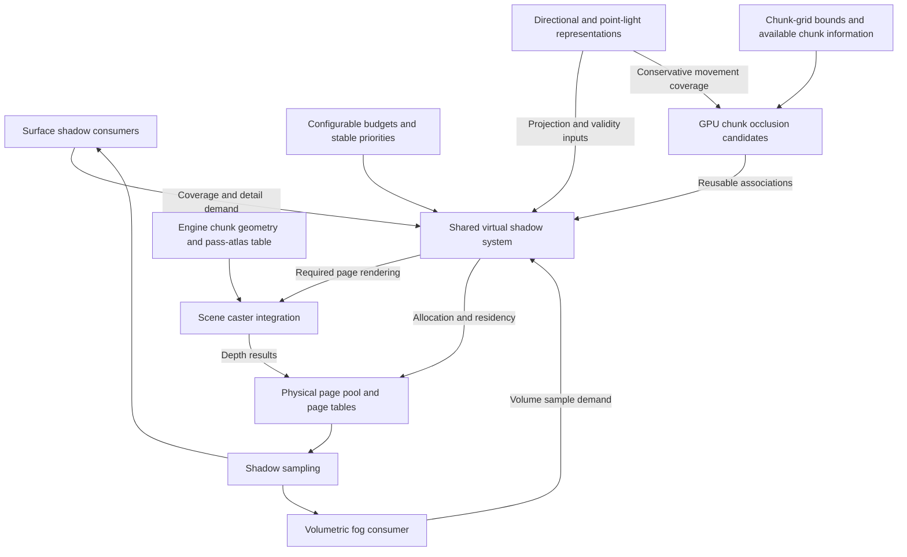

# Shared virtual shadow maps

Status: design discussion in progress. This document records the established direction and
remaining design questions. It describes proposed behavior, not an implemented system.
Targeted source and installed-engine inspection has established the integration findings
below. Concrete APIs, algorithms, and performance targets remain under discussion. No
implementation checklist or detailed execution plan is established here.

## Purpose and scope

Provide an abstract virtual shadow map system shared by directional lighting and local
point lights. Sunlight, moonlight, stationary local lights, and moving local lights use
the same underlying page infrastructure, with light-specific projection behavior.

The following requirements are established:

- Carried lights and moving light sources in general are primary performance targets
  from the outset.
- Sunlight and moonlight are dynamic: their directions change continuously. Both must
  be able to cast shadows simultaneously.
- Memory and shadow rendering work are bounded by configurable budgets, rather than a
  hard-coded fixed capacity or light count.
- When demand exceeds those budgets, reduce shadow detail and then prioritize which
  lights cast shadows using stable priorities and hysteresis.
- Directional and local shadows share physical page storage, with configurable
  reservations and borrowing of unused capacity.
- Surface shadows are the first implementation priority. Shadowed volumetric fog is
  included in scope, with full fog integration at the end of the proposed work.
- Terrain spatial selection uses the existing fixed chunk grid and integer XYZ chunk
  identity, preserving the engine's dimension convention.
- GPU compute shaders generate reusable **chunk occlusion candidates** from fixed
  chunk-grid bounding boxes, without examining mesh geometry or calculating mesh AABBs.
- Candidate associations can be reused across multiple shadow-map updates. Their
  regeneration is amortized over a conservative range of light movement.
- The engine's pass-and-atlas table remains the authority for mesh-pool categories.
  Do not introduce a parallel pool registry, reverse classification map, or a collection
  of hooks that reconstructs relationships the engine already maintains.
- Custom shader clipping is unavailable by design in the pipeline-state system. Shadow
  page routing must respect that constraint; adding or bypassing custom clipping support
  is not part of this proposal.
- OpenGL 4.5 is the required baseline. A complete rendering path must work without
  optional extensions or OpenGL 4.6 features. Additional capabilities may optimize it,
  but cannot be required for baseline correctness or hidden in performance assumptions.

## Terminology

| Term | Meaning |
| --- | --- |
| Shadow receiver | A surface or volume sample where lighting needs to determine whether light is blocked |
| Shadow caster / occluder | Geometry that blocks light and can cast a shadow |
| Chunk occlusion candidates | Other world chunks that could block a light reaching a particular receiving chunk |
| Shadow page | A tile of the light's projected depth map; it is not a world chunk |
| Geometry range | The portion of an existing uploaded mesh selected for drawing |
| Traversability | The engine's information about connected openings between chunk boundary faces |
| Indirect drawing | Drawing from commands stored in a GPU buffer, allowing compute shaders to choose geometry without the CPU reading the results |
| Draw batch | Draws submitted together with compatible geometry bindings, shader, material state, and atlas |
| Physical depth atlas | A depth texture whose rectangular tiles store separately assigned shadow pages |
| Page routing | Selecting a draw's light projection and destination page storage, and keeping its output within that page |

Chunk coordinates describe world-space regions. Shadow pages describe light projections.
There is no assumed one-to-one mapping between them. A candidate association is a broad
selection aid; it is not an exact shadow result.

## Shared system boundary

A virtual shadow space is a logical depth map divided into pages. Physical storage backs
the pages required by shadow consumers. The shared system manages those pages while
light-specific representations define how world-space locations map into shadow space.

| Responsibility | Intended owner |
| --- | --- |
| Physical page storage, page tables, allocation, residency, and eviction | Shared virtual shadow system |
| Page validity, invalidation, and update scheduling | Shared virtual shadow system |
| Budget arbitration across lights | Shared virtual shadow system, using configurable selection policy |
| Light projection, resolution selection, and world-to-shadow mapping | Light-specific shadow representation |
| Required sampling coverage and resolution | Shadow consumers, interpreted through the light representation |
| Terrain chunk occlusion candidate generation | Shared shadow system, using GPU compute and existing chunk information |
| Current terrain geometry and render categories | Existing engine chunk references and pass-and-atlas table |
| Selected geometry drawing and entity integration | Scene rendering integration; exact boundary remains open |
| Shadow lookup and filtering | Shared sampling infrastructure with projection-specific handling |



The diagram expresses responsibilities, not a decided render-pass order or concrete API.
GPU candidate generation is established; the remaining execution and submission details
are open. Fog participates in the intended architecture even though its complete
integration follows surface shadows.

## Dynamic lighting and validity

The baseline workload includes changing sun and moon directions, moving local lights,
camera movement, and moving shadow casters. Performance targets must account for this
combined workload; stationary-light cache reuse is an optimization rather than the basis
of the moving-light performance contract.

Light motion, caster changes, and changes in requested coverage have different validity
consequences. The design must distinguish them. In particular:

- For directional lights, changing direction changes the shadow projection. Spatially
  stable clipmaps alone do not preserve depth validity across that change.
- For moving point lights, previously rendered depths may no longer represent the
  current light position, even when the scene geometry is stationary.
- Allocated storage is not sufficient evidence that a page contains valid shadow data.
- Pages generated for an earlier projection must not silently count as current. Any
  temporal approximation requires a separately defined quality policy.

Sun and moon are independent directional-light clients sharing the directional
allocation. Their simultaneous operation must not depend on an exclusive day/night
shadow switch. Exact contribution-based priorities remain to be specified.

## Chunk occlusion candidates

### Spatial basis and computation

Use the predetermined voxel-grid partition of each chunk as its bounding box. The agreed
terrain model is that the chunk's geometry stays within those bounds. Candidate
generation does not inspect triangles, derive a tighter mesh bounding box, or create
another spatial subdivision for terrain.

For each relevant light and receiving chunk, GPU compute determines which other chunks
could contain occluding geometry. Bounding-box relationships deliberately admit false
positives: a chunk may be selected even when its actual mesh blocks none of the relevant
light. Required occluders must not be omitted.

The regular grid should constrain the spatial search. GPU execution alone does not
justify comparing every loaded chunk against every other loaded chunk. Search bounds,
candidate storage, output capacity, and work scheduling remain design decisions within
the bounded-resource objective.

### Reuse across light movement

Candidate associations and shadow depths have different lifetimes. A changed light
projection can require new depth rendering while leaving the candidate associations
usable. Do not rebuild associations merely because a shadow map needs updating.

For the sun and moon, the proposed reuse mechanism covers an angular interval and
refreshes candidates when the direction leaves that interval. The calculation must
include potential occluders over the entire interval, rather than calculate only one
exact direction and reuse it until a threshold. Sun and moon retain independent coverage.
The interval widths and selection method remain open; no specific degree threshold has
been selected.

For moving point lights, the corresponding candidate is a bounded region of source
positions with a defined influence range. The precise positional coverage and refresh
policy remain open. This must support carried lights as a primary workload.

| Change | Consequence |
| --- | --- |
| Light moves within the covered range | Candidate associations remain usable; depth validity is evaluated separately |
| Light leaves the covered range | New associations or conservative additional coverage are needed before relying on the old selection |
| Chunk geometry is rebuilt within unchanged bounds | Use the current uploaded geometry; bounds-only associations need not change solely because a mesh was replaced |
| Connectivity changes when used to prune candidates | Associations relying on that connectivity require invalidation or conservative expansion |
| Chunks load or unload | Reflect current availability and any resulting changes to pruning or coverage |
| A new receiving chunk needs shadows | Establish candidate coverage for that receiver |

Opening a passage is particularly important: it can expose previously excluded chunks
without any light movement. Once connectivity is used for pruning, angular or positional
thresholds are not the only association invalidation conditions.

### Existing empty and traversability information

Installed-engine inspection confirmed the following in Vintage Story 1.22.7:

| Existing information | Meaning and limitation |
| --- | --- |
| `IWorldChunk.Empty` | Cached empty-data flag; `WorldChunk.UpdateEmptyFlag` derives it from block and fluid data. Currentness must be established before using it to skip terrain. |
| `ClientChunk.traversability` | A 16-bit field containing connections for 15 distinct pairs of the six chunk faces, including opposite and adjacent pairs |
| `ClientChunk.traversabilityFresh` | Indicates whether the engine considers the connectivity current |
| `ClientChunk.IsTraversable(fromFace, toFace)` | Queries the face-pair connection; returns potentially open when connectivity is stale |

`SystemChunkVisibilityCalc.RegenTraversabilityGraph` follows connected voxel paths using
block `SideOpaque` flags, then connects the boundary faces reached by each region. The
existing `ChunkCuller` uses this information during traversal. Relevant opacity changes
queue recomputation and mark the information stale; calculation runs through the engine's
separate-thread work queue. Its collection is gated by the engine's occlusion-culling
setting, so this optimization cannot assume fresh data is always available.

This is connectivity, not a precise ray test or a complete empty/solid classifier:

- No connected face pairs does not prove every voxel is solid; a sealed internal cavity
  can produce the same result.
- Connections between every face pair do not prove emptiness; a chunk containing a pillar
  can still have all those connections.
- A connected passage can bend. An opposite-face connection does not prove a straight
  ray along that axis can pass through.

No independent, exact completely-solid flag was identified in the inspected chunk
interfaces and implementation. Do not infer one by renaming a connectivity result.

The proposed optimization is to supply existing connectivity and freshness information
to GPU candidate generation, retaining the engine's voxel analysis rather than duplicating
it. A blocked face connection may reject further traversal only where the complete
conservative light coverage permits that conclusion. The blocking chunk remains a
candidate itself. Fully connected chunks can still cast shadows, and stale or unavailable
connectivity must remain potentially open. Sources or receivers inside the chunk also
cannot be classified by an unrelated boundary-to-boundary connection.

Using the engine's opacity rules for shadow rejection still requires validation against
the shadow-casting material rules. The transfer/publication mechanism and dependency
invalidation are unresolved; no new mesh-pool classification hooks are implied.

Evidence: `ClientChunk`, `SystemChunkVisibilityCalc`, `ChunkCuller`, and
`WorldChunk.UpdateEmptyFlag` in the installed `VintagestoryLib.dll`. The
[inspection receipt](../artifacts/virtual-shadow-maps/chunk-traversability-inspection.txt)
contains the relevant IL, assembly version, module identity, and SHA-256. This is static
inspection evidence, not a measured performance or live visual result.

## Configurable budgets and allocation

Memory capacity and rendering work are separate constraints. Limiting resident pages
does not alone bound the cost of repeatedly drawing geometry into those pages.

The agreed allocation policy uses a shared physical page pool with configurable
directional and local reservations. Either category may borrow unused capacity. Work
allocation must also account for ongoing directional updates so that reserved storage
does not leave sun or moon shadows without rendering capacity.

Under budget pressure, the system first reduces requested detail and then limits which
lights receive shadows. Selection uses stable priorities and hysteresis to avoid
frequent switching as lights enter or leave view or their importance changes. Lights
excluded from shadow casting continue to contribute illumination.

The following controls have been suggested, but their exact public configuration
contract is not yet settled:

| Candidate control | Intent |
| --- | --- |
| Shadow memory budget | Bound physical page storage and associated cache resources |
| Shadow update budget | Bound scheduled work and target an affordable rendering cost |
| Maximum shadow-casting local lights | Provide an explicit limit on simultaneous shadowed local lights |
| Directional/local reservations | Protect each category while allowing unused capacity to be borrowed |

Configuration requires defaults and validated limits. Units, values, setting names,
runtime adjustment behavior, borrowing/reclamation rules, and priority thresholds remain
open. A GPU time target, if exposed, is a scheduling target rather than a guaranteed
exact per-frame ceiling. Measured-cost scheduling and enforceable work limits are
candidate mechanisms, not yet an approved implementation.

Preferential treatment of the player's carried light has been suggested. The precise
priority policy, including sun/moon contribution and fairness among local lights, remains
to be designed. Page size and other internal tuning details are not established as
user-facing settings.

## Resolution, demand, and coarse coverage

Normal operation targets consistently detailed visible shadows by requesting pages at
the resolution needed by their consumers. Virtualization makes a large logical shadow
map practical through selective physical allocation; it does not require every region
to use the same world-space texel density.

Three distinct concepts must remain separate:

| Concept | Role in this proposal |
| --- | --- |
| Resolution matched to visible detail | Normal demand selection; lower world-space resolution at distance need not look coarse on screen |
| Broad coarse coverage for an additional consumer | Possible coverage requested by effects such as volumetric fog, justified by their sampling needs |
| Reduced resolution under budget pressure | Deliberate quality degradation when requested work exceeds the configured budget |

There is no requirement to render broad coarse coverage for every light before rendering
the pages needed for detailed surface shadows. Such coverage could consume moving-light
work on regions that do not contribute to the image. It must be justified by an actual
consumer or an explicitly chosen fallback policy.

The proposed missing-page policy below reduces requested detail and then withdraws
shadowing for a light whose current surface coverage cannot be completed. A permanently
rendered coarse map is not assumed. This remains a recommendation for discussion;
invalid or outdated pages cannot silently be sampled as valid.

For technical context, Epic's virtual shadow map implementation uses resolution levels
and describes coarse pages for consumers such as volumetric fog and forward-rendered
translucency. It also documents the rendering cost of broad coarse coverage. These are
reference examples, not a requirement to reproduce Unreal's implementation:
[Epic Games: Virtual Shadow Maps](https://dev.epicgames.com/documentation/en-us/unreal-engine/virtual-shadow-maps-in-unreal-engine).

## Proposed missing-page and overload behavior

### Prefer complete surface coverage for each shadowed light

The recommended normal overload policy is to keep a light's surface shadows enabled only
when its required current coverage is complete at the selected detail. A light whose
coverage cannot be completed contributes illumination without shadow attenuation. This
implements the agreed progression from reduced detail to prioritizing shadow-casting
lights, while avoiding normal fallback boundaries that follow individual missing pages.
It is a proposed quality policy, not an established implementation requirement.

Required coverage means the bounded requests from participating surface receivers for
that light, including the footprint of the chosen shadow filter. It does not mean the
entire world, every virtual page, or all six complete faces of a point light. Opaque,
cutout, water, and other participating transparent receivers must be accounted for.
Sun and moon have independent readiness and selection; one unavailable light does not
invalidate another light's complete shadows.

| Available result | Proposed surface behavior |
| --- | --- |
| Complete current data at requested detail | Use its shadows |
| Complete current coverage at reduced requested detail | Use the reduced-detail result |
| Required coverage remains incomplete after bounded detail reduction | Disable surface shadow attenuation for that light; retain its illumination |
| Previously rendered data is still valid for the current light and scene | Reuse it as part of the complete result |
| Allocated data is stale, partially rendered, or belongs to a reused page assignment | Treat it as unavailable |

Reduced detail is a change to the requested coverage/resolution, not permission to reuse
arbitrary old depths or average depth values into a fallback map. A lower-resolution
alternative is usable only if it is current, compatible with the light projection, and
covers all required sample footprints. The policy does not mandate a second broad coarse
map or render a coarse level before every fine update.

The tradeoff is explicit: one unresolved required page can suppress that light's shadows
throughout the participating surface receiver set. This can cause a noticeable brightness
change, especially for the sun. The recommendation favors a coherent light-level change
over page-shaped light leaks; its appearance still requires user-run visual evaluation.
Regional degradation would be a different policy requiring defined regions and boundaries,
not an unrecorded exception to this one.

### Establish readiness before shading

Page completeness and light readiness are separate. A page becomes valid only after its
own complete update; a light becomes ready when all requests for its selected surface
coverage resolve to valid data. Request-list overflow or unfinished demand generation
cannot be mistaken for an empty request list and therefore a ready light.

The GPU can reduce request/page validity into a per-light readiness result before surface
shading, without CPU readback. All participating surface consumers must use the same
result for that rendering interval. This requires demand, including transparent-surface
and filter-neighbor coverage, to be available before the first affected consumer shades.
The existing frame-order integration does not yet establish that contract. A late miss
cannot retroactively withdraw shadows from pixels already shaded.

The proposed scheduler should first seek complete demanded coverage for admitted lights
at an affordable detail, then spend remaining work on refinement. Both choices are subject
to the existing work budgets and stable priorities. Preparing many incomplete light sets
does not establish a useful current result for continuously moving lights. Completed
individual pages may still be retained for reuse only while they remain valid.

As a defensive sampling rule, an unexpected invalid lookup returns unshadowed visibility
and records a demand/validity failure, rather than reading stale or uninitialized storage.
That guard does not replace the normal completeness gate or establish acceptable visual
behavior. The exact diagnostic mechanism remains open. Fog will need its own readiness
scope when integrated; incomplete fog-only coverage should not silently withdraw complete
surface shadows.

### Stable recovery without stale-depth fading

Use hysteresis for selecting lights, changing requested detail, and restoring shadowing
after overload. In particular, a light that has lost coverage should demonstrate sustained
ability to complete its current requests before shadowing is restored. Exact margins,
history length, and priority rules remain to be selected. Hysteresis may delay enabling
shadows; it cannot keep invalid depths usable after light motion or geometry changes.

A fade-in is possible while complete current shadow data is available. A planned fade-out
is possible only while current data continues to be supplied, with that work still charged
to the budget. If current coverage is unexpectedly lost, this policy switches immediately
to unshadowed illumination. It does not promise a smooth fade using obsolete depths.
Any temporal approximation would need separate approval of its quality and validity rules.

## Receivers, casters, and fog

Surface receiving scope includes opaque and cutout terrain, entities, and foliage, as
well as water and other transparent surfaces. Their demand should reflect the receiving
surfaces that actually need shadow samples. Transparent surfaces may require requests
beyond those derived from opaque surface visibility.

Receivers determine where shadow data is needed. Casters determine what geometry must
be rendered into those pages. Geometry outside the camera view must still be able to
cast shadows onto visible receivers.

Volumetric fog is a required consumer, not an excluded future feature. The shared design
must accommodate its coverage and resolution needs from the outset. Full volumetric
shadow integration follows basic opaque/cutout surface shadows and transparent surface
support. Fog-specific coverage is requested according to its needs rather than imposed
unconditionally on every light.

This establishes a broad dependency order only. It does not prescribe implementation
tasks, milestones, or completion claims.

## Engine geometry ownership and selected drawing

The existing `ChunkRenderer.poolsByRenderPass[renderPass][atlas]` categorizes pools by
`EnumChunkRenderPass` and texture atlas. Preserve that authority. Chunk coordinates and
their existing geometry references provide spatial identity; a second system that
enumerates pools to rediscover or retain their categories is not part of this design.

Installed-engine inspection traced `ChunkRenderer.AddTesselatedChunk` through
`TesselatedChunk.AddCenterToPools` / `AddEdgeToPools` and
`TesselatedChunkPart.AddToPools`. Upload selects the existing pass-and-atlas entry.
`ClientChunk.centerModelPoolLocations` and `edgeModelPoolLocations` retain the resulting
geometry references. Each location includes the native pool ID, vertex/index ranges,
bounds, detail level, and visibility state, but not the render pass or atlas. Uploaded
chunk-part descriptions are subsequently released.

A candidate drawing approach, not yet a committed submission algorithm, is:

1. Supply current chunk geometry references as GPU-readable input, using the engine's
   native pool IDs and ranges. Preparing this input does not depend on reading GPU
   candidate results back to the CPU.
2. Traverse the authoritative pass-and-atlas table once for the batch of work to establish
   the compatible drawing groups and their existing resources.
3. GPU compute combines candidate associations, requested pages, and current geometry
   references to generate indirect commands within those groups.
4. The CPU submits the established groups; the GPU consumes their generated commands.
   Temporary commands expire independently of the reusable candidate associations.

This does not require a persistent reverse classification map, copying terrain geometry,
or scanning every pool's individual geometry entries for every page. It still visits
pools in the relevant categories for each batch; the cost has not been measured. The
GPU-readable input is a description of existing geometry for drawing, not another owner
of pool membership or categories. Its publication and refresh cost also require evaluation.
The existing indirect-draw support makes a handoff without candidate readback feasible;
the remaining constraints are described below.

The engine replaces chunk geometry-reference arrays as rebuilt meshes are uploaded.
Draw selection must use the current publication and retain no stale range after its
storage is retired or reused. The native culling path mutates pool draw arrays and
statistics, so temporary shadow selections should preserve that state. Terrain geometry
also contains different detail categories; drawing every retained range indiscriminately
does not preserve the engine's selection rules. Geometry detail is separate from
shadow-map resolution.

Relevant existing source patterns are
[terrain pass selection](../VanillaGraphicsExpanded/HarmonyPatches/TerrainPassDrawHook.cs),
[liquid geometry borrowing](../VanillaGraphicsExpanded/Rendering/Pipeline/EngineLiquidPoolGeometry.cs),
and [borrowed engine inputs](../VanillaGraphicsExpanded/Rendering/Integration/OpenGL/EngineGeometryInputs.cs).
The liquid adapter is specific to its ordinary mesh layout; it is not an already-complete
terrain or animated-entity adapter.

No new generic "caster record" system has been selected. Any integration must preserve
existing geometry and material ownership, including cutouts, deformation, terrain
displacement, animation, and moving-chunk transforms. Entity integration remains a
separate open boundary rather than being forced into static terrain chunk membership.

## Proposed GPU candidate-to-draw handoff

### Existing rendering support

Source inspection establishes that the rendering hardware interface (RHI) already exposes
compute dispatch, indirect graphics drawing, and explicit GPU memory barriers. The
following capabilities are present; a complete terrain shadow path is not:

| Existing capability | Consequence for this proposal | Source |
| --- | --- | --- |
| Indirect indexed and non-indexed drawing | Compute can write commands which graphics subsequently consumes | [OpenGL indirect graphics](../VanillaGraphicsExpanded/Rendering/RHI/Backends/OpenGL/Geometry/OpenGLBackend.IndirectGraphics.cs) |
| Optional GPU draw-count buffer | The GPU can supply the number of commands, bounded by a CPU-supplied maximum, when OpenGL 4.6 or `GL_ARB_indirect_parameters` is available | [Draw descriptor](../VanillaGraphicsExpanded/Rendering/RHI/Descriptions/RHIIndirectDraw.cs), [capabilities](../VanillaGraphicsExpanded/Rendering/RHI/RHICapabilities.cs) |
| Argument-buffer bounds validation without reading generated commands | Integration need not synchronize with the CPU to inspect selections; the producer remains responsible for valid command contents | [Geometry validation](../VanillaGraphicsExpanded/Rendering/RHI/Backends/OpenGL/Geometry/OpenGLBackend.GeometryValidation.cs) |
| `ResourceAccess.Indirect` and `ResourceAccess.ShaderStorage` barriers | Express visibility of compute-written draw arguments and shader-readable data before their consumers run | [Synchronization](../VanillaGraphicsExpanded/Rendering/RHI/Backends/OpenGL/Synchronization/OpenGLBackend.Synchronization.cs) |

For the OpenGL 4.5 baseline, the proposed path submits a bounded command interval with
unused commands initialized to draw zero geometry. GPU-supplied draw counts are an
optional optimization through `GL_ARB_indirect_parameters` or suitable later core support.
The baseline avoids count readback but still has
command-processing cost; it is not free work. Every submitted slot must be initialized
for that submission, so old commands cannot survive in unused slots.

These mechanisms follow the OpenGL contracts for
[multi-draw indirect](https://registry.khronos.org/OpenGL/extensions/ARB/ARB_multi_draw_indirect.txt)
and [indirect parameters](https://registry.khronos.org/OpenGL/extensions/ARB/ARB_indirect_parameters.txt).
The latter also specifies command-barrier visibility for GPU-written count buffers.
Their presence in the RHI is source evidence, not a runtime performance measurement.

### Separate spatial associations from drawing commands

The recommended direction is to retain candidate results on the GPU throughout selection
and command generation. It distinguishes three inputs with different lifetimes:

| Data | Lifetime and meaning |
| --- | --- |
| Chunk occlusion candidates | Reusable spatial associations for a receiving chunk and light, valid within their conservative movement coverage and any pruning dependencies |
| Current geometry descriptions | References to the engine's currently published mesh ranges, refreshed when those ranges change |
| Page drawing commands | Temporary selections for the pages being updated, generated from the other inputs and current page demand |

The receiving chunk's own eligible geometry must also participate for self-shadowing;
an association list described as other chunks must not accidentally exclude it. Several
receiving chunks may request the same page. Their contributions need merging or equivalent
duplicate suppression so that overlapping demand does not multiply identical draws.

GPU work must publish complete candidate collections before using them. Between compute
passes, shader-storage barriers make generated associations and metadata visible; before
indirect drawing, command barriers make draw arguments and optional counts visible.
Shader-readable drawing metadata also requires the corresponding storage barrier. These
are GPU ordering dependencies, not a requirement for a CPU completion wait. Buffer reuse
and engine geometry retirement still need an explicit lifetime contract.

Association storage, geometry descriptions, generated commands, and command-generation
work all belong within bounded resource accounting. Capping a draw count alone is not a
correct overflow policy: a silently truncated collection can omit required occluders.
If complete selection or drawing cannot fit, affected pages cannot be published as valid.
The response must connect to the agreed detail reduction and light-priority policy and
the proposed missing-page behavior. Previous associations are reusable only while their
coverage and dependencies remain valid. Exact storage layout, allocation, and overflow
handling remain undecided.

### Bounded expansion and submission

The proposed scheduler bounds selection work before it produces drawing commands, then
admits complete page updates. This is a design recommendation; numerical limits, storage
layout, and scheduling algorithms are not selected. All limits derive from validated
configuration and hardware constraints. They need not each become a separate public setting.

| Work or storage to bound | What the bound must include |
| --- | --- |
| Input preparation | Chunk visits, current geometry descriptions, and native pool groups examined for the work batch |
| Candidate maintenance | Spatial-search steps and association output, separately from depth-update frequency |
| Page expansion | Candidate entries visited, page/range intersection checks, duplicate suppression, and temporary output |
| Indirect submission | Total submitted command slots, including inactive entries, and total compatible groups across destination arrays |
| Drawing | Geometry/page repetitions, tessellation amplification, baseline geometry-shader work, and estimated raster/material cost |
| Page replacement | Selected-layer clear work and all metadata needed to publish complete results |

These limits bound identifiable work and storage, not exact GPU milliseconds. Timing
feedback can adjust estimates without making this frame wait for GPU results. Historical
estimates may guide scheduling, but cannot prove candidate completeness or page validity.

#### Reuse one terrain command across selected pages

For terrain ranges with compatible drawing state, the recommended command organization
is one slot per current geometry range and destination array. The GPU supplies a list
of admitted pages needing that range. The command's instance count is the list length;
its base-instance field addresses the corresponding page-metadata inputs. Each instance
uses its own page projection and layer. Zero selected pages produces a zero-instance command.

For example, one range needed by eight pages in the same array can use one command with
eight page instances. This reduces commands, not the eight repetitions of geometry work.
Different arrays, incompatible shader/material state, or distinct geometry detail ranges
still require separate slots. Existing entity/object instancing cannot be repurposed
without a compatible instance-addressing contract; this recommendation initially concerns
the terrain command organization.

The existing [indirect command layout](../VanillaGraphicsExpanded/Rendering/GpuIndirectBuffer.cs)
contains instance count and base instance, and the
[vertex-input description](../VanillaGraphicsExpanded/Rendering/RHI/Descriptions/RHIVertexAttribute.cs)
supports instance addressing. The mechanism follows
[OpenGL base-instance addressing](https://registry.khronos.org/OpenGL/extensions/ARB/ARB_base_instance.txt).
This establishes API support, not a completed engine geometry adapter or measured speedup.

The CPU can know the number and offsets of submitted command slots from the bounded
geometry input and destination-array set, without reading GPU page selections. The GPU
chooses each slot's instance count and metadata offset within supplied storage. Every
submitted slot is initialized, including inactive ones. Command and instance-reference
capacities are separate: fewer command slots do not make the page lists unbounded.

#### Bound the whole batch rather than each group independently

The sum of command slots across all groups must fit the submission budget. Giving every
pool or array the full configured allowance would multiply that allowance by the group
count. With range-based slots, the conservative command capacity follows the supplied
range counts and eligible destination arrays; the batch must fit that aggregate before
submission. This does not require slots for every loaded chunk or every resident page.

Input preparation must itself stay bounded. Use existing chunk references for a bounded
spatial work region and the authoritative pass-and-atlas table for compatible groups;
do not scan individual pool allocations for every page or build a reverse pool registry.
The practical publication strategy and its cost remain to be established. A page can
be admitted only if its complete required geometry is available within the supplied
inputs. Reaching an input, group, or command limit cannot silently remove its occluders.

Candidate expansion visits established candidate collections and intersects their fixed
chunk bounds with requested page coverage before resolving eligible current ranges. It
does not construct an unconditional product of all pages and all loaded geometry.
Overlapping receivers must produce at most one occurrence of the same eligible range
for a page. Visits and duplicate-processing work count against the budget even when
they produce no draw. Exact deduplication and compaction algorithms remain open.

#### Admit complete pages before clearing or drawing

Rank work using the agreed stable priorities and hysteresis. Expansion for a page must
establish both complete candidate coverage and all required current geometry, including
self-shadowing and participating non-terrain casters, before the page can be admitted.
Count its range/page references and estimated drawing cost against the remaining limits.
Temporary pair storage, counting, and any second traversal used to emit commands are
also bounded; a counting pass is not permission for unlimited preprocessing.

```text
select bounded input and submission groups
expand page requests in stable priority order within the selection allowance
admit only pages with complete coverage and sufficient remaining resources
build range commands and page-instance lists from admitted pages
clear admitted replacement layers, draw all required geometry, then publish validity
```

If expansion stops or any output overflows, that page has not demonstrated completeness.
Exclude it from clear/draw/publication, or abandon its temporary result before rendering.
Do not use a truncated candidate list or a partially filled draw list as a valid shadow.
An older page may remain usable only if it independently still represents the current
light and scene; retaining its allocation is not enough.

Under sustained pressure, reduce requested detail and then apply the established light
priorities. Lower detail often reduces page count, but does not necessarily reduce the
geometry intersecting each larger page. A page that still cannot fit requires the chosen
missing-page/light fallback, not an endlessly retried same-frame expansion. Reconsidering
requests must itself have bounded work. The proposed missing-page policy withdraws the
affected light's surface shadows if complete current coverage remains unavailable;
its adoption and visual acceptance remain open.

Candidate maintenance can be resumed across bounded work slices while its covered light
movement and dependencies remain valid. Reusing spatial progress does not authorize
carrying partially rendered depth across changing light projections. Sun, moon, and moving
point lights all use the same accounting; stationary cache hits are not assumed when
assessing the baseline budget.

### Drawing groups remain explicit constraints

An indirect command selects a geometry range and instances; it does not independently
change the shader, atlas, geometry bindings, or framebuffer. The CPU therefore still
submits compatible groups derived from the existing pass-and-atlas organization. This
does not imply one submission for the entire scene or eliminate CPU submission cost.
The engine's ordinary indexed and shader-storage terrain layouts require their own
correct geometry binding and shadow shader support.

The page-routing candidates below address the projection and destination for each selected
draw. The preferred direction preserves compatible drawing groups without requiring a
CPU submission for every page. No existing general shadow-page routing path was
identified in the inspected shaders; indirect support is only part of the required work.

## Page routing within existing pipeline constraints

### Constraint and remaining candidates

The pipeline-state system deliberately excludes custom shader clipping. The tiled-atlas
route that remaps each draw into a tile and uses custom clip distances to contain it is
therefore excluded. The existing
[rasterizer description](../VanillaGraphicsExpanded/Rendering/Pipeline/Descriptions/RasterizerDesc.cs)
and [pipeline application](../VanillaGraphicsExpanded/Rendering/RHI/Backends/OpenGL/State/FixedFunction/OpenGlStateCache.PipelineRasterizer.cs)
are constraints to preserve, not gaps this proposal should extend or bypass.

The recommended candidate is to render and retain each physical page in a separate
depth-texture-array layer. Its projection uses the normal hardware clip volume and the
full page-sized viewport; the layer isolates its depth writes from other pages. This
does not require custom clip planes or moving projected geometry into an atlas tile.
It can serve both directional and point-light pages. This is a source-supported design
recommendation, not an approved storage format or runtime-qualified rendering path.

| Approach | Tradeoff |
| --- | --- |
| One page per texture-array layer | Many pages can share a compatible draw batch and viewport without custom clipping; capacity per array is limited by available layers, and routing requires shader layer output |
| Render a batch into array layers, then copy completed pages into an atlas | Separates rasterization from resident storage and permits layer reuse; adds depth-copy work, ordering, and a GPU-driven destination-selection question |
| Viewport/scissor arrays | Hardware rectangles can delimit atlas pages without custom clip planes, but the viewport count bounds a batch and the current dynamic-state API exposes only one rectangle; support cannot be assumed |
| Separate CPU submission per page | Straightforward page-specific state, but submission count grows with page demand; not the recommended baseline for moving lights |

The existing RHI supports the necessary attachment representation and shader-stage types:

| Inspected contract | Finding |
| --- | --- |
| [Attachment resolution](../VanillaGraphicsExpanded/Rendering/RHI/Backends/OpenGL/Passes/OpenGLAttachmentIdentity.cs) and [framebuffer creation](../VanillaGraphicsExpanded/Rendering/RHI/Backends/OpenGL/Passes/OpenGLBackend.FramebufferCreation.cs) | A whole array attachment reaches the native layered-texture attachment operation |
| [Pass validation](../VanillaGraphicsExpanded/Rendering/RHI/Backends/OpenGL/Passes/OpenGLBackend.PassTargetValidation.cs) | A depth-only pass can supply its depth attachment without color attachments |
| [Shader creation](../VanillaGraphicsExpanded/Rendering/RHI/Backends/OpenGL/Shaders/OpenGLBackend.ShaderCreation.cs) | Vertex, tessellation, geometry, and fragment stages are represented |
| [Capabilities](../VanillaGraphicsExpanded/Rendering/RHI/RHICapabilities.cs) | Array-layer, texture-size, and framebuffer limits are available for allocation validation |

No layer-selection shader path or dedicated layer-output capability was identified in
the inspected VGE sources. OpenGL 4.5 provides layer output from a geometry shader;
direct output from vertex or tessellation-evaluation shaders is not guaranteed by that
baseline. The latter is an optional optimization through functionality such as
[`GL_ARB_shader_viewport_layer_array`](https://registry.khronos.org/OpenGL/extensions/ARB/ARB_shader_viewport_layer_array.txt).
The extension explicitly adds those stage outputs to the OpenGL 4.5 contract.

For the layered design, the proposed baseline therefore uses a geometry shader that
passes each already-selected triangle through and assigns its layer. It follows vertex
processing for ordinary geometry and tessellation evaluation for displaced terrain.
It emits that triangle once, retaining its positions, winding, UVs, and required material
outputs; it does not duplicate every triangle across all pages or point-light faces.
GPU command selection determines the required page draws first. The same baseline
layer-routing mechanism must support selective page-clear geometry.

The optional direct-output path removes this routing stage where supported, preserving
the same page selection and shadow behavior. Capability selection and shader-language
declarations must be explicit for each shadow variant. The existing terrain tessellation
source generator declares GLSL 4.00; current sources do not become layer-aware merely
because a device supports the extension.

Geometry-stage work is part of the baseline performance target, not a rarely used
fallback that can be excluded from measurements. This is a functional design supported
by the API, not evidence of acceptable moving-light performance. If its measured cost
is unacceptable, page routing must be reconsidered within OpenGL 4.5 and the prohibition
on custom clipping rather than silently requiring an extension.

### OpenGL 4.5 execution contract

| Responsibility | Proposed baseline | Optional optimization |
| --- | --- | --- |
| Candidate generation and command production | Compute shaders and shader-storage buffers | No additional extension required for these mechanisms |
| Selecting the destination layer | Geometry-shader `gl_Layer` output | Vertex/tessellation-evaluation layer output when supported |
| Identifying per-draw page metadata | Integer instance attribute selected using the indirect command's base-instance field | Shader-visible draw/base-instance parameters when supported |
| Submitting generated geometry | Multi-draw indirect over bounded, initialized command intervals | GPU count buffers when supported |
| Sampling multiple depth arrays | Bounded, statically addressed sampler accesses with valid filtering behavior | Bindless access only if separately supported and justified |

Shader-visible draw parameters, indirect count buffers, and direct layer output are
independent capabilities. None follows merely from the presence of another. The bounded
interval sizes and number of array/material groups contribute work even when many entries
draw nothing; scheduling must account for that cost on the baseline path.

Direct resident arrays avoid a transfer after every page update. The intermediate-array
alternative remains possible, but the existing
[texture-copy path](../VanillaGraphicsExpanded/Rendering/RHI/Backends/OpenGL/Textures/OpenGLBackend.TextureTransfers.cs)
takes host-supplied source and destination regions. It is not an indirect copy-list
consumer. A GPU-driven transfer into an atlas would need a separately designed path
and measured cost; it is not automatically supplied by layered rendering.

### Configurable capacity across depth arrays

One layer stores one physical page, not one light, chunk, or entire point-light face.
Pages from all lights continue to share the allocator and its directional/local
reservations. An array's hardware layer limit is a per-resource limit, not a fixed
shadow-light count or the user-facing memory setting.

For square pages with one depth level and no multisampling, nominal depth storage is:

```text
bytesPerPage = storedPageWidth * storedPageWidth * depthBytesPerTexel
pageCapacity = floor(depthStorageBudget / bytesPerPage)
physicalPage = (array identifier, layer index)
```

The stored width includes any borders eventually selected. The depth-storage allowance
must leave budget for page tables, associations, commands, and other shadow resources;
driver allocation overhead also prevents this formula from being an exact VRAM receipt.
Allocation must satisfy the applicable hardware limits as well as the budget.

For illustration only, 128-by-128 pages at four bytes per texel use 64 KiB each. A
64 MiB depth allowance holds 1,024 such pages; 256 MiB holds 4,096. If an array supports
2,048 layers, the latter needs at least two arrays. These values are not selected defaults
or measurements of the user's hardware. Uniform physical page dimensions do not require
uniform world-space resolution; the light projection determines the area each page covers.

Additional arrays add a bounded submission grouping alongside existing geometry/material
groups. Compute routes commands into those known groups; the CPU need not read back
which individual layers were selected. Multiple arrays also consume sampling resources.
Receiver pixels can select different arrays, so ordinary sampler-array indexing cannot
be assumed legal for an arbitrary per-pixel array identifier. A bounded set of statically
addressed sampler accesses is a candidate, with explicit filtering/derivative handling;
optional bindless access must not become an unstated requirement. See the
[GLSL sampler indexing rules, section 4.1.7](https://registry.khronos.org/OpenGL/specs/gl/GLSLangSpec.4.60.pdf).

The supported array count and configuration range must account for sampler availability
in every participating receiver path and for submission cost. Larger configured budgets
cannot bypass those limits. The multi-array sampling contract remains open under the
established OpenGL 4.5 baseline before layered storage can be adopted as the complete design.

### Per-draw page selection

Each generated draw needs a metadata reference identifying its page, light projection,
and physical destination. GPU-generated metadata and commands must remain paired through
compaction and batching. The metadata describes this shadow work, not mesh-pool membership.

As an optional optimization, shader draw parameters provide a draw index or base-instance value
that can select metadata. A draw index is local to its multi-draw submission and needs
the corresponding batch offset. Count-buffer support and shader draw-parameter support
are separate capabilities; neither implies the other.

The proposed OpenGL 4.5 route uses a small integer input with per-instance addressing.
The indirect command's base-instance field selects the metadata index
from that input stream. `gl_InstanceID` alone does not include this offset. The existing
[vertex-attribute description](../VanillaGraphicsExpanded/Rendering/RHI/Descriptions/RHIVertexAttribute.cs)
supports instance divisors. Integration would still need a shadow-specific vertex-input
binding over borrowed engine buffers, preserving the engine's own vertex-array configuration
and buffer lifetimes. It must not copy meshes or introduce another pool registry. If
compute writes this input stream, a vertex-fetch barrier is required as well as the
command and shader-storage barriers described above.

These options follow [shader draw parameters](https://registry.khronos.org/OpenGL/extensions/ARB/ARB_shader_draw_parameters.txt)
and [base-instance attribute addressing](https://registry.khronos.org/OpenGL/extensions/ARB/ARB_base_instance.txt).
The baseline transport must fit the available vertex inputs and preserve existing
instancing semantics for each caster path. Its concrete geometry integration remains
open; optional shader draw parameters cannot substitute for that baseline contract.

### Projection and material compatibility

With layered rendering, each draw uses its page's projection directly and selects a
destination layer. All vertices of a primitive must agree on that layer, and the last
active geometry-processing stage must supply the required routing output. Layer routing
must support both untessellated and tessellated terrain; attaching a layered texture alone
does not establish this behavior.

The final emitted position must preserve material deformation and the selected light's
depth convention. The installed `chunkshadowmap.vsh` has ordinary and shader-storage
terrain variants, applies vertex/global warping, and supplies UVs for the cutout fragment
shader. VGE's [terrain evaluation stage](../VanillaGraphicsExpanded/assets/vanillagraphicsexpanded/shaders/includes/tessellation/terrain.tesh)
also changes shadow positions for displacement. Tessellated shadows must project that
displaced geometry correctly and carry the page identifier unchanged through the
stages. Existing [stage-interface generation](../VanillaGraphicsExpanded/PBR/Tessellation/TerrainTessellationStages.cs)
is not a complete page-routing adapter. The shadow variants must preserve geometry decoding,
cutout behavior, deformation, and detail selection rather than substitute a position-only shader.

### Selective clearing and sampling

Only pages scheduled for replacement should be cleared. The existing
[pass clear](../VanillaGraphicsExpanded/Rendering/RHI/Backends/OpenGL/Passes/OpenGLRenderPassOperations.cs)
uses `ClearBuffer`; for a layered attachment this clears all layers, including cached
pages. That behavior is specified in
[OpenGL section 9.8](https://registry.khronos.org/OpenGL/specs/gl/glspec46.core.pdf).

The proposed selective mechanism preserves the attachment on pass entry and draws a
full-page primitive into each layer scheduled for replacement. The clear pipeline enables
depth writes with an always-passing depth test and writes the chosen empty-depth value.
GPU-generated layer selections can feed this draw through the same routing mechanism;
no custom clipping or per-layer CPU readback is needed. Existing
[depth-state descriptions](../VanillaGraphicsExpanded/Rendering/Pipeline/Descriptions/DepthStencilDesc.cs)
represent the required test and write controls. This remains unimplemented and its cost
must be included in the update budget.

All selected-layer clears must precede their caster draws, including any defined border
storage. A page being replaced is not valid merely because its storage still exists.
Publication for sampling follows all required drawing and any transfer into resident
storage; normal render-pass and resource-lifetime boundaries must be preserved.

Physical storage locations need not be neighboring virtual pages or even belong to
the same light. Filtering must resolve samples through virtual addressing, or use a
separately specified valid-border scheme. Ordinary filtering across unrelated atlas tiles
is incorrect if atlas storage is selected; array layers also do not supply neighboring
virtual-page samples automatically. The same requirement applies at point-light face boundaries; filter width,
border policy, and missing-neighbor handling remain open.

Intermediate layered rendering would additionally need bounded batches and transfer
accounting. No page size, storage dimensions, or performance advantage is established
by this source inspection.

## Other integration findings

Targeted inspection established these additional constraints; the resulting concrete
changes remain to be designed:

| Finding | Design consequence | Source |
| --- | --- | --- |
| Atmosphere data contains independent solar/lunar quantities, but direct-light properties select one emitter | Simultaneous sun/moon shadows require corresponding direct-light evaluation and publication changes, not just more shadow storage | [AtmosphereLighting](../VanillaGraphicsExpanded/PBR/Atmosphere/AtmosphereLighting.cs) |
| The shared local-light publication contains positions and colors without persistent source identity | Preserve source identity for stable selection, hysteresis, and page ownership; frame-local list indices are insufficient | [VgeLightsUniformBuffer](../VanillaGraphicsExpanded/Rendering/VgeLightsUniformBuffer.cs), [HeldLightSources](../VanillaGraphicsExpanded/PBR/HeldLighting/HeldLightSources.cs) |
| Existing local-light contributions are unshadowed in deferred, forward, and liquid shading | Shadow sampling must reach all participating surface paths | [Deferred shading](../VanillaGraphicsExpanded/assets/vanillagraphicsexpanded/shaders/pbr_direct_lighting.fsh), [forward shading](../VanillaGraphicsExpanded/assets/vanillagraphicsexpanded/shaders/includes/pbr_forward_surface.glsl), [liquid shading](../VanillaGraphicsExpanded/assets/vanillagraphicsexpanded/shaders/includes/pbr_liquid.glsl) |
| The engine's native shadow stages precede opaque rendering; VGE resolves receiver data at opaque order 8.5 and evaluates direct lighting at 9.0 | Generating opaque requests and rendering pages between those VGE operations is a candidate; transparent and late receivers need their own earlier demand | [Receiver publication](../VanillaGraphicsExpanded/PBR/SceneColor/SceneColorParticleCapture.cs), [direct lighting](../VanillaGraphicsExpanded/PBR/DirectLightingRenderer.cs); installed `ClientMain.MainRenderLoop` |
| Entity `BeforeRender` is camera-visibility gated while animation advancement is separate | Offscreen shadow casters need an explicit preparation contract; do not repeat animation advancement per shadow page | Installed `SystemRenderEntities.OnBeforeRender` and `OnRenderFrameShadows` |

The existing 100-entry local-light publication capacity is an engine lighting constraint,
not the proposed configurable limit on shadow-casting lights. No runtime performance or
visual acceptance claim follows from this source and assembly inspection.

## Open design decisions and next discussion

GPU-resident candidate selection, indirect commands, and resident depth-array pages are
the recommended drawing direction under OpenGL 4.5 and the prohibition on custom shader
clipping. The proposed baseline uses geometry-shader layer routing, instance-attribute
metadata selection, and bounded indirect-command intervals. Optional extensions may
reduce their costs; baseline performance still requires measurement.

The proposed work policy bounds input preparation, candidate expansion, aggregate command
slots, page instances, and drawing cost separately, admitting complete page updates.
Terrain range instancing is recommended to reduce command overhead without disguising
repeated geometry cost. Numerical limits and performance validation remain open.

The recommended missing-page policy seeks complete current surface coverage at reduced
detail before withdrawing a light's shadows, with stable recovery and no stale-depth
fallback. Adoption, visual acceptance, and the pre-shading demand/readiness contract
remain open. Multi-array sampling and the supported configuration range also remain open.

The next design topic is bounded spatial search for chunk occlusion candidates, especially
for directional lights: what defines the relevant world region and how the search remains
conservative across light movement. Candidate storage and incomplete-search handling must
preserve that coverage while supporting infrequent refresh.

Other unresolved details include:

- Exact light projections and addressing. Nested orthographic clipmaps for directional
  lights and six perspective faces for point lights are the starting candidates;
  resolutions, page sizes, face-boundary handling, and filtering are undecided.
- Receiver request generation, frame ordering, and coordination between surface and
  volumetric consumers.
- Conservative angular and positional coverage, spatial search, candidate capacity and
  overflow behavior, and targeted refresh when topology changes.
- Freshness and shadow-opacity suitability of existing empty/connectivity information,
  including operation when engine traversability data is unavailable.
- Adoption and details of the proposed GPU candidate-to-draw handoff, page routing,
  terrain detail selection, current geometry publication, and entity preparation for
  repeatedly updated pages.
- Stable light identity and migration of direct celestial consumers to simultaneous
  solar and lunar lighting.
- Budget units and defaults, work-cost estimation, admission priorities, hysteresis,
  and reservation reclamation.
- Missing-page handling, overload transitions, and any permitted temporal approximation.
- Depth representation, bias, soft-shadow filtering, and resource lifecycle integration.
- Measurable performance and visual acceptance targets for the combined dynamic workload.

These details require further discussion and targeted source inspection. The established
requirements above do not authorize an implementation plan or code changes by themselves.
